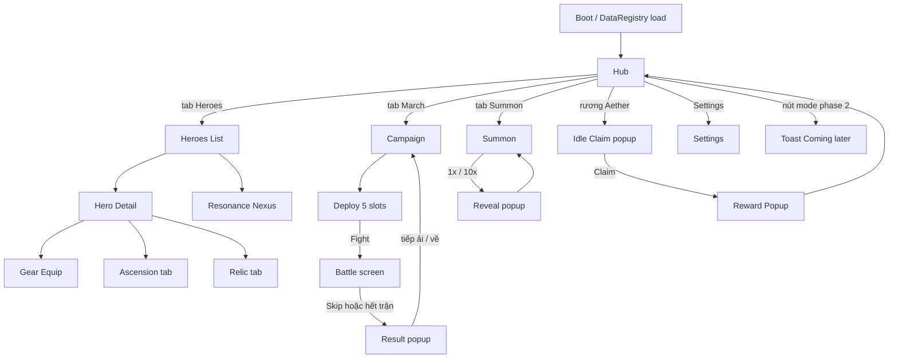

# Aetherbound — Tài liệu triển khai chi tiết

**Dành cho:** OpenAI Codex (coding agent) và lập trình viên mới bắt đầu  
**Engine:** Godot 4.3+ (GDScript)  
**Thể loại:** Idle / hero-collection (kiểu AFK Arena)  
**Tên game (gốc, không sao chép thương hiệu):** Aetherbound  
**Phiên bản tài liệu:** 1.0  
**Ngày:** 2026-11-12  
**Ngôn ngữ tài liệu:** Tiếng Việt (giọng rõ, nói thẳng). **Mọi tên biến, tên hàm, tên class, tên file, comment trong code: tiếng Anh.**

---

## Mục lục

0. [Cách dùng tài liệu này](#0-cách-dùng-tài-liệu-này)
1. [Mục tiêu sản phẩm và nguyên tắc thiết kế](#1-mục-tiêu-sản-phẩm-và-nguyên-tắc-thiết-kế)
2. [Thuật ngữ và quy ước đặt tên](#2-thuật-ngữ-và-quy-ước-đặt-tên)
3. [Cấu trúc project Godot](#3-cấu-trúc-project-godot)
4. [Autoload, EventBus, danh sách class](#4-autoload-eventbus-danh-sách-class)
5. [Hệ thống tài nguyên (currencies)](#5-hệ-thống-tài-nguyên-currencies)
6. [Hệ thống treo máy (Idle / Aether Cache)](#6-hệ-thống-treo-máy-idle--aether-cache)
7. [Hệ thống tướng (Heroes)](#7-hệ-thống-tướng-heroes)
8. [Resonance Nexus](#8-resonance-nexus)
9. [Trang bị, Hero Relic, Artifact](#9-trang-bị-hero-relic-artifact)
10. [Pipeline tính chỉ số (StatCalculator)](#10-pipeline-tính-chỉ-số-statcalculator)
11. [Gacha / Summon](#11-gacha--summon)
12. [Campaign — The March](#12-campaign--the-march)
13. [Combat module (interface + AutoBattle)](#13-combat-module-interface--autobattle)
14. [Save / Load và thời gian offline](#14-save--load-và-thời-gian-offline)
15. [Nội dung data-driven và dữ liệu mẫu](#15-nội-dung-data-driven-và-dữ-liệu-mẫu)
16. [Công thức và bảng số liệu (TUNABLE)](#16-công-thức-và-bảng-số-liệu-tunable)
17. [UI / UX](#17-ui--ux)
18. [Lộ trình triển khai (milestones)](#18-lộ-trình-triển-khai-milestones)
19. [Luật bắt buộc cho Codex](#19-luật-bắt-buộc-cho-codex)

Phụ lục (file tách, cùng thư mục):

- `01_CODE_SKELETONS.md` — skeleton GDScript đầy đủ cho các class lõi
- `02_EXAMPLE_DATA.md` — JSON mẫu: 8 tướng, đồ, 20 ải
- `03_UI_WIREFRAMES.md` — mô tả layout từng màn hình chi tiết hơn

---

## 0. Cách dùng tài liệu này

Tài liệu này là **bản đặc tả triển khai**, không phải ý tưởng chung. Codex phải làm đúng những gì được viết, theo đúng thứ tự milestone ở mục 18.

### 0.1. Đối với Codex

1. Đọc mục 1 (nguyên tắc), mục 19 (luật bắt buộc) và mục 18 (milestone đang làm) trước khi viết code.
2. Làm **một milestone tại một thời điểm**. Không nhảy cóc, không “tiện tay” làm thêm hệ thống khác.
3. Mọi số liệu có nhãn `TUNABLE` được phép để trong hằng số / file cân bằng, **không được hard-code rải rác** trong UI hay combat.
4. Combat phải đứng sau interface ở mục 13. Không được để AutoBattle đụng vào `GameState`, túi đồ, hay bảng vàng.
5. Logic thuần (tính chỉ số, gacha, idle, save, công thức) viết trong class `RefCounted` hoặc `Resource`, **không** nhúng vào node UI. UI chỉ gọi và hiển thị.
6. Nếu tài liệu đã cho chữ ký hàm, hãy giữ nguyên tên hàm và tham số (được phép thêm tham số tùy chọn ở cuối, không được đổi tên hay đổi nghĩa tham số đã có).
7. Khi không chắc, làm phiên bản đơn giản đúng hợp đồng, ghi chú `// TODO(spec):` — không tự bịa hệ thống mới.

### 0.2. Đối với người mới học (Duc Minh)

Bạn không cần viết hết game một lúc. Codex (hoặc bạn) làm lần lượt từng milestone. Mỗi milestone có **tiêu chí nghiệm thu** và **bước kiểm tra bằng tay**. Nếu bước kiểm tra không đạt, dừng lại sửa milestone đó, đừng sang mục mới.

Game này tách làm hai khối:

- **Khối nuôi tướng / tiến trình** (giữ lâu dài): vàng, treo máy, tướng, lên cấp, lên bậc, trang bị, gacha, lưu game.
- **Khối combat** (sẽ thay sau): hiện tại là tự đánh 5v5 đơn giản. Sau này bạn thay bằng bắn súng, hành động, thủ tháp… miễn là nhận cùng input và trả cùng output.

### 0.3. Những gì tài liệu này không làm

- Không sao chép tên riêng, nghệ thuật, cốt truyện, hay số liệu cân bằng gốc của AFK Arena. Số trong tài liệu là **đề xuất của ta**, đánh dấu `TUNABLE`.
- Không yêu cầu art production. Dùng hình chữ nhật màu, icon placeholder, Label, và `ColorRect`. Có thể thay art sau.
- Không làm chế độ Tháp, Labyrinth, Bounty trong phiên bản 1. Chỉ liệt kê hook để làm ở phase 2.
- Không làm furniture / engraving trong phiên bản 1. Chỉ để chỗ trong `FinalStats` và pipeline (hệ số = 0 hoặc bỏ qua).

---

## 1. Mục tiêu sản phẩm và nguyên tắc thiết kế

### 1.1. Gameplay loop (vòng lặp cốt lõi)

```text
Vào game
  → nhận thưởng treo máy (Aether Cache)
  → chỉnh đội 5 tướng (trang bị / lên cấp / lên bậc nếu đủ đồ)
  → đánh ải Campaign (The March) — trận tự chạy
  → thắng thì mở ải tiếp, thua thì về nuôi tướng
  → vàng / Spirit Dust / scroll rơi ra từ ải và từ treo máy
  → summon tướng mới, nâng cấp, lặp lại
```

Treo máy là nguồn tài nguyên **luôn chảy**, kể cả khi thoát game (có trần thời gian). Cảm giác “luôn có việc tiếp theo” đến từ việc mở dần lớp nâng cấp (cấp → bậc → đồ → relic → artifact), không phải từ việc làm combat phức tạp.

### 1.2. Nguyên tắc tách combat (BẮT BUỘC)

```
[Nguồn lực, tướng, đồ, gacha, campaign progress]
        │
        ▼
 StatCalculator.compute(hero_instance, loadout) → FinalStats
        │
        ▼
 CombatRequest (snapshot: FinalStats + skill ids + vị trí + dữ liệu ải)
        │
        ▼
 CombatInterface.run_battle(request) → CombatResult  (win/lose, log, thống kê)
        │
        ▼
 CampaignSystem / RewardService gắn phần thưởng (combat KHÔNG tự tính vàng)
        │
        ▼
 GameState áp dụng thưởng, trừ lượt, lưu game
```

**Hệ quả:**

- Combat **không** được `get_node("/root/GameState")`, không đọc `Inventory`, không tự ý cộng vàng.
- Combat chỉ nhận `CombatRequest` (dữ liệu đã “chụp hình” / snapshot) và trả `CombatResult`.
- Muốn đổi combat sau này: viết class mới `extends CombatInterface` (hoặc implement cùng hàm `run_battle`), rồi đổi 1 dòng đăng ký trong `BattleService`. Phần nuôi tướng không đổi.

### 1.3. Nguyên tắc data-driven

Tướng, trang bị, artifact, ải, bảng tỷ lệ gacha, bảng chi phí lên cấp **không hard-code trong script logic**. Để trong JSON (`res://data/...`) hoặc Godot Resource (`.tres`). Phiên bản 1 ưu tiên **JSON** cho dễ sửa và dễ Codex sinh file. Có thể bọc JSON bằng class `Resource` loader.

### 1.4. Phạm vi phiên bản 1 (phải làm)

- 6 loại tiền tệ, túi đồ, save/load JSON, xử lý offline.
- Idle accrual + UI nhận thưởng, trần 12 giờ.
- Tướng: độ hiếm, phe, khắc chế, chỉ số, lên cấp, lên bậc (ăn bản sao / fodder), tái chế, cap cấp theo bậc.
- Resonance Nexus: 5 tướng neo xác định cấp cộng hưởng, slot mở dần.
- Trang bị 4 ô, độ hiếm, nâng sao, bonus đúng phe; Hero Relic; Artifact (1 ô).
- Gacha có tỷ lệ và pity.
- Campaign 20 ải mẫu, công thức độ khó, sinh enemy từ data.
- StatCalculator duy nhất.
- Combat placeholder: AutoBattle 5v5.
- UI đủ các màn hình ở mục 17.
- 8 tướng mẫu.

### 1.5. Phạm vi phase 2 (chỉ liệt kê, KHÔNG code ở v1)

- Spire of Trials (tháp).
- The Labyrinth (roguelike).
- Contract Board (gửi tướng làm nhiệm vụ).
- Furniture set / Engraving.
- PvP Arena.
- Guild / boss chung.
- IAP / shop thật.

Ở v1, màn hình chính có thể có nút các mode này ở trạng thái **Locked**, bấm vào hiện toast “Coming in a later update”. Không viết logic bên trong.

---

## 2. Thuật ngữ và quy ước đặt tên

### 2.1. Tên trong game (tiếng Anh trong data, có thể hiện bản dịch Việt trên UI)

| Khái niệm | Tên gốc dùng trong code / data | Gợi ý text UI tiếng Việt |
|---|---|---|
| Tên game | Aetherbound | Aetherbound |
| Chiến dịch | The March / `campaign` | Hành quân |
| Treo máy / rương idle | Aether Cache / `idle` | Rương Aether |
| Pha lê cộng hưởng | Resonance Nexus / `nexus` | Nexus Cộng hưởng |
| Đồ riêng từng tướng | Hero Relic / `relic` | Bảo vật tướng |
| Cổ vật | Artifact / `artifact` | Cổ vật |
| Vé quay | Summon Scroll / `summon_scroll` | Vé triệu hồi |
| Bụi linh hồn (EXP tướng) | Spirit Dust / `spirit_dust` | Bụi linh hồn |
| Tinh chất tái chế | Soul Essence / `soul_essence` | Tinh chất |
| Đá rèn đồ | Forge Stone / `forge_stone` | Đá rèn |
| Đá nâng relic | Relic Stone / `relic_stone` | Đá bảo vật |
| Kim cương | Gem / `gem` | Ngọc |
| Vàng | Gold / `gold` | Vàng |
| Tháp (phase 2) | Spire of Trials | Tháp Thí luyện |
| Mê cung (phase 2) | The Labyrinth | Mê cung |
| Bảng nhiệm vụ (phase 2) | Contract Board | Bảng Hợp đồng |

### 2.2. Phe (`Faction`)

```gdscript
enum Faction {
    DAWNKIN,    # trật tự / ánh sáng nhân loại
    IRONFANG,   # thú tộc / dã man
    SYLVAN,     # thiên nhiên
    UMBRAL,     # bóng tối / vong linh
    ASTRAL,     # siêu nhiên ánh sáng (phe “light”)
    ABYSSAL,    # siêu nhiên bóng tối (phe “dark”)
}
```

**Vòng khắc chế 4 phe cơ bản (TUNABLE hệ số ở mục 16):**

```
DAWNKIN  mạnh hơn IRONFANG
IRONFANG mạnh hơn SYLVAN
SYLVAN   mạnh hơn UMBRAL
UMBRAL   mạnh hơn DAWNKIN
```

**Cặp đặc biệt:** `ASTRAL` và `ABYSSAL` khắc lẫn nhau (hai chiều). Chúng **không** tham gia vòng 4 phe ở trên (trung lập với 4 phe kia, hệ số 1.0).

Hệ số mặc định `TUNABLE`:

- Có lợi thế: sát thương gây ra × `1.15`, sát thương nhận vào × `0.95`
- Bất lợi: sát thương gây ra × `0.85`, sát thương nhận vào × `1.05`
- Trung lập: × `1.0`

Công thức tra bảng: viết hàm `FactionMatrix.get_damage_multiplier(attacker, defender) -> float`. Combat **bắt buộc** gọi hàm này, không tự if/else rải rác.

### 2.3. Độ hiếm tướng (`HeroRarity`)

```gdscript
enum HeroRarity {
    COMMON,      # 1 sao xám — chủ yếu làm fodder
    RARE,        # 2 sao lục
    ELITE,       # 3 sao lam
    LEGENDARY,   # 4 sao tím — tướng “xịn” khởi điểm
    MYTHIC,      # 5 sao vàng — cực hiếm khi quay
}
```

Độ hiếm là **độ hiếm gốc khi triệu hồi**. Bậc thăng tiến (`AscensionTier`) là thứ khác (mục 7). Một tướng `ELITE` vẫn có thể lên bậc Transcendent nếu đủ bản sao.

### 2.4. Bậc thăng tiến (`AscensionTier`)

Đi từ thấp đến cao. Mỗi bậc có `level_cap`. Muốn lên cấp vượt cap thì phải lên bậc trước.

```gdscript
enum AscensionTier {
    RECRUIT,        # cap 20
    VETERAN,        # cap 40
    ELITE,          # cap 60
    ELITE_PLUS,     # cap 80
    LEGENDARY,      # cap 100
    LEGENDARY_PLUS, # cap 120
    MYTHIC,         # cap 140
    MYTHIC_PLUS,    # cap 160
    TRANSCENDENT,   # cap 180
    TRANSCENDENT_1, # cap 200  (1 sao transcendent)
    TRANSCENDENT_2, # cap 220
    TRANSCENDENT_3, # cap 240
}
```

v1 phải hỗ trợ đầy đủ enum và bảng chi phí, nhưng **dữ liệu mẫu và tutorial chỉ cần lên được tới `LEGENDARY`** để kiểm tra. Các bậc cao hơn vẫn tính đúng nếu người chơi (hoặc debug cheat) có đủ nguyên liệu.

### 2.5. Vai trò chiến đấu (`HeroRole`) — chỉ dùng cho AI AutoBattle và gợi ý xếp hàng

```gdscript
enum HeroRole {
    TANK,       # ưu tiên hàng trước, hút hate
    WARRIOR,    # hàng trước, đánh gần
    RANGER,     # hàng sau, đánh xa
    MAGE,       # hàng sau, pháp thuật
    HEALER,     # hàng sau, hồi máu / buff
    ASSASSIN,   # hàng sau hoặc trước; ưu tiên mục tiêu máu thấp
}
```

### 2.6. Vị trí đội hình

Đội 5 người, 2 hàng:

```
Hàng sau (back):    [slot 2] [slot 3] [slot 4]
Hàng trước (front):     [slot 0] [slot 1]
```

- `slot` index `0..4`. `0,1` = front; `2,3,4` = back.
- Enemy dùng sơ đồ đối xứng (nhìn từ phía họ).
- Tướng `TANK` / `WARRIOR` nên đứng front; `MAGE` / `HEALER` / `RANGER` đứng back. Không bắt buộc — người chơi tự xếp. Auto-deploy (nút “Auto”) xếp theo rule trên.

### 2.7. Quy ước code

- File class: `PascalCase.gd` trùng `class_name`.
- File scene: `snake_case.tscn`.
- File data: `snake_case.json`.
- Autoload name: PascalCase (`GameState`, `SaveManager`, `EventBus`, `AudioDirector`).
- Enum và hằng: `UPPER_SNAKE` cho const, enum như trên.
- Tín hiệu EventBus: động từ quá khứ, ví dụ `gold_changed`, `battle_finished`, `idle_claimed`.
- Không dùng singleton tự viết nếu đã có Autoload.
- Mọi đường dẫn resource dùng `res://`. Save dùng `user://`.
- Thời gian lưu bằng **Unix UTC seconds** (`int`). Khi hiện UI, format theo local của máy người chơi.

### 2.8. Chỉ số (`StatId`)

```gdscript
enum StatId {
    MAX_HP,
    ATK,
    DEF,
    SPEED,          # quyết định nhịp hành động
    CRIT_RATE,      # 0.0–1.0
    CRIT_DAMAGE,    # ví dụ 1.5 = +50%
    HASTE,          # giảm thời gian chờ chiêu (v1 có thể = 0)
    ENERGY_REGEN,   # năng lượng mỗi đòn đánh thường
    LIFESTEAL,      # 0.0–1.0
    ACCURACY,       # v1 mặc định 1.0, để dành
    RESIST,         # v1 mặc định 0.0, để dành
}
```

`FinalStats` là dictionary hoặc class có getter cho từng stat đã làm tròn (HP/ATK/DEF/SPEED là `int`; tỷ lệ là `float`).

---

## 3. Cấu trúc project Godot

Tạo project Godot 4.3+ tên `Aetherbound`, renderer **Forward Plus** (desktop) hoặc **Mobile** nếu export mobile. Resolution gốc UI: **1080 × 1920** (portrait). `stretch_mode = canvas_items`, `stretch_aspect = expand`. Xem mục 17.11 về desktop.

### 3.1. Cây thư mục (tạo đúng, đủ file `.gdkeep` rỗng nếu thư mục chưa có script)

```text
res://
├── project.godot
├── icon.svg
├── autoload/
│   ├── EventBus.gd
│   ├── GameState.gd
│   ├── SaveManager.gd
│   ├── DataRegistry.gd          # load toàn bộ JSON lúc boot
│   └── AudioDirector.gd         # placeholder: play SFX by id, có thể no-op nếu chưa có file tiếng
├── core/
│   ├── enums/
│   │   └── GameEnums.gd         # mọi enum ở mục 2; class_name GameEnums
│   ├── util/
│   │   ├── TimeUtil.gd
│   │   ├── MathUtil.gd          # safe_div, apply_curve, clamp01
│   │   └── IdUtil.gd            # uuid ngắn cho instance id
│   ├── stats/
│   │   ├── FinalStats.gd
│   │   ├── StatModifier.gd
│   │   ├── FactionMatrix.gd
│   │   └── StatCalculator.gd
│   ├── hero/
│   │   ├── HeroData.gd          # định nghĩa tướng (từ JSON)
│   │   ├── HeroInstance.gd      # một tướng trong túi người chơi
│   │   ├── HeroRoster.gd        # danh sách tướng + tìm theo id
│   │   ├── LevelUpService.gd
│   │   ├── AscensionService.gd
│   │   └── RecycleService.gd
│   ├── nexus/
│   │   └── ResonanceNexus.gd
│   ├── inventory/
│   │   ├── Inventory.gd
│   │   ├── CurrencyWallet.gd
│   │   ├── GearInstance.gd
│   │   ├── GearData.gd
│   │   ├── GearEnhanceService.gd
│   │   ├── RelicInstance.gd
│   │   └── ArtifactInstance.gd
│   ├── gacha/
│   │   └── GachaSystem.gd
│   ├── idle/
│   │   └── IdleRewardSystem.gd
│   ├── campaign/
│   │   ├── StageData.gd
│   │   ├── EnemyWaveFactory.gd
│   │   ├── CampaignSystem.gd
│   │   └── RewardService.gd
│   ├── combat/
│   │   ├── CombatInterface.gd
│   │   ├── CombatRequest.gd
│   │   ├── CombatResult.gd
│   │   ├── CombatantSnapshot.gd
│   │   ├── BattleService.gd     # cầu nối duy nhất: dựng request, gọi combat, gắn thưởng
│   │   └── auto_battle/
│   │       ├── AutoBattle.gd
│   │       ├── AutoBattleSim.gd # mô phỏng thuần, không phải Node
│   │       └── AutoBattleConfig.gd
│   └── save/
│       └── SaveSchema.gd        # version, migrate
├── data/
│   ├── balance.json             # mọi hằng TUNABLE
│   ├── factions.json
│   ├── heroes/
│   │   ├── heroes.json          # 8 tướng mẫu
│   │   └── skills.json
│   ├── items/
│   │   ├── gear.json
│   │   ├── relics.json
│   │   └── artifacts.json
│   ├── gacha/
│   │   └── summon_pools.json
│   └── stages/
│       └── campaign_stages.json # 20 ải
├── ui/
│   ├── theme/
│   │   ├── app_theme.tres
│   │   └── fonts/               # dùng font mặc định Godot nếu chưa có font
│   ├── navigation/
│   │   ├── AppRoot.tscn
│   │   ├── AppRoot.gd           # quản lý stack màn hình, bottom nav
│   │   └── ScreenIds.gd
│   ├── screens/
│   │   ├── hub/
│   │   ├── campaign/
│   │   ├── battle/
│   │   ├── heroes/
│   │   ├── hero_detail/
│   │   ├── gear/
│   │   ├── summon/
│   │   ├── idle_claim/
│   │   ├── nexus/
│   │   └── result/
│   └── components/
│       ├── CurrencyBar.tscn
│       ├── HeroCard.tscn
│       ├── HeroPortrait.tscn
│       ├── RarityStars.tscn
│       ├── FactionBadge.tscn
│       ├── ConfirmDialog.tscn
│       ├── Toast.tscn
│       ├── RewardPopup.tscn
│       ├── ProgressBarLabeled.tscn
│       └── LockedOverlay.tscn
├── scenes/
│   └── main.tscn                # điểm vào: chứa AppRoot
├── assets/
│   ├── placeholders/
│   │   └── (ColorRect / SVG đơn giản)
│   ├── sfx/                     # trống ở v1 cũng được
│   └── music/
└── tests/
    ├── test_runner.tscn
    ├── test_runner.gd           # chạy bộ test thuần khi nhấn F6 trên scene này
    ├── test_stat_calculator.gd
    ├── test_gacha.gd
    ├── test_idle.gd
    ├── test_ascension.gd
    ├── test_nexus.gd
    ├── test_save.gd
    └── test_auto_battle.gd
```

### 3.2. Autoload trong `project.godot` (thứ tự khởi tạo)

Đăng ký đúng thứ tự này (cái sau có thể dùng cái trước):

1. `EventBus` → `res://autoload/EventBus.gd`
2. `DataRegistry` → `res://autoload/DataRegistry.gd`
3. `SaveManager` → `res://autoload/SaveManager.gd`
4. `GameState` → `res://autoload/GameState.gd`
5. `AudioDirector` → `res://autoload/AudioDirector.gd`

`main.tscn` là Main Scene.

### 3.3. Display / input

Trong `project.godot`:

```text
config/name="Aetherbound"
display/window/size/viewport_width=1080
display/window/size/viewport_height=1920
display/window/size/window_width_override=540
display/window/size/window_height_override=960
display/window/stretch/mode="canvas_items"
display/window/stretch/aspect="expand"
display/window/handheld/orientation=1
```

`window_width_override` để khi chạy trên desktop cửa sổ không chiếm hết màn hình dọc; viewport logic vẫn 1080×1920.

---

## 4. Autoload, EventBus, danh sách class

### 4.1. EventBus

`EventBus` là `Node` Autoload, **chỉ chứa signal**, không chứa logic. Class khác `emit` và `connect`. Không gọi chéo UI.

Tín hiệu bắt buộc (khai báo sẵn, được phép thêm tín hiệu mới cùng kiểu đặt tên):

```gdscript
# res://autoload/EventBus.gd
extends Node

signal currencies_changed(wallet_snapshot: Dictionary)
signal hero_added(hero_uid: String)
signal hero_removed(hero_uid: String)
signal hero_leveled_up(hero_uid: String, new_level: int)
signal hero_ascended(hero_uid: String, new_tier: int)
signal hero_stats_dirty(hero_uid: String)  # bất kỳ thay đổi làm FinalStats đổi
signal gear_changed(hero_uid: String)
signal nexus_changed
signal idle_accrued(pending: Dictionary)
signal idle_claimed(rewards: Dictionary)
signal campaign_progressed(stage_id: String)
signal battle_started(request_id: String)
signal battle_tick(snapshot: Dictionary)   # để UI chiến đấu animate
signal battle_finished(result)             # CombatResult
signal rewards_granted(rewards: Dictionary)
signal toast_requested(message: String, kind: String)
signal save_completed
signal screen_changed(screen_id: String)
```

`kind` của toast: `"info"`, `"success"`, `"warning"`, `"error"`.

### 4.2. DataRegistry

Chịu trách nhiệm:

- Lúc `_ready()`, load mọi JSON trong `res://data/`.
- Validate tối thiểu (thiếu field thì `push_error` và dừng boot bằng màn hình lỗi đơn giản, không im lặng).
- Cung cấp getter: `get_hero_data(hero_id)`, `get_stage(stage_id)`, `get_balance()`, `get_gear_data(gear_id)`, v.v.
- Cache trong memory. Không load lại file mỗi lần tính damage.

`get_balance()` trả về Dictionary đã parse từ `balance.json` (mọi số TUNABLE).

### 4.3. SaveManager

Xem mục 14. Tóm tắt trách nhiệm:

- `save_game(state_dict) -> Error`
- `load_game() -> Dictionary` (rỗng nếu chưa có file)
- `has_save() -> bool`
- `delete_save() -> Error` (dùng cho debug / New Game)
- Tự ghi `saved_at_unix`, `schema_version`.
- Atomic write: ghi `user://save.json.tmp` rồi rename thành `user://save.json`.

### 4.4. GameState

Là “nguồn sự thật” lúc runtime. Không phải Node UI. Khởi tạo:

1. `DataRegistry` đã sẵn.
2. Nếu có save: `load` rồi `IdleRewardSystem.accrue_offline(...)`.
3. Nếu không: tạo save mới (`_create_new_profile()`).

Chứa (thành viên):

- `wallet: CurrencyWallet`
- `roster: HeroRoster`
- `inventory: Inventory`
- `nexus: ResonanceNexus`
- `campaign: CampaignSystem`
- `idle: IdleRewardSystem`
- `gacha: GachaSystem`
- `battle_service: BattleService`
- `profile: Dictionary` (`player_name`, `created_at_unix`, `last_seen_unix`, `tutorial_flags`)

Hàm bắt buộc:

```gdscript
func grant_rewards(rewards: Dictionary, source: String) -> void
func can_afford(cost: Dictionary) -> bool
func try_spend(cost: Dictionary, reason: String) -> bool
func get_hero_final_stats(hero_uid: String) -> FinalStats
func build_team_snapshots(slot_uids: Array[String]) -> Array # of CombatantSnapshot
func mark_dirty_and_save() -> void  # debounce 0.4s rồi SaveManager.save_game
```

`grant_rewards` nhận dictionary dạng `{ "gold": 100, "spirit_dust": 20, "items": [ { "type": "scroll", "id": "summon_scroll", "qty": 1 } ] }`. Sau khi cộng, emit `rewards_granted` và `currencies_changed`.

Debounce save: mọi thay đổi kinh tế / tướng / campaign gọi `mark_dirty_and_save()`. Không save mỗi frame.

### 4.5. Bảng class và trách nhiệm (v1)

| Class | Loại | Trách nhiệm | Được phép phụ thuộc |
|---|---|---|---|
| `GameEnums` | RefCounted / script enum | Enum dùng chung | không |
| `FinalStats` | RefCounted | Chứa chỉ số cuối, `duplicate()`, `get/set`, `to_dict()` | GameEnums |
| `StatModifier` | RefCounted | `{stat, op: add/mult, value, source}` | GameEnums |
| `FactionMatrix` | RefCounted | `get_damage_multiplier(a, b)` | DataRegistry/balance |
| `StatCalculator` | RefCounted | Pipeline mục 10 | data + instance |
| `HeroData` | Resource/RefCounted | Định nghĩa tĩnh một tướng | JSON |
| `HeroInstance` | RefCounted | uid, hero_id, level, tier, xp, equipped ids, copies_stored | HeroData |
| `HeroRoster` | RefCounted | thêm/xóa/tìm tướng, đếm bản sao | HeroInstance |
| `LevelUpService` | RefCounted | tính cost, thực hiện lên cấp | wallet, nexus, balance |
| `AscensionService` | RefCounted | kiểm tra nguyên liệu, ăn copy/fodder, lên bậc | roster, balance |
| `RecycleService` | RefCounted | phá tướng / thừa copy → Soul Essence | roster, wallet |
| `ResonanceNexus` | RefCounted | 5 neo, slot, `get_effective_level(hero)` | roster, campaign unlock |
| `CurrencyWallet` | RefCounted | 6 tiền tệ, add/spend, không âm | EventBus |
| `Inventory` | RefCounted | gear, relic, artifact, scroll stack | instances |
| `GearInstance` | RefCounted | uid, gear_id, rarity, stars, equipped_by | GearData |
| `GearEnhanceService` | RefCounted | nâng sao, tốn Forge Stone + vàng | wallet, balance |
| `GachaSystem` | RefCounted | 1x/10x, rates, pity, trả hero_id | balance, roster, wallet |
| `IdleRewardSystem` | RefCounted | accrual theo ải, cap 12h, claim | campaign, wallet |
| `StageData` | RefCounted | dữ liệu ải | JSON |
| `EnemyWaveFactory` | RefCounted | dựng CombatantSnapshot enemy từ StageData + công thức | StatCalculator/balance |
| `CampaignSystem` | RefCounted | ải hiện tại, đã clear, mở khóa | stages |
| `RewardService` | RefCounted | gắn thưởng sau trận / sau claim | stage data |
| `CombatInterface` | RefCounted | `run_battle(request) -> CombatResult` | combat DTO only |
| `AutoBattle` | extends interface | triển khai mặc định | AutoBattleSim |
| `AutoBattleSim` | RefCounted | mô phỏng tick | request, config, FactionMatrix |
| `BattleService` | RefCounted | **duy nhất** chỗ game gọi trận | tất cả trừ UI |
| `SaveSchema` | RefCounted | version + migrate | — |
| `AppRoot` | Control | điều hướng màn hình | GameState, EventBus |
| UI screens | Control | chỉ gọi service / GameState | không chứa công thức |

**Cấm:** UI gọi trực tiếp `AutoBattle`. UI chỉ gọi `GameState.battle_service.start_campaign_battle()` hoặc tương đương.

---

## 5. Hệ thống tài nguyên (currencies)

### 5.1. Danh sách (đúng 6 loại trong wallet + 2 loại đá phụ)

Lưu trong `CurrencyWallet` các key sau (string id ổn định):

| Key | Tên hiện UI | Làm gì | Nguồn chính |
|---|---|---|---|
| `gold` | Vàng | Lên cấp tướng, nâng sao đồ, một số cost khác | Idle, campaign, recycle phụ |
| `spirit_dust` | Bụi linh hồn | Lên cấp tướng (XP) | Idle, campaign |
| `soul_essence` | Tinh chất | Tái chế tướng/copy; v1 dùng để mua bản sao COMMON/RARE trong shop đơn giản (tùy chọn) hoặc làm cost bậc cao | Recycle |
| `forge_stone` | Đá rèn | Nâng sao trang bị | Campaign, idle (ít) |
| `gem` | Ngọc | Premium; v1 dùng mua Summon Scroll trong shop nội bộ (tỷ giá TUNABLE) và **không bắt buộc** | Thưởng ải lần đầu, milestone, debug |
| `summon_scroll` | Vé triệu hồi | 1 vé = 1 lần summon | Idle, campaign, đổi bằng gem |

Hai loại không nằm trong 6 currency “ví chính” nhưng vẫn là resource đếm được, để trong wallet cho đơn giản (được phép):

| Key | Tên | Dùng cho |
|---|---|---|
| `relic_stone` | Đá bảo vật | Nâng cấp Hero Relic |
| `pity_counter` **không** phải currency | — | Lưu trong `GachaSystem` state |

Khuyến nghị: để `relic_stone` trong cùng `CurrencyWallet`. Không tạo hệ thống tiền thứ hai.

### 5.2. API ví

```gdscript
class_name CurrencyWallet
extends RefCounted

# All amounts are int >= 0. Never store float currency.

func get_amount(currency_id: String) -> int
func add(currency_id: String, amount: int, source: String) -> void
func can_spend(currency_id: String, amount: int) -> bool
func can_afford(cost: Dictionary) -> bool          # {"gold": 100, "spirit_dust": 20}
func spend(currency_id: String, amount: int, reason: String) -> bool
func try_spend(cost: Dictionary, reason: String) -> bool
func to_dict() -> Dictionary
func from_dict(data: Dictionary) -> void
```

Quy tắc:

- `amount <= 0` trong `add`/`spend` → `push_error`, không đổi số dư (trừ khi `add` được dùng nội bộ với 0 thì no-op).
- `spend` không đủ tiền → trả `false`, không trừ một phần (atomic).
- `try_spend` trừ tất cả key trong `cost` một lúc; nếu thiếu 1 key thì không trừ gì.
- Sau thay đổi thành công: `EventBus.currencies_changed.emit(to_dict())`.
- Trần tiền: `TUNABLE` mặc định `999_999_999`. `add` clamp, không wrap.

### 5.3. Shop nội bộ tối thiểu (v1, đơn giản)

Một tab nhỏ trong màn Summon hoặc Hub: đổi `gem` → `summon_scroll`.

- Tỷ giá `TUNABLE`: `GEMS_PER_SCROLL = 100` (1 scroll tốn 100 gem).
- Không cần shop khác ở v1. Nút “Shop” khác để Locked.

### 5.4. Số dư khởi đầu (TUNABLE, `balance.json` → `starting_wallet`)

```json
{
  "gold": 2000,
  "spirit_dust": 800,
  "soul_essence": 0,
  "forge_stone": 10,
  "gem": 300,
  "summon_scroll": 5,
  "relic_stone": 0
}
```

Đủ để người mới lên cấp vài lần, quay 5 phát, không đủ để phá game.

---


## 6. Hệ thống treo máy (Idle / Aether Cache)

### 6.1. Ý thiết kế

Người chơi không cần đánh liên tục. Tài nguyên tích theo thời gian thật, dựa trên **ải Campaign cao nhất đã thắng** (hoặc ải đang mở — chọn một và giữ vững: **dùng ải cao nhất đã clear**; nếu chưa clear ải nào thì dùng ải 1 với hệ số `first_stage_idle_mult = 0.5`).

Khi vào game hoặc bấm rương, người chơi **nhận một lần** số đã tích, không tự động cộng ngầm vào ví (trừ khi bạn bật auto-claim — v1 **không** auto-claim, bắt buộc có UI nhận để tạo cảm giác thưởng).

### 6.2. Trần thời gian

- `IDLE_CAP_SECONDS = 12 * 3600` (`TUNABLE`, mặc định 12 giờ).
- Thời gian hiệu lực: `effective = min(now_unix - last_accrual_unix, IDLE_CAP_SECONDS)`.
- `last_accrual_unix` cập nhật khi: (a) claim thành công, hoặc (b) tạo profile mới (`= now`).
- **Không** reset `last_accrual_unix` khi người chơi chỉ mở game rồi thoát mà không claim. Số pending vẫn cộng cho đến trần, rồi đứng im.
- Khi đã đầy trần, UI hiện badge “Đầy” trên rương.

### 6.3. Công thức accrual (TUNABLE)

Gọi `S` = chỉ số ải cao nhất đã clear (1-based, ải 1 có `S = 1` nếu đã clear; 0 nếu chưa clear ải nào).

```
rate_gold_per_min        = GOLD_IDLE_BASE * pow(GOLD_IDLE_GROWTH, max(S, 1) - 1)
rate_dust_per_min        = DUST_IDLE_BASE * pow(DUST_IDLE_GROWTH, max(S, 1) - 1)
rate_forge_per_hour      = FORGE_IDLE_BASE + FORGE_IDLE_PER_STAGE * S
rate_scroll_per_12h      = SCROLL_IDLE_12H_BASE + floor(S / SCROLL_IDLE_STAGE_DIV)
```

Mặc định (`balance.json` → `idle`):

```json
{
  "cap_seconds": 43200,
  "gold_base_per_min": 20,
  "gold_growth": 1.08,
  "dust_base_per_min": 8,
  "dust_growth": 1.07,
  "forge_base_per_hour": 0.4,
  "forge_per_stage_hour": 0.05,
  "scroll_per_12h_base": 1,
  "scroll_stage_div": 5,
  "gem_per_12h": 0,
  "essence_per_12h": 0,
  "uncleared_multiplier": 0.5
}
```

Tính số nhận được:

```
minutes = effective_seconds / 60.0
hours   = effective_seconds / 3600.0
frac_of_cap = effective_seconds / cap_seconds

gold        = floor(rate_gold_per_min * minutes)
spirit_dust = floor(rate_dust_per_min * minutes)
forge_stone = floor(rate_forge_per_hour * hours)          # có thể = 0 nếu offline ngắn
summon_scroll = floor(rate_scroll_per_12h * frac_of_cap)

nếu S == 0: nhân tất cả với uncleared_multiplier rồi floor lại
```

Làm tròn **xuống** (`floor`) để không phát sinh tiền từ số lẻ. Không dùng random trong idle v1 (dễ test, dễ explain). Nếu muốn “rương may mắn”, để phase 2.

### 6.4. API

```gdscript
class_name IdleRewardSystem
extends RefCounted

var last_accrual_unix: int = 0

func configure(balance: Dictionary, campaign: CampaignSystem) -> void

# seconds actually counting (already capped)
func get_effective_elapsed(now_unix: int) -> int

# preview, does not mutate
func peek_rewards(now_unix: int) -> Dictionary
# { "gold": int, "spirit_dust": int, "forge_stone": int, "summon_scroll": int,
#   "elapsed_seconds": int, "capped": bool, "stage_index": int }

# apply to wallet, reset last_accrual_unix = now, return the same dict
func claim(now_unix: int, wallet: CurrencyWallet) -> Dictionary

func to_dict() -> Dictionary
func from_dict(data: Dictionary) -> void
```

Khi boot (trong `GameState`):

```gdscript
func _on_boot() -> void:
    var peek := idle.peek_rewards(TimeUtil.now_unix())
    EventBus.idle_accrued.emit(peek)
    # AppRoot sẽ mở popup Idle Claim nếu elapsed >= 60 giây (TUNABLE min_display_seconds)
```

Không tự `claim` lúc boot.

### 6.5. UI nhận thưởng

Xem mục 17.6. Yêu cầu logic:

- Nếu `elapsed < 60`: rương hiện “Đang tích…”, bấm vào vẫn mở sheet preview nhưng nút Claim disabled, text “Cần ít nhất 1 phút”.
- Nếu đầy cap: thanh tiến trình 100%, nhãn “Đã đầy — hãy nhận”.
- Claim xong: `RewardPopup`, reset thanh về 0, emit `idle_claimed`.

### 6.6. Đồng hồ khi đang mở game

Mỗi 30 giây (hoặc 1 phút) khi app ở foreground, `peek_rewards` lại và cập nhật badge rương. Không cần timer 1 giây (tốn pin, không cần thiết). Khi người chơi mở sheet rương thì `peek` lại ngay.

---

## 7. Hệ thống tướng (Heroes)

### 7.1. Hai lớp dữ liệu (đừng trộn)

- `HeroData` (tĩnh, từ JSON): `hero_id`, tên, phe, vai trò, độ hiếm gốc, chỉ số **base ở cấp 1 bậc RECRUIT**, skill ids, mô tả, màu placeholder, `is_fodder_only` (COMMON thường là true).
- `HeroInstance` (động, của người chơi): `uid` (unique mỗi lần sở hữu), `hero_id`, `level`, `xp` (đang có trong cấp hiện tại, hoặc cumulative — chọn **xp trong cấp hiện tại** cho dễ UI), `tier: AscensionTier`, `stored_copies` (số bản sao đang giữ trên chính instance này, không tính bản thân), `equipped_gear: Dictionary` slot→gear_uid, `relic_level`, `artifact_uid`, `locked: bool` (không recycle nhầm).

Khi quay ra tướng `hero_id` đã có:

- Nếu đã có ít nhất 1 `HeroInstance` cùng `hero_id` **chưa bị khóa mục đích khác**: cộng `stored_copies += 1` vào instance “chính” (instance đầu tiên còn sống của hero_id). Không tạo instance mới.
- Nếu chưa có: tạo instance mới, `stored_copies = 0`, `level = 1`, `tier = _starting_tier_for_rarity(rarity)`.

`_starting_tier_for_rarity` (TUNABLE):

| Rarity | Starting tier |
|---|---|
| COMMON | RECRUIT |
| RARE | RECRUIT |
| ELITE | VETERAN |
| LEGENDARY | ELITE |
| MYTHIC | ELITE_PLUS |

### 7.2. `HeroInstance` API

```gdscript
class_name HeroInstance
extends RefCounted

var uid: String
var hero_id: String
var level: int = 1
var xp: int = 0
var tier: int = GameEnums.AscensionTier.RECRUIT
var stored_copies: int = 0
var equipped_gear: Dictionary = {}  # "weapon"|"helm"|"chest"|"boots" -> gear_uid
var relic_level: int = 0            # 0 = chưa kích hoạt
var artifact_uid: String = ""
var locked: bool = false
var in_nexus_slot: int = -1         # -1 = không trong slot cộng hưởng
var is_nexus_anchor: bool = false   # thuộc nhóm 5 neo?

func get_data() -> HeroData
func get_level_cap() -> int          # tra bảng tier → cap
func is_at_cap() -> bool
func to_dict() -> Dictionary
static func from_dict(data: Dictionary) -> HeroInstance
```

`uid` format: `"h_" + TimeUtil.now_unix() + "_" + random_3_digits` hoặc `IdUtil.make("h")`. Không dùng `hero_id` làm uid.

### 7.3. Lên cấp (`LevelUpService`)

**Nguồn cấp hiệu lực:** xem mục 8. Tướng trong Nexus (không phải neo) **không** lên cấp bằng vàng — cấp của họ = cấp Nexus. Nút Level Up trên tướng đó bị khóa, tooltip: “Cấp do Resonance Nexus quyết định”.

Tướng neo và tướng ngoài Nexus lên cấp bình thường.

Cost để lên từ `level` → `level+1` (TUNABLE, `balance.json` → `level_up`):

```
gold = floor(GOLD_LV_BASE * pow(level, GOLD_LV_EXP))
dust = floor(DUST_LV_BASE * pow(level, DUST_LV_EXP))
```

Mặc định:

```json
{
  "gold_base": 80,
  "gold_exp": 1.45,
  "dust_base": 40,
  "dust_exp": 1.35,
  "max_level": 240
}
```

Ví dụ (làm tròn, để bạn hình dung — Codex phải tính bằng công thức, đừng hard-code bảng ví dụ này):

| Từ cấp | Vàng | Bụi |
|---|---|---|
| 1→2 | 80 | 40 |
| 10→11 | 2254 | 895 |
| 20→21 | 6160 | 2282 |
| 40→41 | 16829 | 5818 |

Quy tắc:

- Không lên vượt `get_level_cap()` của bậc hiện tại. Báo toast “Cần thăng bậc để lên cấp tiếp”.
- Có thể “giữ nút” hoặc nút **+10 / Max**: lặp cost từng cấp, dừng khi hết tiền hoặc chạm cap. Atomic theo từng cấp (lên được bao nhiêu thì lên bấy nhiêu, không rollback cả chuỗi nếu giữa đường hết tiền — vì mỗi cấp đã trừ xong). Hiện preview tổng cost trước khi bấm Max.
- Hàm:

```gdscript
class_name LevelUpService
extends RefCounted

func cost_for(level: int) -> Dictionary
# {"gold": int, "spirit_dust": int}

func preview_multi(hero: HeroInstance, steps: int, wallet: CurrencyWallet, nexus: ResonanceNexus) -> Dictionary
# { "steps_affordable": int, "cost": Dictionary, "target_level": int, "blocked_reason": String }

func try_level_up(hero: HeroInstance, steps: int, wallet: CurrencyWallet, nexus: ResonanceNexus) -> Dictionary
# { "ok": bool, "levels_gained": int, "spent": Dictionary, "error": String }
```

Nếu hero là nexus follower: `blocked_reason = "nexus_follower"`, `ok = false`.

### 7.4. Thăng bậc (`AscensionService`)

Lên bậc **tiêu hao nguyên liệu**, không hoàn lại. Nguyên liệu là:

- **Bản sao chính mình** (`stored_copies` của cùng `hero_id`).
- **Fodder** theo phe và độ hiếm, lấy từ tướng khác trong roster (thường COMMON/RARE, hoặc ELITE cùng phe tùy bậc).

Bảng chi phí (TUNABLE, `balance.json` → `ascension.requirements`). Đây là bảng **đề xuất đơn giản**, đủ sâu để chơi, không sao chép game khác:

Cột “need_self” = số bản sao cùng `hero_id` (trừ bản thân đang nâng).  
Cột “fodder” = danh sách `{rarity, faction_rule, count}`.  
`faction_rule`: `"same"` (cùng phe) hoặc `"any"`.

| Từ bậc → đến bậc | need_self | Fodder |
|---|---|---|
| RECRUIT → VETERAN | 0 | 2× COMMON any |
| VETERAN → ELITE | 0 | 4× COMMON any + 1× RARE same |
| ELITE → ELITE_PLUS | 0 | 2× RARE same |
| ELITE_PLUS → LEGENDARY | 1 | 2× RARE same |
| LEGENDARY → LEGENDARY_PLUS | 1 | 1× ELITE same (fodder tướng ELITE gốc, cùng phe, khác hoặc cùng hero_id; nếu cùng hero_id thì ưu tiên trừ `stored_copies` trước) |
| LEGENDARY_PLUS → MYTHIC | 2 | 2× ELITE same |
| MYTHIC → MYTHIC_PLUS | 1 | 0 |
| MYTHIC_PLUS → TRANSCENDENT | 2 | 0 |
| TRANSCENDENT → TRANSCENDENT_1 | 1 | 0 |
| TRANSCENDENT_1 → TRANSCENDENT_2 | 1 | 0 |
| TRANSCENDENT_2 → TRANSCENDENT_3 | 1 | 0 |

Quy tắc tiêu hao:

1. Trừ `stored_copies` trước cho `need_self`.
2. Fodder: người chơi **chọn** tướng trong UI (checkbox). Service chỉ nhận list `uid` đã chọn, **validate**, rồi xóa instance / trừ copy.
3. Không được ăn tướng `locked`, đang mặc đồ quý (cảnh báo: tự tháo đồ rồi mới ăn, hỏi confirm), đang là nexus anchor, đang trong đội hình campaign hiện tại (hỏi confirm, rồi rút khỏi đội).
4. COMMON/RARE thường cho phép “Auto-select fodder” (chọn tướng cùng điều kiện, không khóa, không trong đội, ưu tiên level thấp).
5. Không đủ nguyên liệu: `ok = false`, `error = "missing_materials"`, kèm `missing: Array`.

Hàm:

```gdscript
class_name AscensionService
extends RefCounted

func next_tier(tier: int) -> int          # -1 nếu max
func requirement_for(from_tier: int) -> Dictionary
func get_level_cap(tier: int) -> int

func can_ascend(hero: HeroInstance, offered_uids: Array[String], roster: HeroRoster) -> Dictionary
# { "ok": bool, "missing": Array, "will_consume": Array, "error": String }

func try_ascend(hero: HeroInstance, offered_uids: Array[String], roster: HeroRoster) -> Dictionary
```

Khi thành công: `hero.tier = next`, emit `hero_ascended`, `hero_stats_dirty`. Cấp tướng **giữ nguyên** (đã ở cap thì giờ cap mới cho phép lên tiếp). Không tự lên cấp.

Bảng cap (TUNABLE):

```json
{
  "RECRUIT": 20,
  "VETERAN": 40,
  "ELITE": 60,
  "ELITE_PLUS": 80,
  "LEGENDARY": 100,
  "LEGENDARY_PLUS": 120,
  "MYTHIC": 140,
  "MYTHIC_PLUS": 160,
  "TRANSCENDENT": 180,
  "TRANSCENDENT_1": 200,
  "TRANSCENDENT_2": 220,
  "TRANSCENDENT_3": 240
}
```

### 7.5. Hệ số bậc lên chỉ số (`tier_multiplier`)

Khi tính stat (mục 10), nhân `tier_mult` (TUNABLE):

| Tier | multiplier |
|---|---|
| RECRUIT | 1.00 |
| VETERAN | 1.10 |
| ELITE | 1.22 |
| ELITE_PLUS | 1.35 |
| LEGENDARY | 1.50 |
| LEGENDARY_PLUS | 1.66 |
| MYTHIC | 1.85 |
| MYTHIC_PLUS | 2.05 |
| TRANSCENDENT | 2.30 |
| TRANSCENDENT_1 | 2.50 |
| TRANSCENDENT_2 | 2.70 |
| TRANSCENDENT_3 | 2.95 |

### 7.6. Tái chế (`RecycleService`)

Hai thao tác:

**A. Recycle copies** (giữ tướng, phá bản sao): trừ `stored_copies`, nhận Soul Essence.

**B. Recycle hero** (phá cả instance): chỉ khi `stored_copies == 0` hoặc người chơi tick “phá luôn cả bản sao đang giữ”. Không phá nếu `locked`, nếu đây là neo Nexus cuối cùng thỏa điều kiện tối thiểu (xem mục 8 — phải confirm và gỡ neo trước).

Essence nhận được (TUNABLE, `balance.json` → `recycle`):

```
essence = ESSENCE_BY_RARITY[rarity] + ESSENCE_PER_TIER[tier] + ESSENCE_PER_COPY * copies
          + floor(level * ESSENCE_PER_LEVEL)
```

Mặc định:

```json
{
  "by_rarity": { "COMMON": 5, "RARE": 15, "ELITE": 40, "LEGENDARY": 120, "MYTHIC": 250 },
  "by_tier": { "RECRUIT": 0, "VETERAN": 5, "ELITE": 15, "ELITE_PLUS": 25, "LEGENDARY": 40, "LEGENDARY_PLUS": 55, "MYTHIC": 80, "MYTHIC_PLUS": 100, "TRANSCENDENT": 140, "TRANSCENDENT_1": 160, "TRANSCENDENT_2": 180, "TRANSCENDENT_3": 200 },
  "per_copy": 20,
  "per_level": 0.25
}
```

Vàng / dust đã tiêu **không hoàn lại** (nói rõ trên dialog confirm). Đồ đang mặc được tháo về túi trước khi phá.

```gdscript
class_name RecycleService
extends RefCounted

func preview(hero: HeroInstance, include_copies: bool) -> Dictionary
func try_recycle_copies(hero: HeroInstance, count: int, wallet: CurrencyWallet) -> Dictionary
func try_recycle_hero(hero: HeroInstance, roster: HeroRoster, inventory: Inventory, wallet: CurrencyWallet, nexus: ResonanceNexus) -> Dictionary
```

### 7.7. Profile khởi đầu (tướng tặng)

Tạo new game với **3 tướng** để chơi ngay (TUNABLE `starting_roster`):

1. `kael` (Dawnkin Tank, ELITE) — level 1, starting tier VETERAN
2. `serin` (Dawnkin Mage, RARE) — level 1, RECRUIT
3. `nila` (Sylvan Healer, ELITE) — level 1, VETERAN

Đội hình mặc định: slot0 = kael, slot2 = serin, slot3 = nila, slot1 và slot4 trống. Campaign cho phép đánh khi **ít nhất 1** tướng trong đội; enemy luôn 5 con (ải đầu yếu).

---

## 8. Resonance Nexus

### 8.1. Ý thiết kế (nói rõ cho người mới)

Bạn không muốn phải luyện lại từ đầu mỗi lần dùng tướng mới. Nexus làm việc này:

- **5 tướng neo (anchors):** 5 tướng có **cấp riêng cao nhất** trong toàn roster (không tính cấp “ảo” do Nexus). `nexus_level = cấp thấp nhất trong 5 neo` — tức là 5 tướng mạnh nhất “kéo” mặt bằng. Nếu chưa có đủ 5 tướng, `nexus_level = 0` và follower không được hưởng (hoặc dùng số tướng hiện có, miễn là ≥1? **Quyết định v1:** cần đủ 5 neo thì mới có `nexus_level > 0`. Nếu chưa đủ 5 tướng, UI hiện “Cần 5 tướng neo”).
- **Ô follower (slots):** tướng đặt vào ô được **cấp hiệu lực** = `min(nexus_level, cap_của_bậc_tướng_đó)`. Họ không tốn vàng/dust để lên cấp, cũng không giữ `level` riêng khi đang trong slot (lưu `level` gốc trong instance; khi ngồi slot, `get_effective_level()` trả cấp Nexus; khi rời slot, họ trở về `level` gốc đã lưu).
- Neo **không** được hưởng cộng hưởng (họ chính là nguồn cấp). Neo lên cấp bình thường.

Cách chọn 5 neo **tự động** mỗi khi roster/level đổi:

```
anchors = 5 tướng có level (gốc) cao nhất
tie-break: tier cao hơn > rarity cao hơn > uid alphabet
```

Người chơi **không** chọn neo bằng tay ở v1 (giảm UI). Được phép thêm “pin anchor” ở phase 2. UI chỉ hiện 5 neo và `nexus_level`.

**Tướng đã là neo thì không cần (và không được) ngồi follower slot.** Nếu một follower sau này levél… khoan, follower không lên cấp gốc. Nhưng nếu họ **rời slot rồi được luyện** lên top 5, họ thành neo, tự nhả slot.

### 8.2. Mở ô follower

`unlocked_slots` bắt đầu = 3. Mở thêm theo ải đã clear (TUNABLE):

| Ô thứ (1-based) | Điều kiện mở |
|---|---|
| 1–3 | Mặc định |
| 4 | Clear ải 4 |
| 5 | Clear ải 6 |
| 6 | Clear ải 8 |
| 7 | Clear ải 10 |
| 8 | Clear ải 13 |
| 9 | Clear ải 16 |
| 10 | Clear ải 20 |

Tối đa v1: **10 ô**. Phase 2 có thể tăng.

### 8.3. API

```gdscript
class_name ResonanceNexus
extends RefCounted

var unlocked_slots: int = 3
var slot_uids: Array[String] = []   # size == unlocked_slots, "" = trống

func refresh_anchors(roster: HeroRoster) -> void
func get_anchors() -> Array[HeroInstance]
func get_nexus_level() -> int
func is_anchor(hero_uid: String) -> bool
func is_follower(hero_uid: String) -> bool
func get_effective_level(hero: HeroInstance) -> int
# if follower and nexus_level > 0: min(nexus_level, hero.get_level_cap())
# else: hero.level

func can_place(hero: HeroInstance, slot_index: int) -> Dictionary
func try_place(hero: HeroInstance, slot_index: int) -> Dictionary
func try_remove(slot_index: int) -> Dictionary
func update_unlocks(highest_cleared_stage: int) -> void

func to_dict() -> Dictionary
func from_dict(data: Dictionary) -> void
```

`can_place` fail nếu: hero đã là anchor; hero đã ngồi slot khác; slot chưa unlock; slot_index out of range.

Khi `refresh_anchors` phát hiện một uid trong `slot_uids` vừa thành anchor: tự gỡ khỏi slot, emit `nexus_changed`.

`LevelUpService` và `StatCalculator` **bắt buộc** dùng `get_effective_level()`, không đọc `hero.level` trần.

### 8.4. Tướng mới và cảm giác “xài ngay”

Đây là lý do có Nexus. Sau khi summon tướng mới, người chơi bỏ vào slot trống → chỉ số gần bằng team chính (trừ bậc, đồ, relic). UI Hero Detail của follower hiện 2 số: “Cấp gốc Lv.X” (mờ) và “Cấp Nexus Lv.Y” (nổi).

---

## 9. Trang bị, Hero Relic, Artifact

### 9.1. Trang bị 4 ô (`Gear`)

Slots cố định: `"weapon"`, `"helm"`, `"chest"`, `"boots"`.

`GearData` (tĩnh): `gear_id`, `slot`, `name`, `faction` (hoặc `null` = trung lập), `set_id` (v1 không làm set 2-4 món — field để dành), `base_stats` ở rarity COMMON 0 sao, `allowed_rarities`.

`GearInstance` (động): `uid`, `gear_id`, `rarity`, `stars` (0–5), `equipped_by` (hero uid hoặc `""`).

**Lấy đồ v1:** rơi từ campaign (RewardService), hoặc 1 bộ COMMON starter gắn sẵn? Cho mỗi tướng starter **không** mặc đồ. Ải 1–2 rơi gear COMMON/RARE.

**Rarity đồ** dùng lại enum giống rarity tướng (COMMON…MYTHIC). Hệ số rarity (TUNABLE):

| Rarity | `rarity_mult` |
|---|---|
| COMMON | 1.00 |
| RARE | 1.25 |
| ELITE | 1.55 |
| LEGENDARY | 1.90 |
| MYTHIC | 2.30 |

**Nâng sao** (`GearEnhanceService`): từ `stars` → `stars+1`, max 5.

Cost (TUNABLE):

```
forge = FORGE_STAR_BASE + FORGE_STAR_PER * current_stars + FORGE_STAR_RARITY[rarity]
gold  = GOLD_STAR_BASE * (current_stars + 1) * rarity_mult
```

Mặc định:

```json
{
  "max_stars": 5,
  "forge_base": 5,
  "forge_per_star": 5,
  "forge_rarity_bonus": { "COMMON": 0, "RARE": 2, "ELITE": 5, "LEGENDARY": 10, "MYTHIC": 18 },
  "gold_base": 200
}
```

Hệ số sao (TUNABLE): `star_mult = 1.0 + 0.12 * stars`  (5 sao = ×1.60).

**Bonus đúng phe:** nếu `gear.faction == hero.faction` và faction không rỗng: nhân thêm `FACTION_GEAR_MULT = 1.10` lên **chỉ số của món đồ đó** (không nhân chỉ số tướng gốc). Nếu đồ trung lập: không bonus, cũng không phạt.

Công thức chỉ số một món:

```
stat = floor(base_stat * rarity_mult * star_mult * faction_mult)
```

`base_stat` lấy từ `GearData.base_stats` (thường 1–2 chỉ số chính tùy slot):

| Slot | Chỉ số chính | Base COMMON 0* (TUNABLE) |
|---|---|---|
| weapon | ATK | 20 |
| helm | MAX_HP | 80 |
| chest | DEF | 12 |
| boots | SPEED | 8 |

Helm/chest có thể có chỉ số phụ nhỏ (ATK 0 hoặc MAX_HP phụ). Ghi trong JSON từng món. 8–12 món mẫu là đủ (xem `02_EXAMPLE_DATA.md`).

Không phá đồ ở v1 (tránh phức tạp). Không gộp đồ. Một instance một món.

```gdscript
class_name GearEnhanceService
extends RefCounted

func cost_for(gear: GearInstance) -> Dictionary
func try_enhance(gear: GearInstance, wallet: CurrencyWallet) -> Dictionary

# Inventory
func try_equip(hero: HeroInstance, gear: GearInstance, inventory: Inventory) -> Dictionary
func try_unequip(hero: HeroInstance, slot: String, inventory: Inventory) -> Dictionary
```

`try_equip`: nếu slot đang có đồ, tháo đồ cũ về túi rồi mặc đồ mới. Nếu đồ đang mặc bởi tướng khác, tháo ở tướng cũ trước (toast “Đã lấy từ [tên]”). Không mặc sai slot.

### 9.2. Hero Relic (đồ đặc trưng từng tướng)

Mỗi `hero_id` có 1 relic định nghĩa trong `relics.json`. Relic **không phải món trong túi**; nó gắn trên `HeroInstance.relic_level`.

- `relic_level = 0`: chưa mở, không có bonus.
- Mở level 1 tốn Relic Stone + có thể tốn 1 bản sao (TUNABLE, mặc định: **10 Relic Stone, 0 bản sao** để dễ test v1).
- Max level 10.
- Cost level n→n+1: `relic_stones = 10 * (n)` với n≥1, level 0→1 = 10. (`TUNABLE`)

Hiệu ứng v1 (giữ đơn giản, data-driven):

Mỗi cấp cộng chỉ số phẳng và/hoặc % theo `RelicData.per_level_stats`. Ở các mốc 1 / 5 / 10 mở **passive text** (mô tả), và flag `unlocks_ultimate_modifier` (AutoBattle đọc: ví dụ ultimate mạnh hơn 15% ở lv5, thêm hiệu ứng heal ở lv10). Nếu skill modifier phức tạp, v1 chỉ cần:

- `ult_damage_mult` (mặc định 1.0, lv5 = 1.15, lv10 = 1.30)
- `ult_heal_pct` (0 hoặc >0)

Combat **không** đọc `relic_level`. `BattleService` khi dựng snapshot phải **nén** relic thành field trên `CombatantSnapshot.skill_mods` (Dictionary). Combat chỉ đọc `skill_mods`.

### 9.3. Artifact (cổ vật)

Người chơi có túi artifact (instance). Mỗi tướng mặc **tối đa 1**. Artifact có `ArtifactData`: `artifact_id`, tên, rarity, `stat_mods` (add/mult), `combat_mods` (ví dụ `{ "start_energy": 200, "damage_taken_mult": 0.95 }`).

V1 mẫu: 4 artifact (xem data). Nguồn: clear ải 5, 10, 15, 20 (mỗi ải lần đầu cho 1 artifact cố định). Không nâng cấp artifact ở v1.

`combat_mods` cũng được nén vào snapshot bởi `BattleService`, combat không tra catalog artifact.

### 9.4. Furniture và Engraving — phase 2

Trong `StatCalculator`, để hai bước:

```
# Phase 2 placeholders — must be no-ops in v1
_apply_furniture(hero, acc)
_apply_engraving(hero, acc)
```

Hàm tồn tại, trả accumulator không đổi, comment rõ. **Không** viết UI, không viết data. `FinalStats` không cần field riêng.

---

## 10. Pipeline tính chỉ số (StatCalculator)

Đây là **một cửa duy nhất** để ra `FinalStats`. UI, combat, so sánh tướng, power score đều gọi đây. Cấm cộng chỉ số rải rác ở chỗ khác.

### 10.1. Cấp dùng để tính

```
level_for_stats = nexus.get_effective_level(hero)
```

### 10.2. Công thức chỉ số gốc từ cấp + bậc

Với mỗi stat nền `MAX_HP`, `ATK`, `DEF`, `SPEED` (các chỉ số tỷ lệ không scale theo cấp trừ khi data nói khác):

```
base = HeroData.base_stats[stat]
growth = HeroData.growth[stat]          # điểm cộng mỗi cấp sau cấp 1; TUNABLE từng tướng

flat_level = base + growth * (level_for_stats - 1)
after_tier = flat_level * tier_multiplier[hero.tier]
```

Nếu muốn cong nhẹ (TUNABLE flag `use_level_curve`, mặc định **false** ở v1):

```
flat_level = base * (1.0 + LEVEL_CURVE * (level_for_stats - 1))
```

v1 dùng `base + growth * (level-1)` cho dễ đọc, dễ test.

Chỉ số tỷ lệ mặc định (nếu data không ghi):

```
CRIT_RATE = 0.05
CRIT_DAMAGE = 1.50
HASTE = 0.0
ENERGY_REGEN = 50          # điểm năng lượng mỗi đòn đánh thường
LIFESTEAL = 0.0
ACCURACY = 1.0
RESIST = 0.0
```

Tướng có thể ghi đè trong JSON (ví dụ Assassin `CRIT_RATE: 0.12`).

### 10.3. Thứ tự pipeline (bắt buộc giữ thứ tự này)

Viết accumulator `raw: Dictionary` (float), bắt đầu 0, rồi:

1. **Base + level + tier** (mục 10.2) → ghi vào `raw`.
2. **Gear** — cộng `add` từng món đã tính rarity/star/faction (mục 9.1). Không nhân chồng lên nhau giữa các món (cộng phẳng).
3. **Hero Relic** — cộng `add` và lưu các `pct` riêng.
4. **Artifact** — cộng `add`, lưu `pct`.
5. **Furniture** — no-op v1.
6. **Engraving** — no-op v1.
7. **Global buff** — v1 chỉ có hook rỗng (campaign modifier nằm ở enemy factory / request.modifiers, không vào FinalStats tướng trừ khi BattleService chủ động đưa vào. **Không** nhúng buff trận vào StatCalculator).
8. **Áp %** — với mỗi stat: `raw[stat] = (raw[stat] + add_total) * (1 + pct_total)`.
9. **Clamp** — `CRIT_RATE` 0..0.8; `LIFESTEAL` 0..0.4; `MAX_HP/ATK/DEF/SPEED` >= 1; làm tròn int cho 4 chỉ số gốc; tỷ lệ giữ 4 chữ số thập phân.
10. Trả `FinalStats`.

Power score (UI, TUNABLE, không dùng trong combat):

```
power = MAX_HP * 0.15 + ATK * 1.6 + DEF * 1.2 + SPEED * 2.0
        + CRIT_RATE * 400 + (CRIT_DAMAGE - 1.5) * 200
        + relic_level * 25
```

Làm tròn `int`. Hiện trên HeroCard.

### 10.4. API

```gdscript
class_name StatCalculator
extends RefCounted

func compute(hero: HeroInstance, ctx: Dictionary) -> FinalStats
# ctx bắt buộc có: { "nexus": ResonanceNexus, "inventory": Inventory, "data": DataRegistry }
# không đọc Autoload bên trong nếu truyền đủ ctx — để test được không cần cây scene.

func compute_power(stats: FinalStats, hero: HeroInstance) -> int

# nội bộ, vẫn viết thành hàm riêng cho dễ test từng bước:
func _base_with_level_tier(data: HeroData, level: int, tier: int) -> Dictionary
func _apply_gear(hero: HeroInstance, inv: Inventory, acc: Dictionary) -> void
func _apply_relic(hero: HeroInstance, data: DataRegistry, acc: Dictionary) -> void
func _apply_artifact(hero: HeroInstance, inv: Inventory, acc: Dictionary) -> void
func _apply_furniture(hero: HeroInstance, acc: Dictionary) -> void
func _apply_engraving(hero: HeroInstance, acc: Dictionary) -> void
func _finalize(acc: Dictionary) -> FinalStats
```

Test bắt buộc (milestone stat): một tướng fixture, không đồ, level 1 / 10 / cap, có đồ, có/không faction match — snapshot số kỳ vọng ghi trong `tests/test_stat_calculator.gd`.

### 10.5. `FinalStats`

```gdscript
class_name FinalStats
extends RefCounted

var values: Dictionary = {}  # StatId-or-string -> number

func get_stat(stat: String) -> float
func set_stat(stat: String, v: float) -> void
func to_dict() -> Dictionary
static func from_dict(d: Dictionary) -> FinalStats
func duplicate_stats() -> FinalStats
```

Dùng **string key** ổn định: `"max_hp"`, `"atk"`, `"def"`, `"speed"`, `"crit_rate"`, `"crit_damage"`, `"haste"`, `"energy_regen"`, `"lifesteal"`, `"accuracy"`, `"resist"` để JSON/save/test dễ đọc. Enum `StatId` map sang string qua `GameEnums.stat_key()`.

---


## 11. Gacha / Summon

### 11.1. Cách chơi

Một gacha pool duy nhất ở v1: **Aether Summon**.

- 1 lần: tốn `1 summon_scroll`.
- 10 lần: tốn `10 summon_scroll`, **đảm bảo ít nhất 1** tướng `ELITE` trở lên (nếu 10 lần raw không có ELITE+, thay lần cuối bằng ELITE+ pity-forced).

Không dùng gem trực tiếp để quay (tránh nhầm IAP). Người chơi đổi gem → scroll ở shop nhỏ (mục 5.3) rồi quay.

Kết quả luôn là `hero_id`. GachaSystem **không** tự thêm tướng vào roster; nó trả list kết quả, `GameState` hoặc `SummonScreen` gọi `roster.add_from_summon(hero_id)` để cộng copy / tạo instance. Lý do: dễ test gacha (pure RNG + pity) tách khỏi roster.

### 11.2. Bảng tỷ lệ (TUNABLE, `summon_pools.json`)

```json
{
  "pool_id": "standard",
  "rates": [
    { "rarity": "COMMON",    "weight": 5000 },
    { "rarity": "RARE",      "weight": 3500 },
    { "rarity": "ELITE",     "weight": 1200 },
    { "rarity": "LEGENDARY", "weight":  270 },
    { "rarity": "MYTHIC",    "weight":   30 }
  ]
}
```

Tổng weight = 10000 → 50% / 35% / 12% / 2.7% / 0.3%. Đây là **đề xuất của ta**, không phải số của game khác.

Trong cùng rarity, mỗi tướng cùng rarity **cân weight bằng nhau**. Tướng starter cũng có trong pool (quay trùng = thêm copy — đúng ý đồ lên bậc).

### 11.3. Pity (bắt buộc)

Hai bộ đếm, lưu trong save:

| Counter | Tăng khi | Reset khi | Ngưỡng mặc định (TUNABLE) | Hành vi khi chạm ngưỡng |
|---|---|---|---|---|
| `pity_elite` | mỗi lần quay không ra ELITE+ | ra ELITE, LEGENDARY, hoặc MYTHIC | `10` | Lần này **ép** rarity tối thiểu ELITE (roll lại trong nhóm ELITE+) |
| `pity_legendary` | mỗi lần quay không ra LEGENDARY+ | ra LEGENDARY hoặc MYTHIC | `40` | Lần này **ép** rarity tối thiểu LEGENDARY |

Thứ tự áp dụng mỗi lần quay:

1. Tăng tạm logic: xác định floor rarity do pity (nếu `pity_elite+1 >= 10` thì floor=ELITE; nếu `pity_legendary+1 >= 40` thì floor=LEGENDARY — floor cao hơn thắng).
2. Roll rarity theo weight, **loại các rarity dưới floor**.
3. Roll `hero_id` đều trong rarity đó.
4. Cập nhật counter theo kết quả thật.

10x guarantee: sau khi roll 10 lần độc lập (có pity từng lần), nếu không có rarity ≥ ELITE, thay **lần thứ 10** bằng roll trong nhóm ELITE+ (và cập nhật pity tương ứng).

### 11.4. RNG

- Dùng `RandomNumberGenerator` của Godot, **seed được truyền vào** (để test deterministic).
- Runtime: seed từ `Time.get_unix_time_from_system()` XOR `Time.get_ticks_usec()` lúc tạo profile, lưu `rng_state` vào save (`randi()` state hoặc `state` property).
- Không dùng `randf()` global.

### 11.5. API

```gdscript
class_name GachaSystem
extends RefCounted

var pity_elite: int = 0
var pity_legendary: int = 0
var rng: RandomNumberGenerator

func configure(pool: Dictionary, balance: Dictionary, rng: RandomNumberGenerator) -> void

func summon_one() -> Dictionary
# { "hero_id": String, "rarity": String, "pity_triggered": String }  # pity_triggered: ""|"elite"|"legendary"

func summon_ten() -> Array  # Array[Dictionary] length 10

func preview_rates() -> Dictionary  # để UI hiện %
func to_dict() -> Dictionary
func from_dict(data: Dictionary) -> void
```

`GameState.try_summon(count: int) -> Dictionary`:

1. Kiểm tra scroll đủ.
2. `try_spend`.
3. Gọi gacha.
4. `roster.add_from_summon` từng kết quả.
5. Save, trả `{ "ok": true, "results": [...] }`.

### 11.6. UI gacha — quy tắc công bố tỷ lệ

Màn Summon phải có nút “Tỷ lệ” mở panel, ghi đúng % sau khi quy đổi weight (làm tròn 2 chữ số, MYTHIC có thể hiện 0.30%). Ghi rõ pity: “Đảm bảo Elite trở lên mỗi 10 lần không ra Elite. Đảm bảo Legendary trở lên mỗi 40 lần không ra Legendary.” Không được hiện tỷ lệ khác với data thật.

---

## 12. Campaign — The March

### 12.1. Cấu trúc ải

20 ải mẫu, id `"march_01"` … `"march_20"`. Tuyến thẳng: chỉ mở ải `n+1` khi clear ải `n`.

`StageData` field bắt buộc:

```json
{
  "stage_id": "march_01",
  "index": 1,
  "name": "Pearl Gate",
  "recommended_power": 400,
  "enemy_ids": ["e_bandit_tank", "e_bandit_melee", "e_bandit_ranged", "e_bandit_ranged", "e_bandit_mage"],
  "enemy_slots": [0, 1, 2, 3, 4],
  "first_clear_rewards": { "gold": 500, "spirit_dust": 200, "summon_scroll": 1, "gem": 20 },
  "repeat_rewards": { "gold": 120, "spirit_dust": 50 },
  "difficulty_bias": 1.0
}
```

`enemy_ids` tra sang bảng enemy template trong cùng file hoặc `enemies.json`. Template có `role`, `faction`, `base_stats`, `skill_profile` (`"basic"` hoặc `"healer"` / `"boss"`).

### 12.2. Công thức độ khó (TUNABLE)

Không hard-code HP từng ải nếu có thể tránh. `EnemyWaveFactory` lấy template rồi scale theo `index`:

```
level_eq     = 1 + (index - 1) * ENEMY_LEVEL_PER_STAGE        # mặc định 3 → ải 20 ~ lv 58
tier_eq      = tier_from_level_cap(level_eq)                  # chọn bậc có cap >= level_eq, thấp nhất
diff         = pow(ENEMY_GROWTH, index - 1) * difficulty_bias # ENEMY_GROWTH mặc định 1.09

enemy_stat   = floor(template.base * (1 + GROWTH_K * (level_eq - 1)) * tier_mult * diff)
```

Mặc định `balance.json` → `campaign`:

```json
{
  "enemy_level_per_stage": 3,
  "enemy_growth": 1.09,
  "growth_k": 0.08,
  "enemy_hp_bias": 1.15,
  "enemy_atk_bias": 1.00,
  "first_clear_gold_base": 500,
  "first_clear_gold_growth": 1.12,
  "repeat_gold_ratio": 0.24
}
```

`MAX_HP` nhân thêm `enemy_hp_bias` để trận hơi trâu, không one-shot ải đầu. Ải 20 phải **khó hơn rõ** so với team starter không đầu tư — đây là chỗ người chơi kẹt và quay lại nuôi tướng. Cân bằng mục tiêu (không phải test tự động, là hướng thiết kế):

- Ải 1–3: thắng bằng team starter, có thể auto.
- Ải 4–8: cần lên cấp + vài món đồ / 1 lần thăng bậc.
- Ải 9–14: cần gacha thêm tướng, đồ sao, relic lv1–3.
- Ải 15–20: cần Nexus, đội 5 người, gear decent, có thể kẹt để người chơi farm idle + summon.

`recommended_power` ghi trong data (tính tay hoặc script lúc soạn) để UI hiện “Lực chiến đề xuất”. Không chặn vào ải nếu thiếu power, chỉ hiện cảnh báo màu vàng/đỏ nếu power đội < 80% / 50% đề xuất.

### 12.3. Enemy generation

```gdscript
class_name EnemyWaveFactory
extends RefCounted

func build_wave(stage: StageData, balance: Dictionary, data: DataRegistry) -> Array
# returns Array[CombatantSnapshot] with is_enemy=true, slot filled
```

Enemy không có gear/relic. `skill_mods` rỗng hoặc profile sẵn. `uid` dạng `"e_0"`…`"e_4"`. `display_name` từ template.

Ải 10 và 20: một enemy (slot 0 hoặc 3) dùng template `boss_*` với `hp_bias` thêm ×1.8, `atk` ×1.2, tên hiện “Warden”. Vẫn 5 enemy, không phải battle mechanic mới.

### 12.4. `CampaignSystem`

```gdscript
class_name CampaignSystem
extends RefCounted

var highest_cleared: int = 0     # 0 = chưa clear
var selected_index: int = 1      # ải người chơi đang chọn
var first_cleared_ids: Dictionary = {}  # stage_id -> true
var clear_counts: Dictionary = {}       # stage_id -> int (số lần thắng, kể cả first)

func is_unlocked(index: int) -> bool    # index==1 always; else highest_cleared >= index-1
func get_stage(index: int) -> StageData
func on_battle_result(stage: StageData, result: CombatResult) -> Dictionary
# if win: update progress, return { "first_clear": bool, "rewards": Dictionary }
# if lose: rewards empty (or consolation? v1: KHÔNG thưởng khi thua)

func to_dict() -> Dictionary
func from_dict(data: Dictionary) -> void
```

`RewardService.rewards_for_campaign(stage, first_clear, victory)`: nếu thua, `{}`. Nếu thắng lần đầu, dùng `first_clear_rewards` (+ artifact nếu stage có field `artifact_reward`). Repeat dùng `repeat_rewards`.

Không giới hạn số lần đánh lại ải cũ ở v1 (farm được). Không tốn ticket.

### 12.5. Sửa số thưởng ải cho khớp công thức

File 20 ải có thể ghi rewards tường minh (dễ cân). Nếu field thiếu, RewardService tính:

```
first_gold = floor(first_clear_gold_base * pow(first_clear_gold_growth, index-1))
repeat_gold = floor(first_gold * repeat_gold_ratio)
```

Ưu tiên số ghi trong JSON nếu có.

---

## 13. Combat module (interface + AutoBattle)

Đây là module **dễ tháo lắp nhất trong project**. Đọc kỹ. Viết sai hợp đồng = phá mục tiêu “chỉ đổi combat sau này”.

### 13.1. Ranh giới

**Nằm trong `res://core/combat/`:**

- DTO: `CombatRequest`, `CombatResult`, `CombatantSnapshot`, `CombatEvent` (log 1 dòng).
- `CombatInterface` (abstract).
- `auto_battle/` — triển khai mặc định.
- Không import `GameState`, `Inventory`, `HeroInstance`, `CampaignSystem`.

**Nằm ngoài combat (cầu nối):**

- `BattleService` (được phép import cả hai phía). Đây là **điểm duy nhất** UI/campaign nói chuyện với combat.

Khi thay combat (ví dụ action-RPG): tạo folder `res://core/combat/action_rpg/`, class `ActionRpgCombat extends CombatInterface` (hoặc cùng method), đổi chỗ `BattleService` khởi tạo implementation. Không sửa StatCalculator, gacha, idle, save schema của tướng.

### 13.2. `CombatantSnapshot` (input unit)

Toàn bộ dữ liệu một combantant **đã nén**, combat không cần catalog:

```gdscript
class_name CombatantSnapshot
extends RefCounted

var uid: String
var display_name: String
var faction: String              # "DAWNKIN" ...
var role: String                 # "TANK" ...
var slot: int                    # 0..4
var is_enemy: bool
var stats: FinalStats            # copy, combat được phép mutate HP trên bản sao trận đấu, không đụng object ngoài
var skill_mods: Dictionary       # {"ult_damage_mult": 1.15, "ult_heal_pct": 0.0, "start_energy": 0, ...}
var skill_profile: String        # "basic", "healer", "assassin", "boss"
var placeholder_color: Color     # UI

func to_dict() -> Dictionary
static func from_dict(d: Dictionary) -> CombatantSnapshot
```

`BattleService` dựng snapshot từ `StatCalculator.compute` + relic/artifact combat_mods + vị trí đội hình.

### 13.3. `CombatRequest`

```gdscript
class_name CombatRequest
extends RefCounted

var request_id: String
var allies: Array  # Array[CombatantSnapshot]  (1..5, slots unique 0..4)
var enemies: Array # Array[CombatantSnapshot]  (1..5)
var seed: int
var max_duration_seconds: float  # default 90.0 TUNABLE
var tick_rate: float             # default 10.0 ticks/second (dt = 0.1s) TUNABLE
var modifiers: Dictionary        # campaign extras, v1 thường rỗng hoặc {"all_enemy_hp_mult": 1.0}
var record_log: bool             # true khi cần hiện log; test có thể tắt cho nhanh

func validate() -> Dictionary  # { "ok": bool, "error": String }
func to_dict() -> Dictionary
```

`validate()` fail nếu: 0 ally hoặc 0 enemy; slot trùng; thiếu `stats`; `max_duration <= 0`. `BattleService` không gọi combat khi validate fail, trả result lỗi cho UI (toast).

### 13.4. `CombatResult` (output)

```gdscript
class_name CombatResult
extends RefCounted

var request_id: String
var victory: bool
var reason: String               # "wipe" | "timeout" | "error" | "enemy_wipe"
var duration_seconds: float
var ticks_simulated: int
var allies_survived: int
var enemies_survived: int
var stats_by_uid: Dictionary     # uid -> { "damage_dealt": int, "healing_done": int, "damage_taken": int, "ults_cast": int, "deaths": int }
var events: Array                # Array[Dictionary] compact log (có thể cắt còn 200 event cuối nếu quá dài)
var error: String
var rewards: Dictionary          # MẶC ĐỊNH {}. AutoBattle KHÔNG ghi field này. BattleService/RewardService ghi sau.

func to_dict() -> Dictionary
static func from_dict(d: Dictionary) -> CombatResult
```

Quy ước thắng/thua:

- Tất cả enemy `hp <= 0` trước khi hết giờ → `victory = true`, `reason = "enemy_wipe"`.
- Tất cả ally chết → `victory = false`, `reason = "wipe"`.
- Hết `max_duration` mà còn cả hai bên → `victory = false`, `reason = "timeout"` (v1: timeout = thua, không hòa thưởng).

### 13.5. `CombatInterface`

```gdscript
class_name CombatInterface
extends RefCounted

# Implementations MUST be side-effect free besides using the request + their config.
# No Autoload access. No file I/O. No UI.

func run_battle(request: CombatRequest) -> CombatResult:
    push_error("CombatInterface.run_battle is abstract")
    var r := CombatResult.new()
    r.victory = false
    r.reason = "error"
    r.error = "abstract_interface"
    return r

# Optional: step-by-step for UI playback. Default implementation may ignore and only support batch.
func start(request: CombatRequest) -> void:
    pass

func step() -> Dictionary:  # { "done": bool, "events": Array, "hp_by_uid": Dictionary }
    return { "done": true, "events": [], "hp_by_uid": {} }

func get_result() -> CombatResult:
    return CombatResult.new()
```

Hai chế độ:

- **Batch:** `run_battle` mô phỏng hết, trả result. Dùng cho test, cho skip, cho tính sẵn trước khi animate.
- **Stepped (khuyến nghị cho UI):** `BattleService` gọi `start`, mỗi frame UI (hoặc Timer 0.05–0.1s) gọi `step`, vẽ thanh HP / số damage. Khi `done`, lấy `get_result()`.

AutoBattle **phải implement cả hai**. Stepped dùng cùng `AutoBattleSim`, chỉ khác chỗ pause giữa tick.

Tốc độ xem: UI có `1x / 2x / 4x / Skip`. Skip = không animate, gọi `run_battle` rồi nhảy ra Result popup.

### 13.6. AutoBattle — gameplay mặc định

**Kiểu:** real-time tick (không phải turn-based cổ điển). Mỗi combatant có thanh hành động (ATB).

**Cấu hình** `AutoBattleConfig` / `balance.json` → `combat` (TUNABLE):

```json
{
  "tick_rate": 10,
  "max_duration_seconds": 90,
  "atb_threshold": 1000,
  "energy_max": 1000,
  "basic_energy_default": 50,
  "ult_energy_cost": 1000,
  "front_damage_taken_mult": 1.15,
  "back_damage_taken_mult": 0.90,
  "melee_vs_back_penalty": 0.85,
  "heal_power_from_atk": 0.80,
  "defend_factor": 80,
  "min_damage": 1,
  "timeout_is_defeat": true
}
```

#### 13.6.1. Vòng đời một trận (batch)

```
validate request
clone snapshots into SimCombatant (hp = max_hp, energy = skill_mods.start_energy or 0, atb = random 0..200 for desync)
loop tick:
    dt = 1 / tick_rate
    time += dt
    if time > max_duration: break timeout
    for each living combatant:
        atb += speed * SPEED_TO_ATB * dt
        # SPEED_TO_ATB TUNABLE default: 10  → SPEED 100 ~ 1 đòn / giây tại threshold 1000? 
        # Wait, let's set clearly:
        # atb_gain_per_second = speed * 10
        # at  speed=100, 1000 ATB needs 1.0s per action. Good.
        if atb >= 1000:
            atb -= 1000
            perform_action(combatant)
    if all enemies dead or all allies dead: break
build CombatResult
```

`SPEED_TO_ATB = 10` nghĩa là:

```
actions_per_second ≈ speed / 100
```

SPEED 80 ≈ 0.8 đòn/s; SPEED 120 ≈ 1.2 đòn/s. Đây là nhịp dễ đọc.

Khởi tạo ATB random 0–200 (dùng RNG seeded) để 5 người không đánh cùng 1 tick.

#### 13.6.2. Chọn hành động

Khi đến lượt:

1. Nếu `energy >= energy_max`: **Ultimate**.
2. Ngược lại: **Basic attack** (healer: basic là heal đồng đội máu % thấp nhất, nếu cả team full HP thì basic attack như bình thường).

Ultimate tốn hết energy (set 0). Basic cộng `energy_regen` (từ FinalStats, mặc định 50). 20 basic ≈ 1 ult nếu regen 50 và max 1000.

#### 13.6.3. Chọn mục tiêu

Luôn chỉ chọn unit **còn sống** (`hp > 0`).

**Đánh thường / ult gây sát thương (không phải healer ult):**

- Ưu tiên hàng trước đối phương còn sống (slot 0,1).
- Nếu front tuyệt, đánh back (slot 2,3,4).
- Trong cùng hàng: `TANK` bị ưu tiên (nếu có tank sống trong hàng).
- `ASSASSIN` (cả basic lẫn ult): **bỏ qua rule front-first**, chọn mục tiêu có `%HP thấp nhất` (ưu tiên backline). Nếu hòa, chọn HP tuyệt đối thấp hơn.
- Nếu nhiều mục tiêu ngang nhau: RNG trong nhóm.

**Healer:**

- Basic: đồng đội `%HP` thấp nhất nhưng `hp < max`. Nếu tất cả full, đánh enemy theo rule thường.
- Ult healer: hồi **toàn bộ** đồng đội còn sống (`heal = atk * heal_power_from_atk * 1.4 * ult_damage_mult`), cộng thêm `ult_heal_pct * max_hp` nếu có.

**Ult không phải healer (v1, đủ dùng):**

- `basic` / `warrior` / `tank`: đánh 1 mục tiêu theo rule front-first, hệ số `ULT_MULT = 2.2 * ult_damage_mult`.
- `mage`: đánh **cả hàng** mục tiêu (nếu còn front thì cả front; nếu không còn front thì cả back). Hệ số `1.4 * ult_damage_mult` mỗi mục tiêu.
- `ranger`: đánh 1 mục tiêu (front-first), hệ số `2.0`, cộng 15% chance (không, giữ deterministic hơn: luôn đánh mục tiêu phụ = unit máu thấp nhất hàng sau, hệ số 0.6) — **aoe nhỏ 1+1**.
- `assassin`: mục tiêu %HP thấp nhất, hệ số `2.5`, ignore front-first.
- `boss`: như mage (đánh cả hàng).

Skill profile lấy từ snapshot. Tướng người chơi: map `HeroRole` → profile (`TANK→tank`, `WARRIOR→warrior`, …).

#### 13.6.4. Công thức sát thương (TUNABLE, một chỗ)

```
faction_mult = FactionMatrix.get_damage_multiplier(attacker.faction, defender.faction)
row_taken    = front ? front_damage_taken_mult : back_damage_taken_mult
range_mult   = 1.0
# nếu attacker đứng front (melee-ish: tank, warrior) và defender đứng back, nhân melee_vs_back_penalty
# assassin/ranger/mage/healer không bị penalty này

raw = atk * skill_coeff * faction_mult * range_mult
mitigation = defend_factor / (defend_factor + defender.def)
           # defend_factor=80, DEF=80 → 50% xuyên; DEF thấp thì xuyên nhiều
pre_crit = max(min_damage, raw * mitigation * row_taken)

is_crit = rng.randf() < attacker.crit_rate
damage = floor(pre_crit * (is_crit ? crit_damage : 1.0))
damage = max(min_damage, damage)

# modifiers từ request (vd all_enemy_hp_mult không vào đây)
# skill_mods.damage_taken_mult trên defender (artifact): damage *= that
```

Áp damage: `defender.hp = max(0, defender.hp - damage)`.

Lifesteal: `heal_self = floor(damage * lifesteal)` nếu `lifesteal > 0`.

Heal: `hp = min(max_hp, hp + heal_amount)`. Không overheal tính vào `healing_done` phần dư (chỉ tính máu thật sự cộng vào).

Chết: `hp == 0` → không hành động, không được chọn làm mục tiêu, `deaths += 1` một lần.

Không có hồi sinh ở v1. Không có CC (stun) ở v1 — để dành field trong event log.

#### 13.6.5. Event log (để UI và debug)

Mỗi hành động push 1 dict:

```json
{
  "t": 3.2,
  "type": "basic"|"ult"|"heal"|"death"|"end",
  "src": "h_123",
  "dst": ["e_0"],
  "value": 142,
  "crit": false,
  "hp_after": { "e_0": 310 }
}
```

UI combat có thể hiện floating text từ event. Test có thể assert event cuối `type==end`.

#### 13.6.6. Class `AutoBattle` / `AutoBattleSim`

```gdscript
class_name AutoBattle
extends CombatInterface

var sim: AutoBattleSim

func run_battle(request: CombatRequest) -> CombatResult:
    sim = AutoBattleSim.new()
    return sim.run_to_end(request)

func start(request: CombatRequest) -> void:
    sim = AutoBattleSim.new()
    sim.setup(request)

func step() -> Dictionary:
    return sim.step_one_tick()

func get_result() -> CombatResult:
    return sim.build_result_if_done()


class_name AutoBattleSim
extends RefCounted

func setup(request: CombatRequest) -> void
func run_to_end(request: CombatRequest) -> CombatResult
func step_one_tick() -> Dictionary
func is_done() -> bool
func build_result_if_done() -> CombatResult
```

Toàn bộ số liệu combat đọc từ `request` + `AutoBattleConfig` (config inject lúc `setup`, lấy từ balance do **BattleService truyền vào request.modifiers.config** hoặc truyền thẳng vào constructor AutoBattle). Combat **không** gọi `DataRegistry` Autoload. BattleService làm: `auto = AutoBattle.new(); auto.config = AutoBattleConfig.from_dict(DataRegistry.get_balance()["combat"])`.

### 13.7. `BattleService` (cầu nối, không phải combat thuần)

```gdscript
class_name BattleService
extends RefCounted

var combat: CombatInterface
var calculator: StatCalculator

func configure(...) -> void
func set_combat_impl(impl: CombatInterface) -> void  # điểm thay combat sau này

func prepare_campaign_request(team_slots: Array[String], stage: StageData) -> CombatRequest
# 1. snapshots ally from GameState.build_team_snapshots
# 2. snapshots enemy from EnemyWaveFactory
# 3. seed, ids, config in modifiers

func run_campaign_battle_batch(team_slots: Array[String], stage: StageData) -> CombatResult
# prepare, combat.run_battle, RewardService fill result.rewards, CampaignSystem.on_battle_result
# GameState.grant_rewards if victory
# emit battle_finished
# mark save

# For UI playback:
func begin_campaign_battle(...) -> CombatRequest
func step_combat() -> Dictionary
func finish_if_done() -> CombatResult  # gắn thưởng đúng 1 lần, idempotent
```

**Thưởng chỉ gắn một lần**, dù UI gọi finish hai lần. Cờ `_reward_applied_for_request_id`.

UI cấm gọi `combat` thẳng.

### 13.8. Gợi ý khi sau này thay combat (chỉ viết trong tài liệu, không code v1)

Nếu đổi sang bắn súng / hành động / thủ tháp:

- Vẫn dựng `CombatRequest` từ FinalStats (máu, atk, tốc độ có thể map sang fire rate, v.v.).
- Trận có thể cần input người chơi: khi đó `CombatInterface.step` nhận thêm `player_input` (phase 2, **không** thêm ở v1). Hoặc implementation mới là scene riêng, nhưng **kết thúc trận vẫn trả `CombatResult`** cho `BattleService.finish`.
- Idle vẫn chạy vì idle dựa vào ải campaign, không dựa vào việc trận tự đánh.
- Nếu combat mới không còn “treo máy đánh hộ”, không phá IdleRewardSystem — hai hệ độc lập.

---

## 14. Save / Load và thời gian offline

### 14.1. File

- Đường dẫn: `user://save.json`
- Encoding UTF-8, `JSON.stringify` pretty (`\t`) cho dễ debug.
- Ghi atomic: `user://save.json.tmp` → `DirAccess.rename`.
- `schema_version`: số nguyên, hiện **1**.

### 14.2. Schema v1 (đủ field, không thừa hệ thống phase 2)

```json
{
  "schema_version": 1,
  "saved_at_unix": 1731400000,
  "profile": {
    "player_name": "Wanderer",
    "created_at_unix": 1731300000,
    "last_seen_unix": 1731400000,
    "tutorial_flags": {}
  },
  "wallet": { "gold": 0, "spirit_dust": 0, "soul_essence": 0, "forge_stone": 0, "gem": 0, "summon_scroll": 0, "relic_stone": 0 },
  "roster": [ { "uid": "h_...", "hero_id": "kael", "level": 1, "xp": 0, "tier": "VETERAN", "stored_copies": 0, "equipped_gear": {}, "relic_level": 0, "artifact_uid": "", "locked": false } ],
  "inventory": {
    "gear": [],
    "artifacts": []
  },
  "nexus": { "unlocked_slots": 3, "slot_uids": ["", "", ""] },
  "campaign": { "highest_cleared": 0, "selected_index": 1, "first_cleared_ids": {}, "clear_counts": {} },
  "team_slots": ["h_kaeluid", "", "h_serinuid", "h_nilauid", ""],
  "idle": { "last_accrual_unix": 1731300000 },
  "gacha": { "pity_elite": 0, "pity_legendary": 0, "rng_state": 12345 },
  "flags": {}
}
```

Enum lưu **string** (`"VETERAN"`), không lưu int (tránh vỡ save nếu thêm enum giữa chừng).

### 14.3. Offline

`last_seen_unix` cập nhật mỗi lần save và lúc `NOTIFICATION_WM_CLOSE_REQUEST` / `tree_exiting`.

Lúc load:

```
now = TimeUtil.now_unix()
idle.peek_rewards(now)   # dùng last_accrual_unix, KHÔNG dùng last_seen_unix làm mốc accrual
# mốc accrual chỉ đổi khi claim (hoặc new profile)
GameState.profile.last_seen_unix = now
```

**Không** cộng vàng lúc load. Chỉ hiện popup nếu `elapsed >= 60`.

Đồng hồ: dùng `Time.get_unix_time_from_system()` (UTC). Không tin `Time.get_ticks_msec` cho offline (reset khi mở app).

Chống gian lận đồng hồ: v1 **không** làm anti-cheat (single player). Nếu `now < last_accrual_unix` (tua ngược đồng hồ): `effective_elapsed = 0`, không trừ thưởng đã nhận, toast debug tùy chọn. Không crash.

### 14.4. `SaveManager` API

```gdscript
class_name SaveManager  # Autoload Node

const SAVE_PATH := "user://save.json"
const TMP_PATH := "user://save.json.tmp"
const SCHEMA_VERSION := 1

func has_save() -> bool
func load_raw() -> Dictionary          # {} nếu không có / lỗi parse (backup rồi trả {})
func save_raw(data: Dictionary) -> Error
func delete_save() -> Error
func migrate(data: Dictionary) -> Dictionary
# v1: nếu thiếu field, điền default; nếu schema_version > SCHEMA_VERSION: push_error, vẫn cố đọc
```

Nếu parse lỗi: copy file hỏng sang `user://save.broken.<unix>.json`, bắt đầu profile mới, toast “Save bị hỏng, đã tạo game mới (file cũ được giữ)”.

### 14.5. Debounce và lúc thoát

`GameState.mark_dirty_and_save()`:

- Đặt cờ dirty, start/restart Timer one-shot 0.4s, timeout → `_flush_save()`.
- `_flush_save` serialize toàn state `to_dict()`, gọi `SaveManager.save_raw`.
- Khi app vào background (`NOTIFICATION_APPLICATION_PAUSED`, `WM_CLOSE_REQUEST`): flush ngay, bỏ debounce.

### 14.6. New Game / debug

Trong Hub, menu ⚙:

- **Save đã được ghi lúc nào** (hiện local time).
- Nút **New Game** (2 lần confirm).
- Nút debug chỉ hiện khi `OS.is_debug_build()`: +10000 vàng/dust/scroll, thắng ải hiện tại, cap idle ngay (giả lập 12h). **Không** hiện trên release export nếu bạn quên — bọc `if OS.is_debug_build()`.

---


## 15. Nội dung data-driven và dữ liệu mẫu

Toàn bộ số và nội dung mẫu nằm ở:

- `res://data/balance.json` — hằng TUNABLE (copy các khối JSON đã nêu ở mục 5–13).
- `res://data/heroes/heroes.json` — 8 tướng.
- `res://data/heroes/skills.json` — profile / text mô tả skill (combat dùng `skill_profile` string, không parse script).
- `res://data/items/gear.json`, `relics.json`, `artifacts.json`.
- `res://data/gacha/summon_pools.json`.
- `res://data/stages/campaign_stages.json`, `enemies.json`.

File đầy đủ (copy-paste được) nằm ở `02_EXAMPLE_DATA.md`. Codex **phải** tạo đúng các file JSON đó trong project, được phép sửa số nếu test balance cần, nhưng **giữ schema và id**.

### 15.1. Tám tướng mẫu (bắt buộc có đủ)

| hero_id | Tên | Phe | Role | Rarity | Vai trong team | Màu placeholder |
|---|---|---|---|---|---|---|
| `kael` | Kael | DAWNKIN | TANK | ELITE | Starter, đỡ đòn hàng trước | `#4A6FA5` |
| `serin` | Serin | DAWNKIN | MAGE | RARE | Starter, AOE | `#6EC1E4` |
| `nila` | Nila | SYLVAN | HEALER | ELITE | Starter, hồi máu | `#3CB371` |
| `ruga` | Ruga | IRONFANG | WARRIOR | ELITE | Carry gần | `#C45C26` |
| `thorn` | Thorn | SYLVAN | RANGER | RARE | Đánh xa, 1+1 | `#7A9A3A` |
| `morwen` | Morwen | UMBRAL | MAGE | ELITE | Mage phe khắc Dawnkin? Umbral mạnh Dawnkin | `#6B3FA0` |
| `solenne` | Solenne | ASTRAL | HEALER | LEGENDARY | Support mạnh, hiếm | `#F2D675` |
| `drax` | Drax | ABYSSAL | ASSASSIN | LEGENDARY | Ám sát backline | `#8B1E3F` |

COMMON fodder (cũng phải có trong pool, ít nhất 4 id để thăng bậc sớm):

| hero_id | Tên | Phe | Role | Rarity |
|---|---|---|---|---|
| `squire` | Squire | DAWNKIN | WARRIOR | COMMON |
| `pup` | Pup | IRONFANG | WARRIOR | COMMON |
| `sprout` | Sprout | SYLVAN | RANGER | COMMON |
| `wisp` | Wisp | UMBRAL | MAGE | COMMON |

Tổng 12 `hero_id` trong `heroes.json`. Mục “~8 tướng” hiểu là 8 tướng chơi được + 4 fodder COMMON. Cả 12 đều vào gacha.

Chỉ số base / growth đề xuất (TUNABLE, cấp 1, trước khi nhân bậc): xem bảng 16.4 và file data. Codex không bịa tướng thứ 13 ở v1.

### 15.2. Loader

`DataRegistry` load JSON bằng `FileAccess` + `JSON.parse`. Validate:

- Mỗi hero có `hero_id`, `faction`, `role`, `rarity`, `base_stats.max_hp/atk/def/speed`, `growth` cùng 4 key.
- Mỗi stage có `index`, `enemy_ids` length 1..5.
- Balance có các key gốc: `idle`, `level_up`, `ascension`, `recycle`, `gear`, `combat`, `campaign`, `gacha`, `starting_wallet`, `starting_roster`, `nexus`.

Lỗi validate: in chi tiết field thiếu, hiện màn `BootError.tscn` (Label + nội dung lỗi), không vào Hub.

---

## 16. Công thức và bảng số liệu (TUNABLE)

**Quy tắc:** mọi hằng số cân bằng chỉ tồn tại trong `balance.json` (và JSON content). Script đọc qua `DataRegistry.get_balance()`. Comment trong code: `# TUNABLE via balance.json -> path`.

Dưới đây gom lại cho dễ tra. Nếu mâu thuẫn với đoạn rải ở mục trước, **ưu tiên bảng mục 16** (và file JSON mẫu).

### 16.1. Idle

| Key | Mặc định | Ý nghĩa |
|---|---|---|
| `idle.cap_seconds` | 43200 | Trần 12 giờ |
| `idle.min_display_seconds` | 60 | Dưới này chưa cho claim |
| `idle.gold_base_per_min` | 20 | |
| `idle.gold_growth` | 1.08 | mũ theo ải đã clear |
| `idle.dust_base_per_min` | 8 | |
| `idle.dust_growth` | 1.07 | |
| `idle.forge_base_per_hour` | 0.4 | |
| `idle.forge_per_stage_hour` | 0.05 | |
| `idle.scroll_per_12h_base` | 1 | |
| `idle.scroll_stage_div` | 5 | +1 scroll/12h mỗi 5 ải |
| `idle.uncleared_multiplier` | 0.5 | Khi chưa clear ải 1 |

Ví dụ: đã clear ải 10, offline 6 giờ (nửa cap):

```
gold/min = 20 * 1.08^9 ≈ 39.98009254
gold     = floor(39.98009254 * 360) = 14392
dust/min = 8 * 1.07^9 ≈ 14.70767370
dust     = floor(14.70767370 * 360) = 5294
forge    = floor((0.4 + 0.05*10) * 6) = floor(5.4) = 5
scroll   = floor((1 + floor(10/5)) * 0.5) = floor(1.5) = 1
```

Test có thể dùng calculator trong `tests/test_idle.gd` với số trên (cho phép sai ±1 do làm tròn trung gian — hãy tính đúng một đường: **floor chỉ ở bước cuối từng loại tiền**).

### 16.2. Lên cấp

`gold = floor(80 * pow(level, 1.45))`  
`dust = floor(40 * pow(level, 1.35))`

Bảng kiểm tra (Codex phải viết test `assert_eq` đúng các mốc này):

| level (cost để lên level+1) | gold | dust |
|---|---|---|
| 1 | 80 | 40 |
| 2 | 218 | 101 |
| 5 | 825 | 351 |
| 10 | 2254 | 895 |
| 20 | 6160 | 2282 |
| 40 | 16829 | 5818 |
| 60 | 30297 | 10059 |

Nếu `pow` của Godot ra lệch 1 vì float, test dùng `assert_true(abs(v - expected) <= 1)` và ghi rõ. Khi implement, tính `float` rồi `floor`.

Mình đã precompute với Python (làm tròn xuống). Codex nên thêm file test với các mốc này.

Tính lại để chắc:

I'll compute these carefully in the appendix. For the spec I'll note they were computed with floor(base * level**exp).

80 * 1**1.45 = 80
80 * 2**1.45 = 80 * 2.732080431... = 218.566 → 218
80 * 5**1.45 = 80 * 8.2158... ≈ 657? Wait I need to recalculate.

5^1.45 = 5^1 * 5^0.45. 5^0.5 ≈ 2.236, 5^0.45 ≈ 2.236 * 5^(-0.05). Let me compute properly later in a script and put accurate numbers in the spec.

I'll run python to compute the tables accurately after writing, and fix if needed.

### 16.3. Cap bậc và tier_mult

Xem bảng mục 7.4 và 7.5. Copy vào `balance.json` → `ascension.level_caps` và `ascension.tier_multipliers`.

### 16.4. Base stats 8 tướng + 4 fodder (cấp 1)

Format: `max_hp / atk / def / speed` và growth mỗi cấp: `g_hp / g_atk / g_def / g_speed`.

| hero_id | base HP | ATK | DEF | SPD | gHP | gATK | gDEF | gSPD |
|---|---|---|---|---|---|---|---|---|
| kael | 320 | 28 | 22 | 85 | 28 | 2.0 | 1.6 | 0.4 |
| serin | 200 | 42 | 10 | 95 | 16 | 3.2 | 0.7 | 0.5 |
| nila | 230 | 30 | 12 | 92 | 20 | 2.2 | 0.9 | 0.4 |
| ruga | 280 | 38 | 16 | 90 | 22 | 3.0 | 1.1 | 0.45 |
| thorn | 210 | 40 | 11 | 100 | 17 | 3.1 | 0.7 | 0.55 |
| morwen | 195 | 44 | 9 | 96 | 15 | 3.4 | 0.6 | 0.5 |
| solenne | 250 | 34 | 13 | 94 | 22 | 2.6 | 1.0 | 0.45 |
| drax | 200 | 46 | 10 | 110 | 16 | 3.6 | 0.6 | 0.6 |
| squire | 160 | 22 | 10 | 80 | 12 | 1.5 | 0.6 | 0.3 |
| pup | 150 | 24 | 8 | 82 | 11 | 1.6 | 0.5 | 0.3 |
| sprout | 140 | 23 | 7 | 88 | 10 | 1.6 | 0.4 | 0.35 |
| wisp | 135 | 25 | 6 | 86 | 10 | 1.7 | 0.4 | 0.3 |

Ví dụ kiểm tra StatCalculator: `kael` level 10, tier VETERAN (×1.10), không đồ:

```
HP  = floor((320 + 28*9) * 1.10) = floor(572 * 1.10) = 629
ATK = floor((28 + 2.0*9) * 1.10) = floor(46 * 1.10) = 50
DEF = floor((22 + 1.6*9) * 1.10) = floor(36.4 * 1.10) = 40
SPD = floor((85 + 0.4*9) * 1.10) = floor(88.6 * 1.10) = 97
```

Ghi test này vào `test_stat_calculator.gd`.

### 16.5. Faction

`advantage_damage_dealt = 1.15`  
`advantage_damage_taken = 0.95`  
`disadvantage_damage_dealt = 0.85`  
`disadvantage_damage_taken = 1.05`  
`neutral = 1.0`

`get_damage_multiplier` chỉ trả hệ số **gây ra** (dealt). Hệ số **nhận vào** có thể gộp vào cùng hàm hoặc nhân thêm `get_taken_multiplier`. Để một lần nhân trong công thức damage: `dealt(att,def) * taken(def,att)`? Cẩn thận đừng nhân hai lần.

**Quyết định v1 (rõ ràng):** chỉ dùng **một** hệ số `get_damage_multiplier(attacker, defender)`:

- attacker có lợi: `1.15`
- attacker bất lợi: `0.85`
- astral vs abyssal (hai chiều): `1.15`
- còn lại: `1.0`

Không nhân thêm `taken`. Đơn giản, dễ explain. Các key `advantage_damage_taken` **không dùng** ở v1 (có thể để trong JSON nhưng comment unused).

### 16.6. Gear

Xem mục 9.1. `faction_gear_mult = 1.10`, `star_mult = 1.0 + 0.12 * stars`.

### 16.7. Gacha

Weight 5000/3500/1200/270/30. Pity elite 10, pity legendary 40. `GEMS_PER_SCROLL = 100`.

### 16.8. Combat

Xem khối JSON mục 13.6. `SPEED_TO_ATB = 10`, `atb_threshold = 1000`, `energy_max = 1000`, `defend_factor = 80`, `ULT` hệ số theo role mục 13.6.3.

Công thức damage tóm tắt:

```
damage = floor(max(1, atk * skill_coeff * faction_mult * range_mult
           * (80 / (80 + def)) * row_taken) * crit_factor)
         * artifact_taken_mult
rồi max(1, floor(...)) một lần ở cuối
```

### 16.9. Campaign growth

`enemy_level_per_stage = 3`, `enemy_growth = 1.09`, `growth_k = 0.08`, `enemy_hp_bias = 1.15`.

### 16.10. Ví dụ shop và starting

Starting wallet mục 5.4. Starting roster mục 7.7. Gems/scroll = 100.

### 16.11. Power score

Mục 10.3. Chỉ để UI.

---

## 17. UI / UX

Hướng thiết kế: **mobile-first portrait 1080×1920**, nhìn rõ từ khoảng cách tay cầm điện thoại, nút tối thiểu 96×96 px logic (dễ bấm). Không giả lập art thương mại; dùng màu phe, ngôi sao rarity, typography rõ.

Chi tiết layout từng màn (khoảng cách, cây node) nằm ở `03_UI_WIREFRAMES.md`. Dưới đây là đặc tả đủ để dựng scene.

### 17.1. Danh sách màn hình (ScreenIds)

```gdscript
class_name ScreenIds
const HUB := "hub"
const CAMPAIGN := "campaign"
const BATTLE := "battle"
const BATTLE_RESULT := "battle_result"
const HEROES := "heroes"
const HERO_DETAIL := "hero_detail"
const GEAR_EQUIP := "gear_equip"
const SUMMON := "summon"
const SUMMON_REVEAL := "summon_reveal"
const IDLE_CLAIM := "idle_claim"
const NEXUS := "nexus"
const SETTINGS := "settings"
```

Popup overlay (không phải screen full, nằm trên stack overlay của `AppRoot`): `IDLE_CLAIM`, `BATTLE_RESULT`, `SUMMON_REVEAL`, `ConfirmDialog`, `Toast`, `RewardPopup`, `RatesPanel`.

### 17.2. Điều hướng

Bottom navigation **4 tab** (cố định trên hầu hết màn, **ẩn** khi Battle / Reveal / Result):

| Tab | Screen | Icon placeholder | Ghi chú |
|---|---|---|---|
| 1. Home | HUB | nhà / ngọn lửa | Rương idle, vào campaign, nút mode locked |
| 2. Heroes | HEROES | người | List tướng, vào detail / nexus |
| 3. March | CAMPAIGN | cờ / kiếm | Chọn ải, Deploy, Fight |
| 4. Summon | SUMMON | cổng / ngôi sao | Quay, shop scroll |

Nút Back (góc trên trái) trên các màn con: Hero Detail, Gear Equip, Nexus, Settings, Battle (nút Surrender).



`AppRoot` giữ `current_tab` và stack màn con. Không dùng `change_scene_to_file` cho từng tab (mất state). Dùng một `AppRoot.tscn` chứa:

- `CurrencyBar` top (luôn hiện trừ Battle).
- `ScreenHost` (Control full, chứa screen hiện tại — instanced hoặc ẩn/hiện).
- `BottomNav`.
- `OverlayLayer` (popup + toast).

Chuyển tab: nếu đang ở màn con (detail), Back về list rồi mới đổi tab; hoặc đổi tab thì reset stack tab cũ (chọn **reset stack tab cũ**, đơn giản hơn).

### 17.3. CurrencyBar (component chung)

Hàng ngang trên cùng, cao 96–128px, nền tối hơi trong suốt.

Hiện 4 loại dùng nhiều: `gold`, `spirit_dust`, `summon_scroll`, `gem`. Có nút `+` nhỏ cạnh gem (tới shop đổi scroll) và cạnh scroll.

Bấm icon tiền mở sheet “Ví” liệt kê đủ 7 loại (kèm relic_stone).

Format số: `1.2K`, `3.4M` khi ≥ 10_000; dưới đó hiện đủ. Font tabular nếu có.

Khi số đổi: tween đếm lên + flash màu vàng 0.2s. Dùng signal `currencies_changed`.

### 17.4. Hub

Từ trên xuống:

1. CurrencyBar.
2. Khu banner tên game “Aetherbound” + `player_name`.
3. **Aether Cache** (rương lớn, giữa hoặc hơi trên giữa): thanh thời gian (0–12h), số vàng/dust đang pending (peek), badge đỏ nếu `elapsed >= 60`, badge “ĐẦY” nếu capped. Bấm mở Idle Claim.
4. Nút chính lớn **Hành quân** (vào tab March).
5. Hàng chế độ phụ: Nexus (mở), Spire / Labyrinth / Contracts (LockedOverlay ổ khóa + toast).
6. BottomNav.

Juice: rương lắc nhẹ (tween xoay ±5°) khi đầy. Particle đơn (CPUParticles2D vài chấm vàng) khi claim.

### 17.5. Campaign

- Trái/phải hoặc list dọc 20 ải (ScrollContainer). Ải chưa mở: xám, ổ khóa, text “Clear ải N-1”.
- Ải đã clear: dấu check, có thể đánh lại (nhãn “Farm”).
- Ải đang chọn: khung sáng, hiện `recommended_power`, power đội hiện tại, 5 enemy portrait placeholder, list thưởng first/repeat.
- Cảnh báo power: xanh nếu ≥ đề xuất, vàng nếu 50–80%, đỏ nếu <50% (“Có thể thua — vẫn vào được”).
- Dưới: 5 slot đội hình (2 front / 3 back, vẽ 2 hàng đúng sơ đồ mục 2.6). Slot trống: dấu `+`, bấm mở picker từ roster.
- Nút **Auto sắp xếp**, **Fight** (disabled nếu 0 tướng).

### 17.6. Idle Claim popup

- Đồng hồ “Đã treo: HH:MM:SS” (cập nhật khi mở).
- Thanh cap.
- Lưới icon thưởng + số (peek).
- Nút **Nhận** / **Đóng**.
- Sau nhận: đóng rồi mở `RewardPopup` (icon bay lên CurrencyBar — nếu làm được trong 1 giờ thì làm; không bắt buộc, ít nhất scale + fade icon).

### 17.7. Heroes List

- Filter chips: All / từng Faction / Rarity.
- Sort: Power, Level, Rarity, Faction (mặc định Power giảm dần).
- Grid 2 cột (mobile) các `HeroCard`: portrait màu, tên, Lv hiệu lực, bậc, power, sao rarity, badge “Nexus” nếu follower, badge “Neo” nếu anchor, số copy `+N`.
- Nút góc: vào Nexus.
- Empty state không xảy ra ở new game (đã có 3 tướng).

### 17.8. Hero Detail (nhiều tab)

Đầu trang: portrait lớn, tên, phe, role, power, cấp (gốc + hiệu lực nếu khác nhau), thanh cap, nút khóa (lock recycle).

Tab (TabContainer):

1. **Stats** — bảng FinalStats, so sánh “không đồ / có đồ” không bắt buộc. Nút Level Up / +10 / Max + preview cost. Disabled + lý do nếu follower hoặc cap hoặc hết tiền.
2. **Ascend** — bậc hiện tại → bậc sau, list nguyên liệu (self copies + fodder slots), Auto-select, nút Thăng bậc, confirm dialog liệt kê tướng sẽ bị ăn.
3. **Gear** — 4 ô + 1 artifact. Bấm ô → màn Gear Equip. Hiện chỉ số món và faction check (dấu ✓ cùng phe).
4. **Relic** — level, cost đá, mô tả mốc 1/5/10, nút nâng.
5. **Recycle** — tách hoặc để icon thùng rác ở Settings nhỏ trong trang; **phải confirm 2 bước** khi phá tướng (gõ hoặc giữ 1s + confirm). Ưu tiên: nút Recycle trong tab Stats dưới cùng, màu cảnh báo.

Nút Back về list. Event `hero_stats_dirty` refresh số.

### 17.9. Gear Equip

- Trái hoặc trên: tướng + ô đang chọn.
- List đồ cùng slot trong túi, sort rarity/star. Đồ đang mặc tướng khác ghi tên.
- So sánh chỉ số (delta ATK/HP…) khi chọn món.
- Nút Trang bị / Tháo / Nâng sao (cost hiện dưới).

### 17.10. Summon

- Art cổng giữa (placeholder).
- Số scroll hiện to.
- Nút **Triệu hồi ×1**, **×10** (disabled + “thiếu vé” nếu không đủ).
- Link “Đổi Ngọc lấy vé”, “Tỷ lệ”.
- Pity hiện nhỏ: “Còn X lần đến đảm bảo Elite”.
- Reveal popup: lần lượt lật thẻ (rarity màu, delay 0.15–0.3s mỗi thẻ, 10x có Skip). Tướng mới badge “NEW”, trùng badge “+1 copy”. Có SFX nếu file tồn tại, không thì bỏ.

### 17.11. Battle screen

- Nền đơn giản, 2 phía: ally dưới, enemy trên (vì portrait: mình ở đáy màn hình).
- 5 portrait / ColorRect đúng 2 hàng mỗi bên. Thanh HP dưới mỗi unit, thanh energy (mỏng).
- Floating text damage (trắng, crit vàng to hơn, heal xanh).
- Nút **1x / 2x / 4x**, **Skip**, **Surrender** (confirm: tính thua, không thưởng).
- Không pause phức tạp ở v1 (trừ khi dễ: nút II dừng `step`).
- Khi `step` xong: tự mở Result.

Playback: `BattleService.begin...`, Timer theo `tick_rate / speed_multiplier`. Skip hủy timer, `run_battle` batch (hoặc sim chạy nốt im lặng), `finish_if_done`.

### 17.12. Result popup

- Chữ CHIẾN THẮNG (vàng) / THẤT BẠI (xám đỏ).
- Thời gian trận, số tướng sống.
- List thưởng (nếu thắng) hoặc tip “Hãy lên cấp / thăng bậc / trang bị” khi thua (3 dòng gợi ý tĩnh cũng được).
- Bảng damage (tùy chọn, nên có: tên + damage_dealt) — giúp người chơi hiểu tướng nào mạnh.
- Nút **Tiếp tục** (nếu thắng và còn ải sau: hỏi vào ải tiếp hoặc về). **Lại** (rematch cùng ải). **Về Hành quân**.

### 17.13. Nexus screen

- Trên: 5 neo (tự chọn), `nexus_level` to.
- Dưới: lưới 10 ô, ô chưa mở ổ khóa + điều kiện. Ô mở: portrait hoặc `+`.
- Bấm `+` → picker tướng hợp lệ (không phải neo, chưa ngồi ô).
- Giải thích ngắn 2 dòng: “5 tướng cấp cao nhất tạo Cấp Nexus. Tướng trong ô được nâng lên cấp đó, không tốn bụi.”

### 17.14. Feedback / juice tối thiểu (phải có)

- Mọi nút chính: scale 0.96 lúc press, thả ra 1.0 (Tween 0.08s).
- Toast 2 giây, trượt từ trên.
- Claim / thắng ải / summon Legendary+: `RewardPopup` + (nếu có) SFX.
- Chặn double-tap: disable nút 0.4s khi đang xử lý spend / battle start.
- Haptic: không bắt buộc.

Accessibility: contrast chữ trên nền tối ≥ rõ; không chỉ dùng màu để phân phe (có cả chữ tên phe + icon hình học).

### 17.15. Portrait 1080×1920 vs desktop

- Thiết kế mọi scene trên 1080×1920.
- Desktop: cửa sổ mặc định 540×960 (`window_*_override`), người chơi resize được.
- `stretch_mode = canvas_items`, `aspect = expand`. Khi cửa sổ **không** cùng tỉ lệ 9:16, hai bên hoặc trên/dưới có thể lộ màu nền project (đặt `rendering/environment/defaults/default_clear_color` tối, `#120E18`).
- Không làm layout ngang ở v1. Không dùng font nhỏ hơn 24px logic cho body, 32–48 cho tiêu đề, 56–72 cho số lớn (gold, nexus level).
- `gui/common/snap_controls_to_pixels = true`.

Safe area: v1 chưa cần notch; để `margin` top CurrencyBar 24px, bottom nav 24px trên cạnh.

### 17.16. Theme

Một `app_theme.tres`: màu nền `#1A1524`, panel `#241E33`, accent `#E0B04A` (vàng Aether), success `#3CB371`, danger `#C44536`, text `#F4F0E6`. Rarity colors:

| Rarity | Hex |
|---|---|
| COMMON | `#9AA0A6` |
| RARE | `#3DDC84` |
| ELITE | `#4C8DFF` |
| LEGENDARY | `#B35CFF` |
| MYTHIC | `#FFC107` |

Faction badge màu gần với bảng tướng mục 15.1.

### 17.17. Copy tiếng Việt trên UI (dùng đúng, không trộn bừa)

Ví dụ bắt buộc: “Hành quân”, “Triệu hồi”, “Nhận thưởng”, “Thăng bậc”, “Lên cấp”, “Cộng hưởng”, “Trang bị”, “Bảo vật”, “Cổ vật”, “Chiến thắng”, “Thất bại”, “Đã đầy”, “Coming in a later update” có thể viết “Sẽ có ở bản sau”. Tên tướng giữ nguyên Kael, Serin… (không dịch).

---

## 18. Lộ trình triển khai (milestones)

Codex làm **đúng tuần tự**, đánh dấu xong khi **mọi acceptance criteria** đạt và đã chạy **bước kiểm tra bằng tay**. Mỗi milestone commit logic (nếu dùng git) với message `milestone-XX: ...`. Không làm milestone sau nếu milestone trước chưa nghiệm thu.

Gợi ý chạy test: scene `res://tests/test_runner.tscn` (F6) in PASS/FAIL ra Output. Mỗi file test là hàm `run(results: Array) -> void` thêm chuỗi `"PASS name"` / `"FAIL name: reason"`. Không bắt buộc plugin GUT, nhưng được phép dùng GUT nếu đã có sẵn; mặc định viết runner tối giản.

---

### Milestone 0 — Tạo project và khung thư mục

**Làm:**

- Tạo project Godot 4.3+ `Aetherbound`, setting màn hình mục 3.3.
- Tạo đúng cây thư mục mục 3.1 (file `.gdkeep` nếu cần).
- Autoload 5 script (stub `_ready` print tên).
- `main.tscn` + `AppRoot` hiện Label “Aetherbound boot OK”.
- `GameEnums.gd` đầy đủ enum.
- `balance.json` tối thiểu + `DataRegistry` load được, fail thì hiện lỗi.

**Acceptance:**

- Mở project, F5, cửa sổ portrait, thấy chữ boot OK, Output không error.
- `DataRegistry.get_balance()` trả Dictionary không rỗng.

**Test tay:** F5, resize cửa sổ — game scale, không vỡ control neo.

---

### Milestone 1 — Wallet, TimeUtil, EventBus tín hiệu tiền

**Làm:** `CurrencyWallet` đủ API mục 5.2, gắn vào `GameState` (profile tạm, chưa cần full save). UI `CurrencyBar` trên AppRoot, nút debug +100 gold (debug only).

**Acceptance:**

- Test đơn vị: add, spend thiếu tiền không âm, `try_spend` atomic, clamp trần.
- Bấm debug, thanh vàng tăng, signal cập nhật UI.

**Test tay:** bấm +100 hai lần, thấy 200 (cộng trên starting).

**Cấm:** chưa làm gacha, chưa làm tướng.

---

### Milestone 2 — Save / Load + New profile

**Làm:** `SaveManager`, `SaveSchema`, `GameState.to_dict/from_dict` cho profile + wallet (các hệ khác default rỗng). Debounce, flush lúc đóng. New Game confirm. Xử lý file hỏng.

**Acceptance:**

- Test: save rồi load, số vàng khớp; atomic tmp; migrate thiếu field.
- Test tay: F5, +vàng, tắt game, F5 lại — vàng còn. New Game reset.

**Cấm:** chưa cần idle thật (có thể ghi `last_accrual_unix`).

---

### Milestone 3 — IdleRewardSystem + popup nhận

**Làm:** đúng công thức mục 6 và 16.1. Peek/claim. UI rương Hub + Idle Claim + RewardPopup. Boot mở popup nếu ≥ 60s. Debug “giả lập 12h”.

**Acceptance:**

- Test: S=10, 6 giờ, số vàng/dust/forge/scroll khớp ví dụ 16.1 (floor cuối).
- Cap 12h không tính thêm. Đồng hồ tua ngược → 0.
- Claim 2 lần liền: lần 2 = 0 (trừ thời gian rất nhỏ).
- Test tay: debug cap, thấy ĐẦY, nhận, ví tăng, rương về 0, tắt/mở app không nhận trùng.

**Cấm:** chưa gắn campaign thật — tạm `highest_cleared` set được bằng debug hoặc default 0 / set 10 trong test.

---

### Milestone 4 — HeroData, HeroInstance, Roster, UI list + detail (chỉ xem)

**Làm:** load 12 tướng JSON. New profile tặng 3 starter. `HeroRoster.add_from_summon`. Màn Heroes + Hero Detail tab Stats (chỉ số **base tạm**: `base + growth*(level-1)`, chưa đủ pipeline). Chưa level up thật nếu muốn tách; **được phép** hiện nút disabled.

**Acceptance:**

- 3 starter hiện đủ. Card có phe, rarity màu, level 1.
- Detail hiện 4 chỉ số gốc đúng data kael cấp 1: 320/28/22/85.

**Test tay:** vào tab Heroes, mở Kael, Back, filter phe Dawnkin.

---

### Milestone 5 — StatCalculator đầy đủ (chưa đồ cũng phải đúng) + Nexus stub

**Làm:** `FinalStats`, `StatCalculator` pipeline. `ResonanceNexus` ít nhất `get_effective_level` (chưa UI, slot chưa bắt buộc — nếu chưa có follower, hàm = `hero.level`). Test kael lv10 VETERAN ra 629/50/40/97.

**Acceptance:** mọi test mục 10.4 / 16.4 PASS. UI Detail dùng `GameState.get_hero_final_stats`.

**Cấm:** chưa viết AutoBattle.

---

### Milestone 6 — LevelUpService + UI lên cấp

**Làm:** cost, +1/+10/Max, chặn cap, chặn follower (nếu nexus chưa place thì chưa test được follower). Trừ ví, save, juice.

**Acceptance:**

- Test cost mốc bảng 16.2 (±1).
- Test lên 3 cấp trừ đúng tổng 3 cost.
- Không vượt cap RECRUIT (20) với tướng RARE starter.
- Test tay: lên cấp Serin đến khi hết tiền hoặc cap, thanh currency đổi, tắt/mở game giữ cấp.

---

### Milestone 7 — Ascension + Recycle + copies

**Làm:** bảng requirement, UI tab Ascend, Auto-select fodder, Recycle confirm. Cheat debug: cấp 10 copy / thêm fodder COMMON vào roster.

**Acceptance:**

- Test: không đủ nguyên liệu fail, không trừ.
- Test: Recruit→Veteran tốn 2 COMMON, tier đổi, cap 40, tướng fodder biến mất.
- Recycle copy tăng essence đúng công thức.
- Test tay: debug thêm 2 squire, thăng Serin lên Veteran, roster còn lại đúng.

---

### Milestone 8 — Resonance Nexus đầy đủ + UI

**Làm:** auto anchors, unlock slot theo ải (debug set cleared), place/remove, effective level, chặn level-up follower, neo tự đá khỏi slot.

**Acceptance:**

- Test: 5 tướng lv 20,20,20,20,10 → nexus_level = 10. Follower cap 20 với tier Recruit thì effective 10. Follower cap 8 (giả lập) thì 8.
- Chưa đủ 5 tướng: nexus_level = 0, place vẫn được nhưng effective = level gốc.
- Test tay: để 3 starter, debug 2 fodder, luyện 5 người khác cấp, vào Nexus thấy 5 neo và level đúng, bỏ Serin vào ô — Detail Serin hiện cấp Nexus, nút Level Up khóa.

---

### Milestone 9 — Inventory, Gear, Enhance, Equip UI

**Làm:** JSON gear, instance, equip/unequip/swap, enhance stars, faction bonus trong StatCalculator. Debug grant 1 bộ đồ. Artifact list tối thiểu (có thể để milestone 9b nếu dài: **gộp artifact mặc vào cùng milestone**, relic có thể milestone 9b).

Tách nếu cần:

- 9a Gear.
- 9b Relic + Artifact + nén `skill_mods` (dù combat chưa đọc).

**Acceptance:**

- Test: weapon COMMON 0* ATK=20; cùng món 5* = floor(20*1.60)=32; đúng phe ×1.10 → 35.
- Equip 2 tướng không mặc chung 1 uid.
- Enhance trừ đá, max 5 sao fail.
- Test tay: mặc đồ Kael, power tăng, tháo ra, nâng sao, mặc lại.

---

### Milestone 10 — Gacha + Summon UI + pity

**Làm:** GachaSystem, trừ scroll, roster.add_from_summon, reveal, rates panel, shop gem→scroll.

**Acceptance:**

- Test: seed cố định, 1 chuỗi 1x cho ra đúng hero_id (ghi sẵn expected trong test sau khi in 1 lần — hoặc test phân bố: 10_000 roll, tỷ lệ ELITE+ sai số hợp lý ±2%).
- Test pity: 9 lần không elite, lần 10 chắc chắn ELITE+.
- Test 10x: luôn ≥1 ELITE+.
- Không đủ scroll: không quay, không tăng pity.
- Test tay: 5 scroll starter quay 1x và xem copy cộng trên card; đọc panel tỷ lệ.

---

### Milestone 11 — Campaign data, EnemyWaveFactory, RewardService (chưa đánh)

**Làm:** 20 ải JSON, map UI Campaign, unlock tuyến, preview enemy + thưởng, cảnh báo power (power đội từ StatCalculator). Factory sinh 5 snapshot, in HP ải 1 vs ải 20 (ải 20 phải cao hơn nhiều).

**Acceptance:**

- Test: ải 2 khóa cho đến khi `highest_cleared=1`.
- Test: HP enemy ải 20 > 3× HP enemy ải 1 (cùng slot tank nếu có).
- Test tay: chọn ải, thấy đội 3 starter, nút Fight chưa cần chạy trận (có thể disabled “Milestone 12”) — **hoặc** để Fight hiện toast cho tới khi M12 xong.

---

### Milestone 12 — Combat interface + AutoBattle + Battle UI + Result

**Làm:** toàn bộ mục 13. `BattleService.set_combat_impl(AutoBattle.new())`. Batch test + stepped UI. Skip, speed, surrender. Thưởng một lần. Win mở ải sau.

**Acceptance:**

- Test: request 1 ally ATK rất cao, 1 enemy HP thấp → win < 90s, reason `enemy_wipe`.
- Test: ngược lại → `wipe` hoặc timeout, `victory=false`, rewards rỗng.
- Test: cùng seed, 2 lần `run_battle` → cùng `duration` (hoặc cùng ticks, cùng damage_dealt) — **deterministic**.
- Test: AutoBattle script **không** chứa chuỗi `GameState` / `Inventory` / `user://` (review code; có thể ghi chú trong checklist).
- Test tay: đánh ải 1 thắng, nhận first-clear, vào lại farm thưởng nhỏ hơn, ải 2 mở. Skip chạy xong. Thua (debug địch buff) thấy tip, không cộng vàng.

**Cấm:** nhét công thức vàng vào `AutoBattle.gd`.

---

### Milestone 13 — Gắn idle với `highest_cleared` thật, polish luồng đầy đủ, Settings, locked modes

**Làm:** idle dùng campaign thật. Hub hoàn chỉnh. Nút phase 2 locked. Settings (tên người chơi đổi được, New Game, hiện giờ save). Juice còn thiếu (toast, press scale, rương lắc). Màn BootError. Debug panel gọn.

**Acceptance:**

- Chơi new game → claim (nếu debug time) → lên cấp → đánh ải 1 → summon → mặc đồ (nếu đã rơi) → xem Nexus. Không crash, save bền.
- Không có nút chết, không có error đỏ trên luồng chính.

**Test tay (smoke 10 phút):** làm đúng kịch bản trên và ghi chú nếu số nào “cảm thấy” gãy (không bắt buộc cân lại trừ khi ải 1 thua với starter — nếu thua, giảm `difficulty_bias` ải 1 hoặc tăng starter, **chỉ sửa JSON**).

---

### Milestone 14 — Test runner đầy đủ + README cho người mới

**Làm:** gom test, `README.md` trong project (cách mở Godot, F5, F6 test, nơi sửa `balance.json`, cách thay combat — 1 trang). Comment đầu `BattleService.set_combat_impl` hướng dẫn thay implementation.

**Acceptance:** F6 tất cả PASS. README tiếng Việt, ngắn, rõ.

---

## 19. Luật bắt buộc cho Codex

1. **Một milestone một lần.** Khi xong, dừng để người ta nghiệm thu nếu đang làm việc với human; nếu chạy unattended, vẫn không gộp 0–12 thành một PR hỗn loạn — xong file milestone này mới sang file khác một cách có kiểm soát, test milestone hiện tại phải viết trước hoặc cùng lúc.
2. **Không đụng module ngoài phạm vi milestone**, trừ khi phải sửa bug blocker do milestone trước (sửa tối thiểu).
3. **Combat cô lập.** `res://core/combat/` (trừ `BattleService` nếu bạn đặt BattleService ngoài folder combat — **đặt `BattleService` ở `res://core/campaign/BattleService.gd` hoặc `res://core/BattleService.gd`**, không đặt trong `auto_battle/`). File trong `auto_battle/` và `CombatInterface` / DTO **cấm** reference Autoload và hệ nuôi tướng.
4. **Logic thuần tách UI.** Công thức không nằm trong `*_screen.gd`. UI gọi service, hiện số, play tween.
5. **Không hard-code số cân bằng** trong script (trừ test expected). Mọi số TUNABLE vào JSON.
6. **Giữ chữ ký hàm** đã ghi trong tài liệu. Được thêm param tùy chọn cuối hoặc hàm phụ.
7. **Không copy tên riêng, lore, art, số liệu của AFK Arena.** Tên game là Aetherbound. Số là bảng mục 16.
8. **Không implement phase 2** (tháp, labyrinth, bounty, furniture, engraving, PvP, IAP). Hook rỗng và nút Locked là đủ.
9. **Không thêm tướng / ải / hệ thống mới** “cho phong phú” ở v1.
10. **Save schema string enum**, atomic write, không lưu FinalStats (tính lại lúc load).
11. **Tiếng Anh trong identifier và comment code.** Text UI tiếng Việt.
12. **Đừng im lặng nuốt lỗi dữ liệu.** Validate, `push_error`, fail rõ.
13. **Không access mạng, không plugin trả phí, không asset store bắt buộc.** Placeholder là đủ.
14. **Deterministic combat và gacha khi có seed.** Test dựa vào đó.
15. **Nếu xung đột:** mục 19 + hợp đồng combat + bảng mục 16 thắng. Rồi mới đến mô tả UI. Được phép chỉnh layout px cho đẹp, không được đổi công thức nếu không phải bug floor/float.
16. **Code style Godot 4:** type hint mọi hàm public (`-> void`, `-> int`, `-> Dictionary`). `@onready` chỉ trong Node. `class_name` cho mọi class lõi. Tránh cyclic preload: dùng duck typing / signal / DataRegistry.
17. **Khi xong một class lõi, viết test** trong `res://tests/` cùng milestone.
18. **Không refactor “để đẹp” xuyên module đã nghiệm thu** trừ khi test đỏ.
19. **File README và comment `TODO(spec):`** nếu phải cắt phạm vi vì blocker kỹ thuật — nêu rõ chỗ cắt, không im lặng bỏ tính năng acceptance.
20. **Bắt đầu bằng Milestone 0.** Không vẽ sẵn 15 màn UI rỗng rồi mới viết logic — làm theo thứ tự: data/khung → kinh tế/save → idle → tướng/stat → nâng cấp → nexus → đồ → gacha → campaign → combat → polish.

---

## Phụ lục trong bộ tài liệu

Cùng thư mục với file này:

| File | Nội dung |
|---|---|
| `01_CODE_SKELETONS.md` | Skeleton GDScript đầy đủ, copy được, cho mọi class lõi |
| `02_EXAMPLE_DATA.md` | JSON đầy đủ: balance, 12 tướng, gear, relic, artifact, gacha, 20 ải, enemies |
| `03_UI_WIREFRAMES.md` | Cây node, neo, kích thước từng màn |
| `README.md` | Mục lục bộ tài liệu, cách giao cho Codex |

Hết tài liệu chính. Codex lấy file này làm nguồn sự thật, lấy 3 file phụ lục để copy skeleton và data, không được bỏ qua mục 19.

