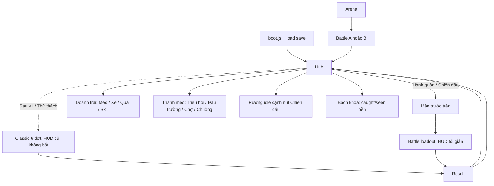

# MEOW BASTION — Tài liệu triển khai meta (bản cho codebase hiện có)

**Project:** `/workspace/tank_cat/` (tên npm: `meow-bastion`)  
**Tên game:** MEOW BASTION — Pháo đài trăng xanh  
**Stack:** Vanilla JavaScript (ES modules) + Three.js 0.180.0 trong `public/vendor/` + CSS/HTML. **Không phải Godot.**  
**Đối tượng:** Codex / lập trình viên làm tiếp đúng repo này.  
**Phiên bản tài liệu:** 3.7 (Hub 3 tab kiểu AFK, màn trước trận, 2026-11-12)  
**Text UI:** tiếng Việt. **Tên biến, hàm, module, comment trong code: tiếng Anh.**  
**Ảnh concept bắt buộc giữ:** `Moonlit Cat-Dog Tank Battle.png` (và mọi ảnh nguồn gốc). Không sửa bitmap gốc.

Trước khi code: đọc `AGENTS.md` và `SESSION_NOTES.md` trong `tank_cat`. Tài liệu này **không thay** các rule đó.

---

## Mục lục

0. [Cách dùng và luật AGENTS.md](#0-cách-dùng-và-luật-agentsmd)
1. [Game đang có — đọc từ code](#1-game-đang-có--đọc-từ-code)
2. [Đã có vs cần thêm / sửa](#2-đã-có-vs-cần-thêm--sửa)
3. [Mục tiêu bản meta và nguyên tắc không phá trận](#3-mục-tiêu-bản-meta-và-nguyên-tắc-không-phá-trận)
4. [Cấu trúc file (hiện có + module mới)](#4-cấu-trúc-file-hiện-có--module-mới)
5. [Mở rộng `Battle` (giữ mặc định)](#5-mở-rộng-battle-giữ-mặc-định)
6. [Tài nguyên, idle, save localStorage](#6-tài-nguyên-idle-save-localstorage)
7. [Roster mèo, nâng cấp, Nexus, đồ](#7-roster-mèo-nâng-cấp-nexus-đồ)
8. [Pháo đài: tầng, súng, operator](#8-pháo-đài-tầng-súng-operator)
9. [StatCalculator và loadout snapshot](#9-statcalculator-và-loadout-snapshot)
10. [Gacha, campaign meta, PvP](#10-gacha-campaign-meta-pvp)
11. [Công thức TUNABLE](#11-công-thức-tunable)
12. [UI/UX: giữ HUD trận, thêm Hub](#12-uiux-giữ-hud-trận-thêm-hub)
13. [Thu thập quái (Chuồng quái)](#13-thu-thập-quái-chuồng-quái)
14. [Milestones và test](#14-milestones-và-test)
15. [Luật bắt buộc cho Codex](#15-luật-bắt-buộc-cho-codex)
16. [Sẵn sàng mở rộng](#16-sẵn-sàng-mở-rộng)

Phụ lục: `01_CODE_SKELETONS.md`, `02_DATA_AND_BALANCE.md`, `03_UI_WIREFRAMES.md`, `README.md`.

---

## 0. Cách dùng và luật AGENTS.md

Làm **sửa / thêm** trên repo `tank_cat`, không tạo project mới, không port Godot.

Từ `AGENTS.md` (bắt buộc giữ):

- Đọc `SESSION_NOTES.md` trước khi làm tiếp.
- Giữ nguyên ảnh tham chiếu gốc. Mục tiêu hình ảnh là `Moonlit Cat-Dog Tank Battle.png`.
- **Mỗi tầng xe có đúng một mèo gắn cố định**, cụm súng xoay độc lập; **mèo bộ binh có vũ khí, chạy theo xe**.
- Đây là project local. **Không** tuyên bố đã xác minh gameplay bằng mắt trừ khi đã render và xem trong trình duyệt.
- Dùng Three.js local `public/vendor/` trước khi nghĩ tới tải mạng.

`npm run check` hiện đang khóa các khẳng định sau — **mặc định `new Battle()` phải vẫn thỏa**:

- 40 vũ khí (`WEAPONS.length === 40`), 20 loài, size loài đôi một khác nhau.
- `MONSTER_BALANCE` (size×2, máu thường ×2×1.5, damage ×0.8): mốc kiểm tra `check.mjs` (Kiến 154/780/104, Sói 264/1800/208, boss 660/90000/680).
- Seed 42 + bot heal/shield/barrage: `state === 'won'`, `seen.size === 20`, `fired.size === 40`, 5 unit `role==='tower'`, 10 unit `role==='infantry'`, máu trong [0, 48000].
- Skill `heal`: 20000 → 29000, trừ 120 energy; khiên giảm 94% (1000 → 60); khóa mục tiêu; chậm; event `beam`/`lightning`/`bullet`.

Mọi thay đổi `Battle` / `data.js` combat **không được làm đỏ** các assert này, trừ khi người dùng chủ động đổi cân bằng và cập nhật test cùng lúc.

---

## 1. Game đang có — đọc từ code

Đây không phải AFK Arena, không phải game dọc, không phải 5v5 tự đánh. Đây là **một trận phòng thủ 2.5D màn hình ngang**: xe-tháp mèo bên trái, quái từ phải, HUD và hàng kỹ năng khớp concept đêm trăng.

### 1.1. Vòng chơi hiện tại

1. `index.html` + `src/boot.js` tải Three.js (vendor rồi CDN), gọi `launch()` trong `src/game.js`.
2. Overlay intro: nút **XUẤT KÍCH**. Preview vài quái đứng sẵn.
3. `new Battle(onEvent)` — mặc định: HP 48000, energy 600, xe `player.x=290, y=175`.
4. **5 tầng** (`units` `role:'tower'`, `tower-0`…`tower-4`), y = `258+i*80`, mỗi tầng một mèo cố định (sprite `cat-0`…`cat-4`, tên `CAT_NAMES`).
5. **10 mèo bộ binh** (`cat-0`…`cat-9`), 2 tổ Alpha/Bravo, **5 con visible** luân phiên mỗi 18 giây, chạy theo xe (`player.x-180+(index%5)*88`).
6. **4 bệ phụ** (`aux-0`…`aux-3`) gắn module `PACKS`.
7. `assignWeapons()`: mỗi 10 giây `bank = floor(time/10)%10` — tháp xoay 10 họ `TURRETS`, bộ binh giữ `HANDHELD[index]`, aux xoay 20 `PACKS`. Mục tiêu: đủ 40 vũ khí trong một màn (`fired` Set).
8. Quái từ `WAVES` (6 đợt, tên tiếng Việt), 20 `MONSTERS` với `behavior` riêng (swarm, wolf, bay, giáp, lao, nhảy, chui đất, độc, hồi máu, triệu hồi, boss…). Thỉnh thoảng spawn phục kích gần xe (`x≈650`).
9. Đạn có đường bay, splash, pierce, laser, tesla, burn/poison/slow/stun. Khiên: `hurtPlayer` nhân 0.06. Sửa chữa xóa độc. Energy +9/giây, +6 khi hạ, +90 khi clear đợt; clear đợt cũng +1600 HP.
10. **Thắng:** hết đợt 6 (trùm chết, không còn quái). **Thua:** `hp <= 0`. Có chơi lại. Không lưu tiến trình.
11. Điều khiển: A/D hoặc nút cảm ứng di chuyển xe (clamp x 175–550); click quái khóa `targetId` (bấm trống = ngắm tự động); phím **1 rally, 2 heal, 3 freeze, 4 drone, Q barrage, E shield**; P/Space pause; B bách khoa; F fullscreen; tắt tiếng.
12. HUD có sẵn (đừng vẽ lại): Pause, **Chiến lợi phẩm** (`#coins`), **Quái đã hạ** (`#kills`), **ĐỢT x / 6**, **Bách khoa**, nhạc, fullscreen, **PHÁO ĐÀI MÈO** `#hp-text` 48.000, thanh quái/boss, **NGẮM TỰ ĐỘNG** / **ĐANG KHÓA MỤC TIÊU**, **CẤU HÌNH VŨ KHÍ 01 · n/40**, năng lượng **600 / 600**, 6 skill đúng cost 80/120/150/100/200/120, gợi ý xoay ngang, toast, overlay thắng/thua.

Kỹ năng (giữ nguyên id và số trong `SKILLS`):

| id | UI | cost | cd | hiệu ứng trong `Battle.useSkill` |
|---|---|---|---|---|
| `rally` | Tiếp viện | 80 | 16 | `buffs.rally` 10s, tốc độ bắn ×1.8 |
| `heal` | Sửa chữa | 120 | 20 | +9000 HP, xóa `buffs.poison` |
| `freeze` | Bão băng | 150 | 24 | mọi quái `slow=6`, 120 damage ice |
| `drone` | Drone | 100 | 20 | 14s, bắn mỗi 0.3s như `HANDHELD[9]` |
| `barrage` | Mưa tên lửa | 200 | 28 | 18 rocket |
| `shield` | Lá chắn | 120 | 22 | 7s, nhận 6% damage |

Energy max 600, bắt đầu 600, hồi `dt*9`.

### 1.2. Module nguồn hiện có (giữ trách nhiệm)

| File | Việc đang làm |
|---|---|
| `src/data.js` | `CAT_NAMES`, `TURRETS` (10), `HANDHELD` (10), `PACKS` (20), `WEAPONS`, `MONSTERS`, `MONSTER_BALANCE`, `WAVES`, `SKILLS` |
| `src/battle.js` | `class Battle` — mô phỏng độc lập renderer (`constructor(onEvent, random)`, `step(dt)`, `useSkill`, `start`, `spawn`, …) |
| `src/visuals.js` | Three.js, tháp procedural 5 tầng, sprite, đạn, hiệu ứng; sói `beast-0` dùng 24 frame |
| `src/game.js` | load asset, input, HUD, bách khoa, vòng lặp 60Hz + timer tab ẩn 250ms |
| `src/audio.js` | Web Audio tổng hợp theo event |
| `src/boot.js` | import Three.js |
| `src/enemy-animation.js`, `cat-rig.js`, `wolf-rig.js`, trang preview | animation / mẫu; rig mèo và wolf-rig **chưa** vào gameplay |
| `index.html`, `style.css` | HUD trận landscape, palette đêm xanh/vàng |
| `scripts/check.mjs` | kiểm tra combat mặc định |
| `scripts/server.mjs`, `build.mjs`, `vendor.mjs` | dev:5173, dist, Three.js local |
| `public/assets/`, `public/vendor/` | sprite, ảnh gốc, Three.js |

**Chưa có:** Hub/menu meta, localStorage, idle, gacha, roster nâng cấp, Nexus, đồ bền, cấp tài khoản, mở tầng, gán operator bằng tay, PvP, nhiều ải campaign, **thu thập/nâng cấp quái** (Bách khoa hiện chỉ ghi `seen` trong một trận). `coins` chỉ đếm trong một trận rồi mất khi chơi lại.

### 1.3. Vì sao bản spec Godot / UI AFK trước đây lệch

- Sai stack (Godot 4 / portrait hoặc “app gacha” tự bịa), trong khi game đã là web JS + Three.js ngang.
- Bịa combat 5v5 rồi “lane defense” generic, trong khi `Battle` đã có tầng, bộ binh theo xe, 40 vũ khí, 20 behavior, skill, HUD **đã khớp** concept (Pháo đài mèo, Đợt x/6, 600/600, 6 skill, ngắm tự động, cấu hình vũ khí, bách khoa).
- Bịa tên Aetherbound / Kael / Dawnkin — project đã có `CAT_NAMES` (Mướp, Khói, Bông, …), `turret-0`…, `SKILLS.rally`…
- Gắn UI kiểu AFK lên trên combat này làm **không khớp HUD đã dựng** (đúng sự cố: “UI không fit combat”). Đã khôi phục bản sáng 12/11 theo `gamedesign/RESTORE_NOTES.md`. **Không** làm lại việc đó.

---

## 2. Đã có vs cần thêm / sửa

### 2.1. Giữ nguyên (đừng viết lại)

- Toàn bộ mô phỏng đạn, behavior quái, skill, energy, di chuyển xe, khóa mục tiêu, HUD trận (HTML/CSS id hiện có), visuals/audio, preview animation, `npm run check` mặc định.
- Tên và số: `TURRETS` / `HANDHELD` / `PACKS` / `SKILLS` / `WAVES` / `MONSTERS` / `CAT_NAMES` / HP 48000 / energy 600.
- Một mèo cố định mỗi tầng đang bắn; bộ binh chạy theo xe.
- Chiến dịch gốc “Thung lũng Trăng” (6 đợt hiện tại) luôn chơi được như cũ.

### 2.2. Sửa nhẹ (tương thích ngược)

| File | Sửa | Không được |
|---|---|---|
| `src/battle.js` | `constructor(onEvent, random, options={})`. Nếu `options` rỗng / `classic:true` (mặc định): hành vi **y hệt** hiện tại. Nếu `options.loadout`: dùng súng/operator/squad/HP từ snapshot, **tắt** `assignWeapons` xoay bank (trừ khi loadout yêu cầu). Ẩn tầng `unlocked===false` (`visible=false`, không bắn). PvP: nhánh `options.mode==='pvp'` (mục 10). | Đổi công thức skill, damage mặc định, WAVE, 5+10 unit khi không có options |
| `src/data.js` | **Thêm** export (`CATS`, `BALANCE`, `STAGES`, `GACHA`, `MONSTER_BOOK`, …). Rate lồng / bắt nằm trong `BALANCE.monsters` (không cần `CAGE_TABLES` riêng). Không đổi số `MONSTERS` đã áp `MONSTER_BALANCE`, không đổi cost `SKILLS`, không đổi `WAVES` của ải gốc | Xóa/đổi id `turret-0`, `gun-0`, `pack-0`, `rally`… |
| `src/visuals.js` | Tôn trọng `u.visible`; tầng khóa không hiện mèo/súng (hoặc mờ). Map operator `catId` → sprite `cat-0`…`cat-9` (và placeholder nếu id mới). | Đổi bố cục HUD (HUD không nằm ở đây); phá scale sói / tank texture gốc |
| `src/game.js` | Router Hub ↔ trận. Classic: `new Battle(onEvent)` + HUD 6 skill cũ. Loadout: snapshot, `#skillbar-loadout` 4 ô + `#catch`. `end` → `GameState`. | Nhúng công thức gacha/idle vào `tick`; xóa/sửa `.skillbar` classic |
| `index.html` | **Thêm** markup Hub / panel meta (`#hub`, dialog đội, pháo đài, …). Giữ nguyên `#hud`, `#viewport`, skill, overlay trận | Xóa hay đổi id HUD đang dùng (`#coins`, `#hp-text`, `data-skill`, …) |
| `style.css` | **Thêm** Hub AFK-style (bottom nav 3 chỗ, landscape) + `#skillbar-loadout` (chỉ `#game.mode-loadout`). Không ghi đè `.topbar` `.skillbar` `.health-row` classic | Đè layout AFK / portrait lên **trận**; sửa skillbar classic |
| `scripts/check.mjs` | Giữ hành vi classic; đổi assert **theo id gốc** (không `length===40/20`) khi bắt đầu M20. Thêm `check-meta.mjs` | Đừng lock `WEAPONS.length`; `new Battle()` vẫn 5 tower + 10 infantry |
| `scripts/build.mjs` | Không cần đổi (đã copy cả `src/`) | — |

### 2.3. Thêm mới (module `src/meta/*` và UI Hub)

Idle 12h, ví, save `localStorage`, roster mèo (10 mèo hiện có + copy/độ hiếm), lên cấp/bậc/tái chế, Resonance Nexus, đồ 4 ô + relic + artifact, cấp tài khoản, mở tầng, nâng súng/module, gán operator (không trùng đội bộ binh), gacha, campaign thêm ải (vẫn tái sử dụng 20 quái; ải 1 có thể là bản scale của `WAVES` hiện tại), PvP mock, **Chuồng quái: bắt 20 loài `MONSTERS` trên sân (ném lồng) + mở lồng phụ, nâng cấp, 3 ô đồng hành loadout/PvP**, encyclopedia: tab quái thêm seen/caught bền.

---

## 3. Mục tiêu bản meta và nguyên tắc không phá trận

### 3.1. Hai chế độ vào trận

**A. Classic 6 đợt — mode riêng, không nằm vòng chơi chính v1**

- Giữ nguyên `WAVES` 6 đợt, HP xe 48000, 5 tầng, 10 bộ binh xoay 18s, bank 10s, **không** HP từng đơn vị, **không** bắt quái.
- `new Battle(onEvent)` / `{ classic: true }` hành vi **y hệt** hiện tại — `check.mjs` phải PASS.
- **Không** đưa lên CTA chính của Hub ở v1 (vòng chính = Hành quân). Có thể mở sau như “Thử thách Trăng” / mục phụ; không chặn việc giữ code và test.
- Thắng classic vẫn có thể cộng meta (coins, XP, cờ `classicCleared`) nếu gọi từ Hub sau này.

**B. Hành quân / PvP (Loadout) — vòng chơi chính v1**

- `new Battle(onEvent, random, { classic: false, loadout, unitHp: true })`.
- Mỗi ải **đúng 1 đợt**, dài khoảng **1–2 phút**. Quái thường ra **dồn dập tăng dần về cuối đợt**. Mỗi ải thứ 5 (**5 / 10 / 15 / 20**) là **ải trùm** (có `beast-8`, đã scale).
- Tầng = số đã mở; mỗi tầng súng + operator; bộ binh do người chơi chọn (thiếu = dân quân). Một `catInstance.id` **không** vừa operator vừa bộ binh.
- Súng/chỉ số/`maxHp` đơn vị đã nén trong loadout. `Battle` chỉ đọc snapshot, không gọi StatCalculator.
- **Mọi thứ có máu:** xe (pháo đài), mèo tầng, mèo bộ binh/dân quân, quái đồng hành. Chết **hết trận** (không hồi sinh, skill Sửa chữa không revive). Máu xe = 0 thì **thua**. Đồng hành/mèo chết không mất khỏi sổ/roster — chỉ vắng trong trận đó.
- Thắng: hết quái của 1 đợt. PvP: mục 10.4.
- **Chỉ trận Hành quân / loadout** bật `options.capture`. PvP và classic tắt bắt.
- Idle theo ải Hành quân cao nhất đã clear (`S` = index ải 1–20). Classic không bắt buộc để chạy idle.

### 3.2. Operator = cùng roster

Một danh sách mèo. Mèo đứng **tầng** (cố định, ngắm súng — đúng AGENTS.md) hoặc **bộ binh theo xe**, không đồng thời. Lý do: một hệ lên cấp; tránh nhân đôi một uid; khớp “một mèo một tầng”.

### 3.3. Mở tầng vs art 5 tầng

`visuals.js` và texture tháp đang **cố định 5 tầng**. Mốc mở: mỗi 20 cấp tài khoản thêm 1 tầng, trần 5.

**Quyết định v1 (đã rà soát):**

- `FLOORS_PER_LEVELS = 20`, công thức `unlocked = min(MAX_FLOORS, 1 + Math.floor(accountLevel / 20))`.
- **`MAX_FLOORS = 5` là tối đa cố định** (khớp mesh/sprite tháp hiện có). Không có tầng 6, không vẽ thêm tầng. Cấp 1–19: 1 tầng; **20**: 2; **40**: 3; **60**: 4; **80+**: đủ 5. Tầng khóa = không bắn, visual mờ/không mèo. Classic luôn 5 tầng hoạt động.

### 3.4. Combat tách meta

```
GameState / StatCalculator / Fortress
    → loadout snapshot (weapons + hp + skills + waves)
    → new Battle(..., { loadout })
    → events + result { won, kills, coins, time, hp }
    → RewardService / PvpService (Battle không ghi localStorage, không cộng ví)
```

`Battle` không `import` `src/meta/*`. Đây đã gần đúng (hiện chỉ import `data.js`).


### 3.5. Chốt đã sửa khi rà soát (2026-11-12)

Các lỗi dưới đây **đã sửa trong tài liệu**; Codex làm theo bản này, không theo số cũ nếu còn nhớ.

1. **Bắt quái trên đường (chính)** — kiểu Pokémon: quái thường ≤ 25% máu, ném lồng (`tryCatch`). Trùm bắt được khi máu **< 10%**, **chỉ Lồng trăng**, tỷ lệ 0,9%→2%, **không pity** trên sân. Lật bài lúc hết trận. Mở lồng ở Chuồng là nguồn phụ (trùm vẫn ra từ Lồng trăng + pity 80). **Classic 6 đợt / `new Battle()` / PvP: tắt bắt.** Chỉ Hành quân (loadout) bật capture.
2. **Mở tầng mỗi 20 cấp tài khoản** (1/20/40/60/80), trần 5. `xpToNext = 15 + 4*level`. Repeat ải = `40+8*index`. Công thức cũ `120 * level^1.35` và cửa 50 cấp **bỏ**.
3. **Ải Hành quân = đúng 1 đợt**, ~1–2 phút, quái ra dồn dập về cuối. Ải **5/10/15/20** có trùm (scale, không dùng 90.000 máu thô). Classic 6 đợt là mode riêng, không phải vòng chính v1.
4. **3 mèo starter không đủ 1 operator + 5 bộ binh** — slot thiếu = **dân quân** (`militia`, không uid, súng `gun-0`, damage ×0.75, có HP riêng). Starter: Mướp tầng 1, Khói + Bông bộ binh.
5. **Mọi đơn vị có HP** (xe, mèo, đồng hành). Bỏ pet bất tử và bỏ `companionDamageMult = 0.40` (chết được nên không cần nerf nặng). Chết hết trận, không respawn, Sửa chữa chỉ hồi đơn vị còn sống + xe. Pet chết **không** xóa khỏi sổ.
6. **`Battle.step` / `assignWeapons` / `visuals.createUnit`** phải có nhánh `role==='companion'` (không rơi vào infantry/aux). Đơn vị `alive===false` không bắn. HUD dùng `model.maxHp` / `energyMax`.
7. Milestone **M15** (bắt trên sân) trước M16 (chuồng / nâng / pet vào loadout).
8. Classic 6 đợt: giữ code + `check.mjs`, **không** CTA chính v1, **không** bắt quái, **không** HP từng đơn vị, **HUD 6 skill cũ**.
9. Hành quân: **10 skill**, chọn **4 ô** trước trận. Mở dần (heal+barrage sẵn; shield ải 2; rally ải 4; freeze/drone/orbital ải trùm 5/10/15; decoy/magnet/kamikaze cấp 20/40/60). Energy bắt đầu 1/3, hồi nhanh, +energy khi hạ. Nâng bằng `skillCore` (Lõi kỹ năng) rơi ải trùm. Nút bắt tách riêng, không tốn energy.
10. Mỗi mèo có `specialty`: `operator` hoặc `infantry`. Đúng vị trí **+15%** chỉ số (nén snapshot). Sai vị trí vẫn gán được, **không** bonus, **không** phạt. 10 mèo: xem 7.1.
11. Đồng hành **tự đánh** (AI riêng, bám xe). Trùm có thể **đẩy lùi** pet. PvP: AI đối thủ **tự dùng skill** theo luật đơn giản (chỉnh sau).
12. Kinh tế kiểu AFK: rương idle ~**70–80%** coins/dust/catXp trong ngày; daily quest; shop refresh + cửa hàng token đấu trường (`arenaToken`). Thua: **giữ đồ đã nhặt**, **mất** quái bắt trong trận đó (`pendingCatches` hủy).
13. **Sẵn sàng mở rộng:** sau này thêm **+30 mỗi loại** nội dung (mèo, súng/tháp/súng tay/pack, quái, skill, đồ, artifact, ải, …). Mọi thứ data-driven (mục 16). `MAX_FLOORS` vẫn = 5 (mesh xe).
14. Hub **landscape**, bottom nav **3 chỗ**: Hành quân (bản đồ ải + rương idle cạnh nút Chiến đấu lớn), Doanh trại (tab Mèo / Xe / Quái / Kỹ năng), Thành mèo (bản đồ toà: Triệu hồi, Đấu trường, Chợ, Chuồng quái). Mở dần theo ải, tutorial chạm ngắn. Một màn trước trận. HUD loadout tối giản. Chi tiết mục 12 và `03_UI_WIREFRAMES.md`. Classic HUD 6 skill **không** đổi.


---

## 4. Cấu trúc file (hiện có + module mới)

```text
tank_cat/
  src/
    data.js              # re-export registries; được tách src/data/*.js
    battle.js            # MỞ RỘNG constructor options
    game.js              # THÊM điều hướng Hub
    visuals.js, audio.js, boot.js, ...
    meta/
      balance-access.js  # getBalance() từ data.BALANCE
      wallet.js
      idle.js
      save.js
      cats.js            # CatInstance, roster, level/ascend/recycle
      nexus.js
      gear.js
      stats.js           # StatCalculator
      account.js
      fortress.js        # floors, turret instances, OperatorService
      loadout.js         # squad 5, skill slots (mặc định 6 skill sẵn có), presets
      gacha.js
      campaign.js
      pvp.js
      monsters.js        # mở lồng, sổ, nâng cấp, companions snapshot
      game-state.js      # façade, debounce save
    hub.js               # UI Hub: bind DOM, không chứa công thức
  index.html             # + #hub và dialog meta
  style.css              # + khối /* hub */
  scripts/check.mjs      # giữ
  scripts/check-meta.mjs # mới
```

Không tạo build tool mới, không thêm npm dependency.

---

## 5. Mở rộng `Battle` (giữ mặc định)

```js
// src/battle.js
export class Battle {
  /**
   * @param {(e: object) => void} onEvent
   * @param {() => number} random
   * @param {{ classic?: boolean, mode?: 'campaign'|'pvp', loadout?: LoadoutSnapshot }} [options]
   */
  constructor(onEvent = () => {}, random = Math.random, options = {}) {
    // If !options.loadout && options.classic !== false: IDENTICAL to current constructor body.
  }
}
```

`LoadoutSnapshot` (plain object, không class trong battle.js):

```js
{
  unitHp: true,
  maxHp: 12800,
  energyMax: 600,
  energyStart: 200,        // ~1/3 thanh; classic bắt đầu 600
  energyRegen: 16,         // classic 9
  energyOnKill: 12,        // classic +6 (giữ nguyên ở classic)
  floors: [
    { index: 0, unlocked: true, weapon: { /* TURRETS shape + id */ }, catSprite: 'cat-0', operatorName: 'Mướp', maxHp: 400 }
  ],
  infantry: [
    { slot: 0, weapon: { /* HANDHELD shape */ }, catSprite: 'cat-1', name: 'Khói', maxHp: 320, militia: false }
  ],
  companions: [ /* { id, name, asset, flying, weapon, maxHp, offset } */ ],
  aux: [],
  rotateBanks: false,
  // đúng 4 phần tử đã nén (cấp, cost, cd, effect). Không phải 6 id classic.
  skills: [
    { id: 'heal', cost: 80, cooldown: 8, healVehicle: 9000, healUnitPct: 0.40 },
    { id: 'barrage', cost: 140, cooldown: 10, rockets: 18, rocketDamage: 190 }
    // tối đa 4; slot trống không có mặt trong mảng
  ],
  waves: [ /* length 1 */ ],
  enemyFortress: null
}
```

Khi `rotateBanks===false`: không gọi logic đổi `u.weapon` theo `time/10`. `this.fired` vẫn thêm id khi bắn (meta không cần đủ 40).

Tầng `unlocked===false`: `u.visible=false`, skip fire. `visuals.js` đã có nhánh infantry visible; thêm ẩn tower crew / gun khi `!u.visible`.

PvP v1 (nếu chưa làm dual-citadel): xem 10.4 — **không** phá nhánh campaign.

### 5.1. HP đơn vị — chỉ khi `loadout.unitHp === true` (Hành quân / PvP)

Classic **không** bật: `hurtPlayer` / `useSkill('heal')` giữ nguyên (xe +9000, test 20000→29000). Không có `u.hp`.

Loadout:

- `applyLoadout` gán mỗi `tower` / `infantry` / `companion`: `u.maxHp`, `u.hp = u.maxHp`, `u.alive = true`. Xe dùng `this.hp` / `this.maxHp` như cũ (mất xe = thua).
- `chooseDefendTarget(fromX, fromY)`: ưu tiên đơn vị **còn sống** gần điểm đánh (đồng hành và bộ binh trước, rồi operator tầng), trong bán kính TUNABLE (vd. 140). Không ai trong tầm → `hurtPlayer` (xe).
- Đạn/cận chiến địch ở nhánh loadout gọi hàm này; classic không gọi. Độc/lava theo thời gian v1 vẫn chỉ vào xe (đỡ phức tạp).
- `u.hp <= 0`: `alive=false`, ngừng bắn, không `chooseTarget`, không đi bộ (xác có thể ẩn hoặc nằm). **Không** respawn, không skill hồi sinh. `heal` (`id==='heal'`): +9000 HP xe (clamp max), xóa độc xe; **cộng** `floor(u.maxHp * healUnitPct)` (mặc định 0.40) cho mọi unit `alive===true`. Không hồi đơn vị đã chết.
- Thua **chỉ** khi máu xe = 0 (còn pet/mèo sống cũng thua). Đồng hành chết: emit `unit-down`, **không** xóa instance khỏi sổ (GameState bỏ qua).
- `step` / `assignWeapons`: bỏ qua `!u.alive`. Companion: `else if (u.role==='companion')` bám xe; cấm rơi nhánh infantry. `visuals`: thanh máu nhỏ trên mèo/pet; ẩn hoặc đổ khi chết.

Máu mèo lấy `StatCalculator.compute().maxHp` lúc build loadout. Dân quân: `BALANCE.militia.maxHp` (đề xuất 240). Đồng hành: công thức 13.6 (`baseHp`…), **không** nhân 0.40.

`assignWeapons`: chỉ `tower` / `infantry` / `aux`. **Không** `else` ra `PACKS`.

`tryCatch(enemyId, cageType)`: chỉ khi `options.capture?.enabled`. Mặc định tắt. Không import `src/meta/*`. Xem mục 13.3. RNG dùng `this.random`. Classic (`new Battle()` / `{ classic: true }` / Xuất kích gốc) và PvP **không** truyền `capture` — `check.mjs` không lệch seed.

`src/game.js` `hud()` hiện ghi cứng `/ 48.000` và `#energy-fill` = `energy/6`. Khi có loadout: dùng `model.maxHp` và `model.energyMax` (gán từ snapshot, classic = 48000 / 600). `#wave-label` / `#wave-dots`: classic = 6 đợt; Hành quân 1 đợt — hiện “ẢI N” (hoặc “ĐỢT 1 / 1”), có thể ẩn dots, dựa vào `#enemy-count`.

---


## 6. Tài nguyên, idle, save localStorage

### 6.1. Ví (`src/meta/wallet.js`)

Key (int ≥ 0, trần 999_999_999):

| key | UI | Ghi chú |
|---|---|---|
| `coins` | Chiến lợi phẩm | Vàng; idle là nguồn chính (mục 11.1). Đồ nhặt trong trận cộng ngay, **giữ khi thua** |
| `catXp` | Kinh nghiệm mèo | Pool chung nâng cấp mèo (cùng `coins`). Idle là nguồn chính |
| `spiritDust` | Bụi linh hồn | Chủ yếu lên cấp súng / đồ; shop |
| `soulEssence` | Tinh chất | Tái chế |
| `forgeStone` | Đá rèn | Sao đồ và sao súng |
| `gem` | Ngọc | Đổi vé |
| `summonScroll` | Vé triệu hồi | Gacha |
| `relicStone` | Đá bảo vật | Relic |
| `skillCore` | Lõi kỹ năng | Nâng cấp skill; rơi ải trùm 5/10/15/20 |
| `arenaToken` | Xu đấu trường | Thắng/thua PvP; tiêu ở shop token |

API: `get`, `add`, `canAfford(cost)`, `trySpend(cost)` atomic, `toJSON`/`fromJSON`. Không import DOM.

Starting (TUNABLE, `BALANCE.startingWallet`): coins 2000, spiritDust 800, catXp 200, forgeStone 10, gem 300, summonScroll 5, skillCore 0, arenaToken 0, còn 0.

Shop nhỏ: `GEMS_PER_SCROLL = 100`.

### 6.2. Idle (`src/meta/idle.js`)

Trần `capSeconds=43200` (12h). `lastAccrualUnix` chỉ đổi khi claim hoặc tạo hồ sơ mới. Không auto-claim. Peek lúc vào Hub; hiện rương nếu elapsed ≥ 60s.

`S` = số ải campaign meta cao nhất đã clear (classic “Thung lũng Trăng” = ải 1 khi đã thắng ít nhất một lần). Chưa clear: `S=0`, nhân `unclearedMultiplier=0.5`.

```
goldPerMin   = 7 * 1.065^max(S-1,0)
dustPerMin   = 2.6 * 1.06^max(S-1,0)
catXpPerMin  = 5 * 1.055^max(S-1,0)
forgePerHour = 0.4 + 0.05*S
scrollPer12h = 1 + floor(S/5)
beastCage/12h = floor(S/4)
chowPerMin   = 0.1
floor từng loại ở bước cuối
```

Test bắt buộc: S=10, 6 giờ (21600s) → coins **4441**, spiritDust **1581**, catXp **2914**, forgeStone **5**, summonScroll **1**, monsterChow **36**, beastCage **1**.

Không gọi `Battle.step`. Đồng hồ tua ngược: elapsed 0. Không phát `moonCage` / `gem` / `skillCore` / `arenaToken` từ idle. Chi tiết nguồn/hố: mục 11.1.

### 6.3. Save (`src/meta/save.js`)

- Key: `localStorage['meow-bastion-save-v1']`.
- JSON, `schemaVersion: 4` (v2 quái, v3 skill, v4 `catXp` / `arenaToken` / daily quests).
- `save(state)` atomic-ish: `JSON.stringify` rồi ghi; try/catch quota.
- `load()`: parse lỗi → backup key `meow-bastion-save-v1-broken-<unix>`, trả `null` (tạo hồ sơ mới, toast).
- Debounce 400ms trong `GameState.markDirty()`. Flush `visibilitychange` hidden + `pagehide`.
- Không lưu FinalStats (tính lại). Có thể lưu `pvp.defense` snapshot đã nén.

Schema (rút gọn): `profile`, `wallet` (thêm `skillCore`, `catXp`, `arenaToken`), `roster[]`, `inventory`, `nexus`, `account`, `fortress`, `squadSlots[5]`, `skills: { levels: { heal:1, barrage:1, … }, loadout: ['heal','barrage','',''] }`, `presets`, `campaign`, `idle`, `gacha`, `pvp`, `classicCleared`, `monsters` (mục 13), `flags`.

Không có backend. Không cookie.

---

## 7. Roster mèo, nâng cấp, Nexus, đồ

### 7.1. Dữ liệu mèo — tái sử dụng 10 mèo sẵn có

`CAT_NAMES = ['Mướp','Khói','Bông','Tam Thể','Mun','Xiêm','Vằn','Tux','Mochi','Mây']`  
Sprite: `cat-0` … `cat-9`. **Đừng đổi tên.**

Thêm `export const CATS` trong `data.js` (10 entry): `id` (`cat-0`…), `name`, `sprite`, `role` (gợi ý: Mướp tank, … — gán hợp lý, TUNABLE), `rarity` gốc, `baseStats`, `growth`. Có thể thêm `faction` (tùy chọn v1: 4 tộc nhẹ để bonus đồ; nếu chưa cân thì factionMult=1).

Gacha pool = toàn bộ `CATS` (v1 có 10). Trùng = `storedCopies++`. Thêm mèo mới chỉ cần entry data (+ sprite hoặc fallback art, mục 16) — không sửa logic gacha.

`CatInstance`: `{ uid, catId, level, xp, tier, storedCopies, gear, relicLevel, artifactUid, locked }`.

Starter: `cat-0` Mướp (tầng 1, đúng `specialty: 'operator'`), `cat-1` Khói và `cat-2` Bông (bộ binh, đúng `'infantry'`). Slot còn lại = dân quân. Mở dần 3–5 ô bộ binh theo cấp 8 / 15 / 25.

### 7.1.1. Chuyên môn (`specialty`)

Mỗi entry `CATS` có `specialty: 'operator' | 'infantry'` (cố định, không đổi). Gán **đúng** vai: nhân **+15%** (`BALANCE.cats.specialtyBonus = 0.15`) — operator: `finalDamage` súng tầng và HP mèo tầng; infantry: `weapon.damage` và `maxHp`. Gán **sai** vai: vẫn được, **không** cộng, **không** phạt. Dân quân không có specialty. Bonus **nén vào snapshot**.

| id | name | specialty | rarity | role gợi ý |
|---|---|---|---|---|
| cat-0 | Mướp | operator | ELITE | TANK |
| cat-1 | Khói | infantry | RARE | MAGE |
| cat-2 | Bông | infantry | ELITE | HEALER |
| cat-3 | Tam Thể | operator | RARE | WARRIOR |
| cat-4 | Mun | infantry | ELITE | ASSASSIN |
| cat-5 | Xiêm | infantry | RARE | RANGER |
| cat-6 | Vằn | operator | COMMON | WARRIOR |
| cat-7 | Tux | operator | COMMON | TANK |
| cat-8 | Mochi | operator | RARE | HEALER |
| cat-9 | Mây | infantry | COMMON | RANGER |

5 / 5. Test: Mướp tầng → damage/HP ×1.15 so với cùng chỉ số không bonus; Mướp xếp bộ binh → đúng hệ số 1.0.

### 7.2. Lên cấp / bậc / tái chế

Giống thiết kế idle-collector, số đã chốt:

```
levelUpGold  = floor(80 * level^1.45)
levelUpCatXp = floor(25 * level^1.22)
```

Mốc test: lv1→80/40; 5→825/351; 10→2254/895; 20→6160/2282; 40→16829/5818; 60→30297/10059.

Bậc `RECRUIT…TRANSCENDENT_3`, cap 20/40/…/240, `tierMult` 1.00 / 1.10 / 1.22 / … như bảng phụ lục. Nguyên liệu: bản sao + fodder (các mèo `rarity: COMMON` — v1 có thể đặt một phần mèo hoặc chỉ dùng copy; **đơn giản hóa v1:** thăng bậc chủ yếu tốn `storedCopies` + vài COMMON nếu bạn gắn rarity COMMON cho bản sao trùng. Hoặc: mọi mèo có rarity, trùng id = copy. Fodder “any COMMON” có thể là copy của mèo thường. Để dễ: bảng `needSelf` như phụ lục, fodder = copy của **bất kỳ** mèo khác rarity thấp / hoặc tinh chất. Chốt v1: dùng **needSelf + soulEssence** nếu chưa có đủ mèo junk; vẫn viết `AscensionService` nhận `offeredUids` để sau dùng fodder thật.

Follower Nexus không lên cấp bằng tiền.

Tái chế: essence theo rarity/tier/copy/level (bảng phụ lục). Confirm 2 bước khi phá instance.

### 7.3. Resonance Nexus

5 neo tự động (cấp gốc cao nhất). `nexusLevel = min(5 neo)` nếu đủ 5 mèo, không thì 0. Follower trong ô: `effectiveLevel = min(nexusLevel, cap bậc)`. Ô bắt đầu 3, mở theo ải clear (4,6,8,10,13 — max 8 ô v1, đủ 10 nếu muốn đủ bảng cũ). API `getEffectiveLevel(cat)`.

### 7.4. Đồ, relic, artifact

4 ô: `weapon` (có thể là id `gun-*` hoặc gear generic), `helm`, `chest`, `boots`. Stats: `floor(base * rarityMult * (1+0.12*stars) * factionMult)`. Test: base atk 20, 5★, đúng tộc 1.10 → **35**. Sao tốn `forgeStone`. Relic 0–10, artifact 1 ô. Nén cộng vào FinalStats trước khi nặn `weapon.damage` cho loadout.

Furniture/engraving: hook rỗng, không UI.

---

## 8. Pháo đài: tầng, súng, operator

### 8.1. Cấp tài khoản (`src/meta/account.js`)

`level` bắt đầu 1, `xp` trong cấp. `xpToNext = 15 + 4*level` (lv1 cần 19, lv20 cần 95). Tổng XP để *vào* các mốc tầng:

| Mốc | Cấp | Tổng XP từ cấp 1 | Ước số trận (đường chính) | Chỉ farm ải 1 (48 XP/thắng) |
|---|---|---|---|---|
| Tầng 2 | 20 | **1.045** | First-clear ải 1–7 (hoặc ải 1–6 + 1 repeat) ≈ **7–10 trận** | ≈ **22 trận** |
| Tầng 3 | 40 | **3.705** | First-clear đến ải 14 ≈ **14–20 trận** | ≈ **77 trận** |
| Tầng 4 | 60 | **7.965** | Xong campaign 20 ải (6.850 XP) + ≈ **6** trận ải 20 (200 XP) | ≈ **166 trận** |
| Tầng 5 | 80 | **13.825** | Sau campaign + ≈ **35** trận ải 20 (hoặc ≈ 58 trận ải 10) | ≈ **288 trận** |

Mỗi trận Hành quân ~**1–2 phút** nên thời gian thực ngắn hơn bảng cũ (20 first-clear ≈ 20–40 phút). **Pacing XP/phút là TUNABLE — sẽ bàn lại sau**; giữ bảng này cho thống nhất. Classic 6 đợt không tính vào vòng farm chính v1.

XP từ thắng ải / PvP, **không** từ idle. `unlockedFloorCount()` như 3.3.

`accountXp` ải (TUNABLE): first-clear = `80 + 25*index`, repeat = `40 + 8*index` (ải 1: 105 / **48**; ải 10: 330 / **120**; ải 20: 580 / **200**). Classic nếu mở sau: cùng XP ải 1, **không** bắt. PvP thắng: 25 XP.

Test: lv1 và 19 → 1 tầng; 20 → 2; 40 → 3; 60 → 4; 80 → 5; 999 vẫn **5**. `xpToNext(1)===19`, `xpToNext(20)===95`; tổng 1→20 = 1045; 1→80 = 13825.

### 8.2. Súng — tái sử dụng `TURRETS`

Mỗi tầng một `TurretInstance`: `{ turretId: 'turret-0'..'turret-9', level, stars, modules: { core, aux } }`. Đổi loại = lắp họ khác đã mở (`unlock` theo ải hoặc classic cleared). Giữ level/sao khi đổi họ.

Mặc định tầng 1: `turret-3` (Gatling cầu vồng) hoặc `turret-0` — chốt **`turret-0` Pháo xuyên giáp** (index 0, dễ test) trừ khi muốn gatling vì rate cao; **dùng `turret-0`**.

Lên cấp súng: `floor(60*level^1.40)` vàng, `floor(30*level^1.30)` bụi. Cap `40+8*stars`. Sao: `starMult = 1+0.14*stars`, tốn forgeStone.

Module: **tái sử dụng `PACKS`** (`pack-0`…`pack-19`) làm module 2 ô (core/aux). Không bịa 20 module mới. Khi vào trận meta, `aux` units có thể gắn pack đang mặc, hoặc pack chỉ cộng chỉ số vào súng tầng (đơn giản hơn: module chỉ modify turret weapon stats, classic mới xoay 4 bệ aux). **Chốt v1 meta:** module cộng vào súng tầng; 4 `aux` units **tắt** (`visible=false`) để khỏi phá cân trừ khi loadout gán pack. Classic giữ 4 aux.

### 8.3. Gộp operator (`StatCalculator.computeTurret`)

Lấy weapon gốc từ `TURRETS[id]`, scale damage/rate/range theo level/sao/module, rồi:

- Không operator: `damage *= 0.70` (`EMPTY_OPERATOR_MULT`). `rate` không nhanh hơn.
- Có operator: `op = compute(cat)` (đã gồm +15% nếu `specialty==='operator'`).

```
bonusPct = 0.50 * (op.atk / 50)
finalDamage = floor( (turretAtk + op.atk * 0.15) * (1 + bonusPct) )
hastePct = clamp(0.25 * (op.speed/100 - 0.80), 0, 0.30)
finalRate = max(0.15, turretRate * (1 - hastePct))  // rate là giây/phát, nhỏ hơn = nhanh hơn
range giữ của họ súng
kind, splash, pierce, color, asset giữ nguyên
```

Ví dụ test (chốt trong phụ lục sau khi tính với baseStats Mướp): viết fixture `CATS[0]` trong data rồi assert số floor đúng thứ tự. Codex tính expected một lần, ghi vào `check-meta.mjs`.

`OperatorService.tryAssign(uid, floorIndex)` fail nếu busy (squad hoặc tầng khác) trừ khi confirm chuyển.

`Fortress.maxHp` cho **trận loadout**: `floor(12000 * 1.08^(fortressLevel-1) + 800*unlockedFloors)` nhân `stage.fortressHpMult`. Starter (cấp pháo đài 1, 1 tầng) = **12.800**. Classic luôn 48000, không dùng công thức này.

**Không** ghép ải Hành quân với `WAVES` classic 6 đợt / trùm 90.000 máu. Mỗi ải = 1 đợt, scale `enemyHpMult` / `enemyAtkMult` (TUNABLE). Ải 1: không trùm, dồn dập nhẹ, starter thắng được trong ~1–2 phút. Ải 5/10/15/20: có type 19 đã scale (máu trùm << 90.000 ở ải sớm). Test: loadout starter (1 tầng `turret-0` lv1, Mướp hoặc operator ×0.70, 2 bộ binh/dân quân `gun-0`, HP xe 12800, 0 pet, `unitHp:true`) + bot heal/shield **thắng fixture ải 1** trong `check-meta`.

---

## 9. StatCalculator và loadout snapshot

`src/meta/stats.js` — một cửa:

- `compute(cat, ctx)` → `{ maxHp, atk, def, speed, critRate, ... }`  
  `level = nexus.getEffectiveLevel(cat)`; `flat = base + growth*(level-1)`; `* tierMult`; +gear +relic +artifact; clamp.
- `computeTurret(turret, operator|null, ctx)` → FinalStats + `toWeapon(baseTurret)` ra object giống `make()` trong `data.js` (để `Battle.fire` không đổi).
- Power UI: công thức phụ lục, không dùng trong `Battle`.

`src/meta/loadout.js` — `buildCampaignLoadout(state, stage)` / `buildClassicLoadout()` (hoặc classic không cần, gọi Battle mặc định).

Power đội = tổng power 5 bộ binh + súng tầng đã mở. Cảnh báo ải nếu thấp; không chặn vào.

---

## 10. Gacha, campaign meta, PvP

### 10.1. Gacha (`src/meta/gacha.js`)

Pool 10 mèo, weight theo rarity trong `CATS`. Pity elite 10, legendary 40 (nếu chưa có legendary, pity legendary ép rarity cao nhất đang có). 1x/10x tốn `summonScroll`. 10x: ≥1 elite nếu có elite trong pool. RNG seed lưu trong save (`rngState`). Panel tỷ lệ đúng weight. `GameState.trySummon` trừ vé rồi `roster.addFromSummon`.

### 10.2. Campaign meta (`src/meta/campaign.js`)

- Vòng chính: `STAGES` 20 ải, **mỗi ải đúng 1 đợt** (~1–2 phút). Quái thường: `bursts` dày dần về cuối. Ải **5, 10, 15, 20** = ải trùm (type 19 + thêm quái, vẫn 1 đợt, máu/atk đã scale).
- Ải 1 “Thung lũng Trăng” (Hành quân): 1 đợt, không trùm, scale để starter thắng. `highestCleared` / idle = ải Hành quân (không cần clear classic).
- `WaveFactory` / `loadout.waves` dài 1. Nhân `enemyHpMult` / `enemyAtkMult` lúc spawn; **không** sửa `MONSTERS` gốc. Classic 6 đợt không dùng pipeline này.

Cách scale an toàn: `loadout.waves[i].types` trỏ index `MONSTERS`; `Battle.spawn` thêm `options.enemyHpMult` chỉ khi loadout có `modifiers` — **mặc định 1**, classic không truyền. Test check.mjs không truyền modifiers.

Mở tuyến tính. **Thắng:** first-clear / repeat + `accountXp` + lật bài `pendingCatches`. **Thua:** giữ tài nguyên đã nhặt trong trận (orb, coins/chow/lồng/core đã vào túi); **hủy** `pendingCatches` (mất quái bắt trận đó); không first-clear, không accountXp, không thưởng thắng. Lồng đã ném vẫn mất.

`WaveFactory` không bắt buộc class trong battle.js — build waves array trước.

### 10.3. Kỹ năng: 10 skill, 4 ô mỗi trận (Hành quân)

Classic **giữ nguyên**: object `SKILLS` 6 id, cost/cd/hiệu ứng, HUD 6 nút, phím 1–4/Q/E, energy bắt đầu 600, hồi 9/s, +6 khi hạ, `useSkill` như hiện tại. `check.mjs` không đổi.

Hành quân / PvP: hệ riêng, số liệu nén vào `loadout.skills` (Battle không import meta, không đọc `SKILLS` classic trừ khi không có snapshot).

#### Bộ 10 id

Giữ 6 id cũ, thêm 4 id mới (không đổi 6 id cũ):

| id | UI | Mở khóa | Loadout lv1: cost / cd | Hiệu ứng (lv1, TUNABLE) |
|---|---|---|---|---|
| `heal` | Sửa chữa | **Mở sẵn** | 80 / 8s | +9000 HP xe, hồi `40%` maxHp unit còn sống, xóa độc xe. Không revive |
| `barrage` | Mưa tên lửa | **Mở sẵn** | 140 / 10s | 18 rocket (như classic, damage từ snapshot) |
| `shield` | Lá chắn | Clear ải **2** | 80 / 8s | Khiên 7s, nhận 6% damage (như classic) |
| `rally` | Tiếp viện | Clear ải **4** | 60 / 7s | 10s, tốc độ bắn ×1.8 |
| `freeze` | Bão băng | Clear ải trùm **5** | 100 / 9s | Slow 6s + 120 ice (như classic) |
| `drone` | Drone | Clear ải trùm **10** | 70 / 8s | Drone 14s, bắn mỗi 0.3s |
| `orbital` | Không kích | Clear ải trùm **15** | 150 / 10s | Một đòn lớn vào mục tiêu khóa (không khóa: quái/trùm máu cao nhất). Damage 4000, **×1.5** nếu `boss`. Có telegraph ngắn 0.4s |
| `decoy` | Mồi nhử | Account cấp **20** | 70 / 8s | Đặt mồi 5s, HP 800; địch trong tầm 420 ưu tiên mồi |
| `magnet` | Nam châm | Account cấp **40** | 50 / 6s | Hút toàn bộ orb rơi trên sân về xe và thu. Loadout: hạ quái có thể rơi orb (xu/chow đã ghi hoặc pending); đi gần cũng nhặt. Classic: không orb, skill không có trên HUD |
| `kamikaze` | Mèo cảm tử | Account cấp **60** | 90 / 9s | Một mèo lao vào mục tiêu rồi nổ (splash 180, damage 2200). Không phải unit roster, không chết mèo thật |

Hồ sơ mới: chỉ `heal` + `barrage` mở; `skills.loadout = ['heal','barrage','','']`. Sau ải 4 đủ 4 skill đầu, 4 ô đầy. Skill chưa mở không gắn được. Trận chỉ dùng tối đa **4** skill đã chọn (mảng snapshot ≤ 4). `useSkill` id không nằm snapshot → false, không trừ energy.

#### Energy (chỉ loadout)

- `energyMax` 600, **bắt đầu `floor(energyMax/3) = 200`**.
- Hồi **16**/s (classic 9).
- Hạ quái **+12** energy (classic +6, không đổi ở classic).
- Ải 1 đợt: không cần +90 giữa các đợt.

#### Nâng cấp — Lõi kỹ năng (`skillCore`)

Rơi ải trùm (TUNABLE): first-clear ải 5/10/15/20 = **2 / 3 / 4 / 6** lõi; repeat **1 / 1 / 2 / 2**.

Mỗi skill cấp 1–8 (mặc định 1 lúc mở). Lên cấp tốn `coreCost(level) = level` lõi (1→2 tốn 1, … 7→8 tốn 7; max một skill = 28 lõi).

```
effectMult = 1 + 0.10 * (level - 1)          // lv8 = ×1.70
cost = max( ceil(baseCost * 0.55), floor(baseCost * (1 - 0.06 * (level-1))) )
cooldown = max(5, baseCd - 0.25 * (level-1)) // vẫn trong khoảng 5–10s
```

Test lv1 heal cost 80 cd 8; lv5: cost `floor(80*0.76)=60`, cd `max(5, 8-1)=7`, effectMult 1.40. Nâng khi không đủ lõi → fail, không trừ.

`src/meta/skills.js`: `isUnlocked(id, campaign, account)`, `canEquip`, `setLoadout(4)`, `upgrade(id, wallet)`, `toSnapshot(ids, levels)` → mảng 4 def đã nén.

#### Battle / HUD

- `useSkill(id)` classic: như cũ.
- Loadout: lấy def trong snapshot (cost/cd/effect đã tính cấp). Nhánh mới cho `orbital` / `decoy` / `magnet` / `kamikaze`. `heal` loadout = xe + unit sống (mục 5.1).
- HUD loadout: `#game.mode-loadout` ẩn `.skillbar` và `.specials`; hiện `#skillbar-loadout` 4 thẻ (phím 1–4) + `#catch` riêng. **Bắt không tốn energy**, chỉ tốn lồng đã mang (`energyCost = 0`).
- HUD classic: 6 nút hiện tại, không `#catch` (không bắt).

#### UI Hub (skill)

- 4 ô skill trên **màn trước trận**; kho skill ở Doanh trại > Kỹ năng (cuộn, khóa “Mở ở ải X” / cấp). Không đủ 1 skill đã mở thì không xuất kích (luôn có heal).
- Nâng cấp: cấp, cost/cd/hiệu lực, số lõi, nút nâng; chấm đỏ chỉ khi đủ lõi và chưa cap.

Test 10.3.1 (check-meta): unlock đúng mốc; không gắn skill khóa; snapshot đúng 4; classic energy 600 / regen 9 / 6 skill; loadout start 200 / regen 16 / +12 kill; upgrade trừ lõi và giảm cost; `tryCatch` không trừ energy; orbital ×1.5 lên boss fixture; decoy tồn tại; magnet thu orb; kamikaze nổ; `new Battle()` 6 skill + heal 20000→29000.

### 10.4. PvP mock (`src/meta/pvp.js`)

Interface:

```js
export class PvpClient {
  async listOpponents(myRating, count) { return []; }
  async submitDefense(snapshot) { return { ok: true }; }
  async submitAttack(payload) { return { ok: true }; }
}
export class LocalMockPvpClient extends PvpClient { /* data.MOCK_OPPONENTS, scale theo rating */ }
```

Không fetch mạng.

`DefenseSnapshot`: tên, rating, accountLevel, fortressHp, floors (weapon đã nén), infantry (weapon đã nén), **companions (0–3 quái đồng hành đã nén)**, skills, energy.

**Hai cách implement — chọn A nếu kịp, B nếu A đụng quá nhiều `visuals.js`:**

- **A (đủ thiết kế):** `options.mode='pvp'`, pháo đài địch bên phải, unit địch AI, thắng khi `enemyHp<=0` trước; timeout so % HP (hòa → attacker thua). Cần thêm nhánh trong `step` và vẽ xe địch. Tách hàm để campaign path không đổi.
- **B (an toàn v1):** một `Battle` loadout của mình, `waves` sinh từ power snapshot đối thủ (máu/số lượng/loài scale). Thắng/thua như PvE. Ghi rõ trong README là “tấn công sóng mô phỏng phòng thủ”, không phải hai xe bắn nhau. Có thể thay bằng A sau, cùng `PvpService.applyResult`.

Rating Elo: start 1000, K=32, div 400. Test: 1000 vs 1000 thắng +16, thua -16. Thưởng thắng nhỏ (200 coins, 80 dust, 15 XP). `check.mjs` không chạy PvP.

Nút Hub: Đấu trường, list mock, Tấn công, Lưu phòng thủ (snapshot gồm companions + 4 skill đã nén). **Không** bắt trong PvP.

**AI dùng skill (PvP, chỉnh sau):** mỗi 0,5s, nếu đang `playing` và energy ≥ cost và hết CD, chọn **một** skill theo thứ tự:

1. `heal` nếu máu xe < 50%
2. `shield` nếu máu xe < 35% hoặc ≥3 địch trong 400px
3. `decoy` nếu ≥2 địch trong 300px (khi đã mở)
4. `orbital` nếu có trùm / mục tiêu máu > 40% max (khi đã mở)
5. `barrage` nếu ≥3 địch còn sống
6. `freeze` nếu ≥4 địch hoặc trùm đang charge
7. `kamikaze` nếu có cụm ≥3 hoặc trùm (khi đã mở)
8. `rally` nếu ≥3 địch và máu xe ≥ 50%
9. `drone` nếu energy dư ≥ cost+40
10. `magnet` nếu ≥3 orb trên sân

Người chơi vẫn bấm skill thủ công ở phía mình. Luật số % / số địch là TUNABLE; test: bot không dùng skill khi thiếu energy; khi hp thấp và đủ energy thì gọi `heal` (fixture).
Thưởng PvP: 200 coins, 80 dust, 25 XP, **`arenaToken` 8** khi thắng; thua: 2 token, 0 XP. Trần nhận token **40/ngày** (5 trận thắng đầy đủ).

---

## 11. Công thức TUNABLE

Tất cả trong `export const BALANCE` ở `data.js` (hoặc `src/meta/balance.js` import từ data). Không hard-code rải Hub.

Giữ: gear 35; Elo ±16; empty operator 0.70; tầng 1/20/40/60/80; `xpToNext=15+4*level`; fortress 12800; ải 1 đợt; 10 skill / 4 ô; specialty +15%. Idle **đã chỉnh** (mục 11.1): S=10, 6h → coins **4441**, dust **1581**, catXp **2914**, forge 5, scroll 1, chow 36, beastCage 1 (thay mốc cũ 14392/5294).

### 11.1. Kinh tế (kiểu AFK Arena, tên resource gốc)

Idle / rương 12h là **nguồn chính** (~70–80% coins, `spiritDust`, `catXp` mỗi ngày nếu claim). Trận Hành quân chủ yếu để tiến ải, XP tài khoản, lồng, lõi, bắt quái. **Không** XP tài khoản từ idle. Mọi số TUNABLE; pacing tầng muộn ~**5–7 ngày / 1 tầng**.

Nâng cấp mèo: tốn **`catXp` + `coins`** (bảng vàng cũ `80*level^1.45`). `spiritDust` chủ yếu cho súng/đồ. `catXp` cần: `floor(25 * level^1.22)` (lv1=25, lv20=966, lv60=3692). Pool chung trong ví.

**Nguồn / hố theo pha** (một ngày điển hình: claim 12h idle, 5 trận repeat ải hiện tại, làm hết daily, 3 PvP thắng trong trần 5 trận):

| Resource | Early (ải 1–5, S≈5) nguồn | Mid (6–15, S≈10) | Late (16–20+, S=20) | Hố (tránh lạm phát) |
|---|---|---|---|---|
| `coins` | Idle 12h **6483**; 5 trận ~500; daily ~800; PvP ~600. Tổng ≈ **8400** (idle ~77%) | Idle **8883** + trận ~800 + daily 1200 + PvP 600 ≈ **11500** | Idle **16675** + trận ~1400 + daily 1500 + PvP 600 ≈ **20200** | Lên cấp mèo (lv40 **16829**, lv60 **30297** / lần); súng; shop lồng 1500; **không** tăng mạnh repeat coins |
| `catXp` | Idle **4459** + trận/daily nhỏ ≈ **4800** | Idle **5828** ≈ **6400** | Idle **9956** ≈ **11000** | Lên cấp mèo (1→20 một con **8219**; 60→80 **≈88400**). Nhiều mèo = hố dài |
| `spiritDust` | Idle **2363** + trận/daily/PvP ≈ **3100** | Idle **3162** ≈ **4200** | Idle **5663** ≈ **7200** | Lên cấp súng (`30*level^1.30`); đồ; shop token |
| `soulEssence` | Ít (tái chế, shop token) | Shop token + tái chế | Như mid | Thăng bậc / awaken. Không rơi đầy từ idle |
| `forgeStone` | Idle ~8 + daily | Idle ~12 | Idle ~16 | Sao súng/đồ. Trần idle thấp |
| `gem` | Daily ~20 + first-clear rải | Daily ~20–30 | Daily ~30 + ải mới | Vé 100, lồng thú 80, lồng trăng 250, refresh shop. **Cấm** idle ra ngọc |
| `summonScroll` | Idle 12h `1+floor(S/5)` (S5: 2) + daily 1 | S10: 3/12h | S20: 5/12h | Gacha. Trần daily shop |
| `beastCage` | Idle `floor(S/4)` /12h + thắng trận + daily 1 | S10: 2/12h | S20: 5/12h | Ném bắt / mở lồng. Shop coins **5/ngày**, gem 5/ngày |
| `moonCage` | Không idle; 8% ải trùm; shop 250 gem **2/ngày**; mốc sổ | + first ải 10/15/20 | Như mid | Mở lồng trùm. Không farm idle |
| `monsterChow` | Idle 0.1/phút → 72/12h + 5 trận (~40–80) + daily 10 | Nhiều hơn theo kill | ~72 + 5×(8+kills/5) | Lên cấp pet (1→20 ≈ **4827**). Nhiều pet = hố |
| `skillCore` | First ải 5: **2** (rồi repeat 1) | ải 10/15: 3–4 / 1–2 | ải 20: 6 / 2 | Nâng skill (max 1 skill = 28 lõi). Không idle |
| `arenaToken` | 8/thắng, 2/thua, trần **40/ngày** | Giống | Giống | Shop token (dust, essence, đá, vé, chow, lõi đắt). Không mua bằng coins vô hạn |

**Daily quest** (reset 00:00 local, một lần): claim rương idle; thắng 3 ải; nâng cấp 1 lần (mèo/súng/skill); mở lồng hoặc bắt 1 quái; 1 trận PvP. Thưởng từng việc + bonus hoàn thành (early: 800 coins, 200 dust, 20 gem, 1 scroll, 10 chow — TUNABLE, tăng nhẹ mid/late).

**Shop:** refresh **mỗi ngày**. Tab ngọc/coins: lồng, chow, vé, bụi (giới hạn mua). **Cửa hàng đấu trường:** tiêu `arenaToken` (không refresh giá bằng gem; stock daily). Không bán `moonCage` bằng coins.

**Trần / chống lạm phát:** idle cap 12h; không ngọc/lõi/lồng trăng từ idle; PvP token 40/ngày; shop daily cap; repeat ải cho ít coins hơn idle; chi phí lên cấp mèo/súng tăng nhanh (giữ bảng mũ). Post-campaign S tối đa 20 ở v1 (idle không tăng vô hạn). Flag: đừng buff repeat coins khi player kêu nghèo — tăng nhẹ idle hoặc daily, kiểm tra hố lv60 trước.

**Pacing tầng (account XP, không từ idle):** ải 20 repeat 200 XP × 5 + PvP 75 + daily ~150 ≈ **1225 XP/ngày** (late) → 60→80 cần 5860 ≈ **5 ngày / tầng**. Mid 40→60 ≈ 5–6 ngày. Early 1→20 chủ yếu first-clear (ải 1–7). Pacing vẫn TUNABLE (bàn sau).

Test idle S=10, 21600s: coins **4441**, spiritDust **1581**, catXp **2914**, forgeStone **5**, summonScroll **1**, monsterChow **36**, beastCage **1**.

Faction (nếu dùng): dealt 1.15 / 0.85 — chỉ áp khi tính `toWeapon` hoặc trong `Battle.damage` qua `weapon.faction` vs `enemy.def.faction`. `MONSTERS` hiện **không** có faction; v1 **bỏ** nhân faction trong trận (tránh sửa `damage()`). Faction chỉ bonus đồ cùng tộc.

Classic không dùng StatCalculator.

---

## 12. UI/UX: giữ HUD trận classic, Hub kiểu AFK

Chi tiết wireframe: `03_UI_WIREFRAMES.md`. Tóm tắt chốt:

### 12.1. Nguyên tắc

- Toàn app **landscape**; `#rotate-hint` khi portrait. **Không** HUD trận portrait.
- **Classic** 6 đợt: **không** đổi layout trận (`.topbar`, `.health-row`, `.skillbar` 6 ô, A/D, “PHÁO ĐÀI MÈO”).
- **Loadout** (Hành quân / PvP): HUD **tối giản** — máu xe, 4 skill, nút Bắt, thanh năng lượng, thanh quái, ẩn `.skillbar`/`.specials` cổ điển, ẩn `#bank-label` xoay 40 súng và `#wave-dots`. Giữ `#pause`, có thể giữ coins/kills gọn. Không đè mock AFK lên viewport.
- Hub `#hub`: palette sẵn (`#041828`, `#ffd278`, Nunito / Barlow), `.primary` / `.square` / `dialog`. Landscape. Ẩn khi `started`.

### 12.2. Ba chỗ (bottom nav)

```
#hub  (landscape)
├── .hub-top     ví (coins, dust, catXp, scroll, gem; token khi ở đấu trường) + cấp TK + settings + daily (Go)
├── .hub-main
└── .hub-nav     [ Hành quân | Doanh trại | Thành mèo ]   ← 3 nút đáy, chỉ trên Hub
```

**Hành quân** (tab mặc định, vòng chính): bản đồ ải cuộn (`STAGES.length`, huy hiệu trùm theo `boss`). Nút **Chiến đấu** lớn = ải đang mở. **Rương idle** cạnh nút đó (peek ≥ 60s, claim dialog). Daily quest (nút Go deep-link, mục 12.6). Classic “Thử thách Trăng” không phải CTA. Bấm Chiến đấu → **một** màn trước trận (12.4) → xuất kích.

**Doanh trại** — 4 tab trong cùng chỗ (list cuộn):

- **Mèo:** roster; bấm card → chi tiết 1 màn (12.5).
- **Xe:** 5 tầng (tầng 5 trên), súng `TURRETS`, module `PACKS`, gán operator, nâng HP pháo đài. Tầng khóa: “Mở ở cấp 20/40/60/80”.
- **Quái:** shortcut cùng màn Chuồng (sổ, cho ăn, 3 ô đồng hành). Toà Chuồng ở Thành mèo cũng mở màn này.
- **Kỹ năng:** lưới `SKILL_DEFS` (cuộn), nâng `skillCore`; 4 ô gán cũng có trên màn trước trận.

**Thành mèo** — bản đồ thị trấn, bấm toà:

- **Triệu hồi** — ×1/×10, pity, đổi ngọc.
- **Đấu trường** — list mock, tấn công, lưu phòng thủ, shop token.
- **Chợ** — refresh daily, tab coins/gem + tab token.
- **Chuồng quái** — mở lồng, sổ, nâng pet (cùng màn tab Quái).

Toà/tab khóa: mờ, ghi **“Mở ở ải X”**, không vào được. Settings: tên, xóa save (2 confirm), `?debug`.

### 12.3. Mở dần + tutorial

Mốc TUNABLE (clear ải N thì mở):

| Mở | Sau ải |
|---|---|
| Hành quân, Doanh trại > Mèo, Doanh trại > Xe | Có sẵn (ải 1) |
| Tab Quái + toà Chuồng | 1 |
| Tab Kỹ năng | 2 |
| Bản đồ Thành mèo + Chợ | 3 |
| Triệu hồi | 4 |
| Đấu trường | 5 |

Lần đầu mở: **tutorial chạm ngắn bắt buộc** (2–4 nhịp, highlight + “Bấm đây”), không skip lần đầu, lưu `flags.tutorials[id]`. Không hiện lại.

### 12.4. Một màn trước trận

Xe giữa; **5 tầng** (operator + súng) bên thân xe; **5 bộ binh** dưới/cạnh; **4 ô skill**; **3 ô quái**; nút **Đội mạnh nhất** (auto: đúng specialty ưu tiên, power cao, 3 pet, 4 skill — heal luôn nếu đã mở; TUNABLE); **preset** đã lưu (v1: 3 ô). Badge +15% / sai chỗ. Ô khóa ghi điều kiện. Một nút **Xuất kích**. Không tách thêm màn “chọn skill” riêng.

### 12.5. Chi tiết mèo (một màn)

Sprite lớn; tab (Chỉ số / Đồ / Bậc — cuộn nếu thêm). Nút to **Lên cấp** (`catXp` + `coins`). **Mặc nhanh** (đồ tốt nhất đang có, không đụng mèo khác). **Nâng nhanh** (lên cấp liên tục khi còn đủ tài nguyên, dừng khi hết hoặc cap). Chỗ gán tầng/bộ binh từ đây hoặc từ màn trước trận.

### 12.6. Chấm đỏ và daily Go

Chấm đỏ **chỉ** khi `canAfford` (đủ tài nguyên **và** còn nâng hợp lệ: cấp mèo, súng, skill, cho ăn, rương ≥ 60s, shop miễn phí nếu có). Không chấm “mới” sau tutorial, không chấm khi thiếu tiền.

Daily quest: mỗi việc nút **Đi** → `hub.go(target)` (`campaign`, `barracks.cats`, `barracks.skills`, `town.summon`, `town.shop`, `town.den`, `town.arena`, `chest`, `prebattle`). Claim tại panel Hành quân (và icon trên `.hub-top`).

### 12.7. Cấm

Không bottom-nav portrait / không 3 tab trên màn trận. Không ẩn A/D, không đổi chữ “PHÁO ĐÀI MÈO”. Không xóa skillbar 6 ô classic — chỉ ẩn khi `mode-loadout`. Không biến trận thành mock AFK dọc.

### 12.8. Luồng



Hub không che `#viewport` khi trận (`#hub.hidden` lúc `started`). Ở Hub được để nền trăng tĩnh. Bách khoa `#book` giữ; tab loài: ĐÃ GẶP / ĐÃ BẮT bền, thanh `caught/length`, mốc thưởng. Nâng pet ở Chuồng. **Không** dùng `#coins` HUD làm ví Hub.

---


## 13. Thu thập quái (Chuồng quái)

Người chơi muốn **chỗ thu thập loài quái đã có** (v1 = 20 trong `MONSTERS`), nâng cấp chúng, và **bắt kiểu Pokémon**: chủ yếu **bắt trên đường trong trận loadout** (quái yếu, ném lồng); **chỉ khi thắng** mới lật bài (IV / MỚI / mảnh). Classic 6 đợt và PvP **không** bắt. Mở lồng ở menu là nguồn phụ. Sổ kích thước = `MONSTERS.length` (sau này +30 loài qua data, mục 16). Trùm **Bạo long hắc nguyệt** (`beast-8`, `boss:true`) cực hiếm: bắt trên sân rất khó (Lồng trăng, máu < 10%) **và** vẫn ra từ Lồng trăng ở Chuồng. Không dùng index 19 trong logic — luôn `speciesId === 'beast-8'` / `def.boss`.

### 13.1. Quyết định dùng trong trận (v1, một hướng rõ)

**3 ô quái đồng hành** xuất trận cùng loadout / PvP, phía trái. Classic `new Battle()` không có pet (`check.mjs` không đổi).

**AI tự đánh** (chỉ loadout, `Battle` không import meta):

- Bám xe trong slot (`player.x + offset`), leash TUNABLE (~180). Tự chọn mục tiêu (`companionAcquire`): độc lập với `targetId` của người chơi; ưu tiên quái trong `weapon.range` (gần, bay nếu pet `flying`, trùm nếu cùng tầm). Bắn bằng `fire` như unit khác khi `alive`.
- Không dùng skill người chơi, không ném lồng.
- **Đẩy lùi bởi trùm:** đòn trùm (cận, húc, hơi lửa, roars) khi trúng pet: `knockback` 100–160px (hướng ra xa trùm, thường về trái/phải kẹp theo x), `stun` 0.45–0.8s, rồi tự chạy về slot. Clamp x trong [40, player.x+80] để không văng khỏi lane. Pet bay: knockback *0.7. Không knockback khi `alive===false`. Infantry v1: có thể cùng rule (TUNABLE, mặc định **có** knockback nhẹ hơn 0.6).
- Chết hết trận như mục 5.1; không xóa sổ.

- Ô 1 mở sẵn khi có ít nhất 1 quái đã bắt.
- Ô 2: bắt đủ 5 loài **hoặc** account level ≥ 10 (đủ một điều kiện).
- Ô 3: bắt đủ 10 loài **hoặc** account level ≥ 25.

Cùng một `speciesId` chỉ gán **một** ô (không ba con Sói giống nhau). Có thể để trống.

Quái đồng hành:

- Sprite = `MONSTERS[i].asset` (đã có PNG). Bay nếu `flying`. Không dùng máu quái địch thô.
- Chỉ số / vũ khí đã **nén vào snapshot** (`weapon` cùng shape `make()` trong `data.js`: `kind`, `rate`, `damage`, `range`, `color`, splash/pierce nếu có). `Battle` không import `src/meta/monsters.js`.
- `role: 'companion'`, đi theo xe, offset riêng, không xoay 18s. Có `maxHp` / `hp` / `alive` (mục 5.1). Hết máu: ngừng bắn hết trận, **không** làm thua (chỉ mất xe mới thua), **không** xóa khỏi sổ thu thập. Hết trận về đủ máu.
- Buff thụ động nhẹ **nướng vào loadout trước trận**, không sửa `damage()`: Hươu +3% `maxHp` xe, Khỉ băng +0.4 energyRegen, cộng dồn có trần (+8% maxHp, +0.8 energyRegen). V1: buff giữ cả trận kể cả khi pet chết (đơn giản). **Không** nhân `companionDamageMult`. Classic không áp.
- `visuals.js`: vẽ từ `u.asset`, quay phải, viền xanh, scale ~0.7, thanh máu; ẩn/đổ khi chết. Không đụng skillbar.

PvP: `DefenseSnapshot.companions` cùng format; đối thủ AI dùng pet nếu có (nhánh PvP A hoặc B).

### 13.2. Vật phẩm

Không nhét vào 7 key ví cũ; túi riêng `state.monsters.bag`:

| key | UI | Việc |
|---|---|---|
| `beastCage` | Lồng thú | Mở ra 1 quái (bảng rate chuẩn, **không** ra trùm) |
| `moonCage` | Lồng trăng | Rate tốt hơn; **chỉ loại này** (và pity mythic) có thể ra Bạo long |
| `monsterChow` | Thức ăn thú | XP lên cấp quái |

Mảnh theo loài: `shards[speciesId]` (số nguyên). Trùng loài (đã có instance) → cộng mảnh, không tạo instance thứ hai. Mỗi loài tối đa **một** instance (sổ + nâng cấp trên con đó).

**Nguồn lồng / thức ăn (TUNABLE):**

- **Cuối trận** loadout: luôn trừ lồng đã ném. Khi **thắng**: thêm `beastCage = 1 + (firstClear?1:0)`; 15% thêm 1; ải trùm hoặc hạ trùm: 8% `moonCage`; `monsterChow = 8 + floor(kills/5)`; lật bài `pendingCatches`. Khi **thua**: giữ đồ đã nhặt trên sân; **không** thưởng thắng; **hủy pendingCatches** (mất quái bắt trận đó).
- **Idle:** thêm vào `peek`: `beastCage` như scroll (base 0 + floor(S/4) mỗi 12h, floor cuối); `monsterChow` = `floor(6 * minutes / 60)` nhân uncleared nếu S=0. Không phát `moonCage` từ idle (tránh vỡ rate trùm).
- **Hàng ngày:** 1 `beastCage` + 5 `monsterChow` trên Hub (reset 00:00 **local** người chơi, lưu `lastDailyUnix`). Không stack nếu quên nhận (mất ngày đó).
- **Cửa hàng:** 1 `beastCage` = 1500 coins hoặc 80 gem; 1 `moonCage` = 250 gem. Giới hạn mua gem/ngày: 5 lồng thú, 2 lồng trăng (TUNABLE).

### 13.3. Bắt trên đường trong trận (nguồn chính)

Cảm giác Pokémon: gặp quái trên sóng, hạ máu, ném lồng; **chỉ khi thắng** mới lật bài (IV / MỚI / mảnh). `Battle` chỉ mô phỏng cú ném; `GameState.onBattleEnd` nếu thắng mới `resolvePendingCatches`. Thua: hủy pending, giữ đồ đã nhặt. **Không** `import` meta trong `battle.js`.

#### Bật / tắt (bắt buộc để `check.mjs` xanh)

- `new Battle()` / `{ classic: true }` / không có `options.capture` / `capture.enabled!==true`: `tryCatch` trả `false`, không trừ energy, không thêm lần gọi `random` trên đường `step`. Xuất kích gốc (classic 6 đợt) **luôn** đi nhánh này, kể cả khi chơi tay. `check.mjs` xanh.
- Chỉ **Hành quân / trận loadout** (`options.loadout` + `options.capture.enabled=true` khi túi còn lồng): mới bắt được.
- PvP: tắt capture (không farm bắt).

```js
// options.capture (plain object, build ở loadout.js / game.js từ BALANCE.monsters.capture + MONSTER_BOOK)
{
  enabled: true,
  charges: { beastCage: 2, moonCage: 0 }, // snapshot túi, tối đa mang vào = 5 lồng tổng (maxThrows)
  energyCost: 0,           // bắt không tốn energy, chỉ tốn lồng
  hpThreshold: 0.25,
  bossHpThreshold: 0.10,
  bossBaseChance: 0.02,
  maxThrows: 5,
  chanceCap: 0.90,
  hpSlope: 0.55,
  baseChance: {
    beastCage: { COMMON: 0.50, RARE: 0.28, ELITE: 0.14, LEGENDARY: 0.06, MYTHIC: 0 },
    moonCage:  { COMMON: 0.80, RARE: 0.55, ELITE: 0.32, LEGENDARY: 0.16, MYTHIC: 0 }
  },
  table: {
    // key = MONSTERS index (type)
    0: { rarity: 'COMMON', boss: false },
    /* ... */
    19: { rarity: 'MYTHIC', boss: true }  // beast-8
  }
}
```

**Trùm trên sân** (`beast-8` / `boss:true` / `behavior==='boss'`):

- Chỉ bắt khi `hpRatio < 0.10` (không dùng ngưỡng 25%).
- **Chỉ Lồng trăng.** Ném Lồng thú vào trùm: fail sớm, **không** trừ lồng, toast “Cần Lồng trăng”.
- `chance = bossBaseChance * ((1 - hpSlope) + hpSlope * (0.10 - hpRatio) / 0.10)` — vừa dưới 10% máu ≈ **0,9%**; tại 5% máu: **1,45%**; tại 0% máu: **2,0%**. Trần 5%. `hpRatio >= 0.10` → 0.
- **Không pity** bắt trùm trên sân (fail không tăng `moonMythic`). Pity 80 chỉ cho mở Lồng trăng ở Chuồng. Trùm vẫn ra từ mở lồng (1% + pity).
- Ải 1 loadout không có trùm; bắt trùm trên sân ở ải muộn (vd. 10/20) đã scale.

#### Điều kiện “có thể bắt”

Quái sống. Thường: `hpRatio <= 0.25`. Trùm: `hpRatio < 0.10` và còn charge Lồng trăng. `Battle` gắn `e.catchable` mỗi `step` (chỉ flag, không roll). Emit `catchable` khi vừa xuống ngưỡng (HUD/visuals nháy).

#### Hành động `tryCatch(enemyId, cageType='beastCage')`

Phím **C** (chưa dùng trong `game.js`); nút `#catch` gần thanh năng lượng, **không** thay 6 ô skill. Ném vào `targetId` (cần khóa mục tiêu). `cageType`: mặc định Lồng thú; giữ / chọn Lồng trăng nếu còn charge (toggle nhỏ trên nút, hoặc giữ Shift+C).

Thứ tự (giống `useSkill` — fail sớm **không** trừ lồng):

1. `state==='playing'`, `capture.enabled`, không đang windup.
2. `charges[cageType] > 0`, `throwsUsed < maxThrows`. **Không** kiểm tra/trừ energy (`energyCost = 0`).
3. Enemy tồn tại, `!dead`. Thường: `hpRatio <= 0.25`. Trùm: `hpRatio < 0.10` và `cageType==='moonCage'` (Lồng thú → fail sớm, không trừ).
4. Trừ 1 charge, +1 `throwsUsed`, trừ energy, emit `catch-throw`.
5. `hpBonus = (threshold - hpRatio) / threshold` (0 tại 25% máu, 1 tại 0%).
   `chance = min(chanceCap, baseChance[cage][rarity] * ((1 - hpSlope) + hpSlope * hpBonus))`.
   Ví dụ Lồng thú COMMON: 25% máu → 22,5%; 0% máu → 50%. Lồng trăng LEGENDARY: 7,2% → 16%.
   Trùm: dùng `bossHpThreshold` / `bossBaseChance` (vừa dưới 10% ≈ 0,9%; 0% = 2%), không dùng baseChance MYTHIC (0).
6. `this.random() < chance` → thành công: xử lý như hạ gục (cộng `kills` / `coins` / `seen`, xóa khỏi sóng — đợt vẫn clear được), đẩy `{ type, speciesId: def.asset, rarity, cageType }` vào `this.pendingCatches`, emit `catch-success`. Thất bại: quái ở lại, `stun` ngắn 0,4s, emit `catch-fail` + toast “Thoát rồi!”.
7. Kết quả trận: `emit end` kèm `pendingCatches` (hoặc `result.pendingCatches` từ GameState đọc `battle.pendingCatches`). **Chưa roll IV trong Battle.**

UI hết trận: **chỉ khi thắng** và pending > 0 mới lật bài (MỚI + IV, hoặc +mảnh). **Thua:** không lật, toast ngắn “Quái thoát khi thua trận”; đồ đã nhặt vẫn hiện trên overlay.

Túi thật: trừ lồng đã ném lúc `onBattleEnd`; cộng đồ đã nhặt (kể cả khi thua). **Thắng** mới `resolvePendingCatches`. **Thua / thoát:** `pendingCatches` bị hủy, không vào sổ, không mảnh.

#### HUD / visuals (không đè skillbar)

- Nút `#catch`: hiện số lồng, xám nếu không ném được; nháy khi `target` đang `catchable`.
- Thanh máu quái catchable: thêm dấu chân / khung (trong `visuals.js` khi `e.catchable`, không sửa HTML máu pháo đài).
- `hud()` không ghi đè `#coins` ví Hub.

Test 13.9 và M15.

### 13.4. Mở lồng ở Chuồng (nguồn phụ)

Vẫn dùng `openCage(cageType, rng, state)` trong `src/meta/monsters.js`. Lồng thừa từ idle / daily / shop / thưởng / không ném hết trong trận mở ở đây. Cùng bảng rarity + pity. `rng` inject, không `Math.random` trong hàm thuần.

Thứ tự một lần mở:

1. Tăng bộ đếm pity tương ứng (**lồng thú / lồng trăng riêng**). `beastCage` **không** tăng `moonMythic`.
2. Sàn pity: elite 10, legendary 40 (cả hai loại lồng); **mythic chỉ `moonCage`, ngưỡng 80**. Pity là **sàn** (vẫn có thể ra bậc cao hơn). Khi ra ≥ sàn, reset đúng bộ đếm đó; ra legendary cũng reset elite của loại lồng ấy. Ra mythic reset cả ba đếm trăng.
3. Roll rarity theo weight, loại bậc dưới sàn.
4. Roll đều trong loài cùng rarity (bảng 13.5). `beastCage` không có MYTHIC. `moonCage` mới ra `beast-8`.
5. Chưa `caught`: tạo instance, `isNew=true`. Đã có: cộng `SHARDS_BY_RARITY`, **không** reset IV/level.
6. Thêm `seen`. Trả kết quả để UI reveal.

Weight (`BALANCE.monsters.cages`, /10000):

| Rarity | Lồng thú | Lồng trăng |
|---|---|---|
| COMMON | 5500 | 2000 |
| RARE | 3000 | 4000 |
| ELITE | 1200 | 2700 |
| LEGENDARY | 300 | 1200 |
| MYTHIC | 0 | 100 |

Tỷ lệ UI 2 chữ số (Lồng trăng MYTHIC = 1,00%). Kỳ vọng xấp xỉ **55** Lồng trăng / 1 trùm (1% + pity 80).

`SHARDS_BY_RARITY`: COMMON 10, RARE 20, ELITE 40, LEGENDARY 80, MYTHIC 150.

### 13.5. Sổ 20 loài (`MONSTER_BOOK`)

`speciesId` = `MONSTERS[i].asset`. Không đổi `hp/damage` địch. Sổ thêm metadata thu thập + chỉ số **đồng hành** riêng.

| # | speciesId | Tên | catchRarity | element | Ghi chú đồng hành (kind gợi ý) |
|---|---|---|---|---|---|
| 0 | bug-0 | Kiến tiên phong | COMMON | nature | rapid, đàn — rate nhanh, damage thấp |
| 1 | beast-0 | Sói bóng đêm | RARE | dark | claw, cận; v1 chỉ claw |
| 2 | bug-4 | Ong sát thủ | COMMON | nature | flying, arrow |
| 3 | bug-1 | Bọ sừng đỏ | RARE | earth | shell, chậm; passive +giáp nhỏ |
| 4 | beast-1 | Lợn rừng cuồng nộ | RARE | earth | shell |
| 5 | bug-2 | Nhện giăng tơ | COMMON | dark | poison + `slow` |
| 6 | bug-3 | Bọ ngựa đao | RARE | nature | claw |
| 7 | beast-2 | Gấu cuồng chiến | ELITE | fire | shell, damage cao, rate chậm |
| 8 | bug-5 | Ấu trùng đất | COMMON | earth | drill |
| 9 | beast-4 | Hổ kiếm | ELITE | fire | sniper |
| 10 | bug-6 | Bọ cạp độc | RARE | poison | poison, ranged |
| 11 | beast-3 | Khỉ băng | ELITE | ice | ice + slow; passive +energyRegen 0.4 |
| 12 | bug-7 | Bướm thôi miên | ELITE | poison | flying, poison splash |
| 13 | beast-5 | Rùa dung nham | LEGENDARY | fire | flame splash; passive +maxHp 2% |
| 14 | beast-6 | Tê giác bọc giáp | LEGENDARY | earth | shell nặng; passive +giáp 3% |
| 15 | bug-8 | Bọ tinh thạch | ELITE | crystal | crystal |
| 16 | beast-7 | Đại bàng sư tử | LEGENDARY | wind | flying, arrow loạt |
| 17 | beast-9 | Hươu cổ thụ | LEGENDARY | nature | **không** `weapon.kind==='heal'` (tránh hồi nhầm HP xe). Passive +3% maxHp, weapon plasma nhẹ |
| 18 | bug-9 | Bọ chúa giáp gai | LEGENDARY | poison | poison splash |
| 19 | beast-8 | Bạo long hắc nguyệt | MYTHIC | dark | flame splash; passive +4% maxHp. Bắt trên sân: Lồng trăng, máu < 10%, 0,9%–2%, không pity |

`element` chỉ UI; v1 **không** nhân hệ trong `Battle.damage()`.

Base đồng hành (TUNABLE, **không** lấy `MONSTERS[].damage`): xem `02_DATA_AND_BALANCE.md`. COMMON atk ~18–24 / HP ~80–90; LEGENDARY atk ~40–50 / HP ~200–240; MYTHIC atk ~70 / HP ~300. **Không** nhân 0.40 — pet có thể chết nên để số gốc, chỉnh sau nếu mạnh.

### 13.6. Instance, IV, nâng cấp, tiến hóa

```js
{
  uid, speciesId, level: 1, xp: 0, stars: 0, evo: 0,
  ivs: { hp, atk, def, speed }, // 0..15, roll 1 lần lúc nhận (lật bài / mở lồng), không reroll
  trait: 'none' // v1: 85% none, 15% một trong swift|brutal|sturdy|gifted (±8% một stat). Hook sẵn.
}
```

IV: `floor(rng()*16)`. `mult = 1 + iv/15 * 0.20` (0 → ×1.0, 15 → ×1.20).

**Lên cấp:** tốn `monsterChow`. `chow = floor(12 * level^1.30)`. Test: lv1→12; lv5→97; lv10→239; lv20→589. Cap: `20 + 16*stars` (0★=20, 5★=100).

**Lên sao (0→5):** mảnh cùng loài: `20, 40, 80, 160, 280` (index = sao hiện tại).

**Tiến hóa (không sprite mới):** `evo` 0→1 khi `stars>=3` và `level>=40` (50 mảnh). 1→2 khi `stars>=5` và `level>=80` (100 mảnh). `evoMult = 1 + 0.25*evo`. Visual: scale ×(1+0.12*evo), cùng asset.

```
starMult = 1 + 0.14 * stars
atk = floor( baseAtk * (1 + 0.08*(level-1)) * starMult * evoMult * (1 + ivs.atk/15*0.20) )
maxHp = floor( baseHp * (1 + 0.08*(level-1)) * starMult * evoMult * (1 + ivs.hp/15*0.20) )
```

Ghi vào `weapon.damage`. `rate` giảm tối đa 20% theo `ivs.speed`. Clamp rate ≥ 0.15.

`GameState.resolvePendingCatches(pending, rng)`: trùng loài → mảnh; loài mới → instance + roll IV/trait. Cùng hàm dùng sau `openCage` cho UI (openCage tự tạo instance).

### 13.7. Sổ Bách khoa và thưởng hoàn thành

Tab quái `#book` hiện dùng `model.seen` **theo index số** (`Set` type 0–19). Save meta lưu `speciesId` (asset). Chuẩn hóa:

- Trong trận: vẫn `seen` index như cũ (đừng phá `check` / HUD một trận).
- Lúc `end`: `state.monsters.seen` union `MONSTERS[type].asset` cho mọi type đã gặp.
- Bách khoa Hub / sau trận: map `speciesId` ↔ index qua `asset`. “ĐÃ GẶP” bền; “ĐÃ BẮT” nếu có instance.

UI: chưa gặp = bóng + “???”; đã gặp chưa bắt = tên + “Chưa bắt”; đã bắt = sao/cấp, bấm mở chuồng. Thanh `bắt / 20`. Thưởng một lần (`flags.collectionRewards`):

| Mốc bắt | Thưởng |
|---|---|
| 5 | 2 beastCage, 20 chow, 200 coins |
| 10 | 1 moonCage, 40 chow, 500 coins |
| 15 | 2 moonCage, 80 chow, 20 gem |
| 20 (cả trùm) | 5 moonCage, 200 chow, 100 gem, 1 relicStone |

### 13.8. Save `monsters` + migrate v2

```js
monsters: {
  bag: { beastCage: 0, moonCage: 0, monsterChow: 0 },
  instances: [],
  shards: {},
  seen: [],               // speciesId[] — không lưu index số
  caught: [],
  pity: { beastElite: 0, beastLegendary: 0, moonElite: 0, moonLegendary: 0, moonMythic: 0 },
  companionSlots: ["", "", ""], // speciesId (một instance / loài)
  lastDailyUnix: 0
}
```

`schemaVersion: 4`. 1→2 `monsters`; 2→3 skill; 3→4 `catXp`, `arenaToken`, `dailyQuests`. Key vẫn `meow-bastion-save-v1`. Hồ sơ mới: `beastCage: 3`, `monsterChow: 15`.

### 13.9. Test chấp nhận (check-meta)

Bắt trên sân:

- `new Battle()` và `{ classic: true }`: `tryCatch` false; không companion; `check.mjs` PASS.
- Loadout `tryCatch` không đổi energy.
- **Thua** có `pendingCatches`: sổ/mảnh không đổi; ví vẫn cộng đồ đã nhặt. **Thắng** mới resolve bắt.
- Bật capture (loadout): cùng seed → cùng thành công/thất bại, trừ đúng charge/energy.
- Quái thường `hpRatio > 0.25`: fail sớm, **không** trừ lồng.
- Trùm + Lồng thú (dù 1% máu): fail sớm, không trừ. Trùm + Lồng trăng + hpRatio ≥ 0.10: fail sớm, không trừ.
- Chance thường: COMMON + Lồng thú + hpRatio=0 → 0.50; hpRatio=0.25 → 0.225 (sai số 1e-9).
- Chance trùm + Lồng trăng: hpRatio=0.10 hoặc cao hơn → **0**; hpRatio=0.05 → **0.0145**; hpRatio=0 → **0.02**. Vừa dưới 10% ≈ 0,9%. Fail trùm không tăng `moonMythic`.
- Thành công: quái/trùm biến, `kills+1`, pending có `speciesId`, sóng có thể clear.
- `throwsUsed` không vượt `maxThrows`.
- PvP: không kèm capture, `tryCatch` false.
- Loadout `unitHp`: đồng hành/mèo hết máu → `alive===false`, không bắn lại; `heal` không revive; máu xe = 0 → thua dù còn pet; sau `end`, sổ `instances` vẫn đủ loài (không xóa).
- Classic: không có `u.hp`, heal vẫn 20000→29000.
- Ải fixture: `waves.length===1`; ải 5/10/15/20 có type 19; ải 1 không type 19 và starter thắng ~≤120s (TUNABLE).

Mở lồng / sổ / pet:

- `openCage` cùng seed → cùng species/rarity/ivs; 10 `beastCage` không elite thì lần pity **chắc** elite+; không ra `beast-8`.
- `moonCage` lần 80 không mythic thì ép `beast-8`.
- Trùng loài → đúng mảnh, không 2 instance.
- Chow 12/97/239/589; không vượt cap sao; evo 1.25/1.5.
- Loadout 1 pet: `step` bắn được; `assignWeapons` không đổi súng pet; `new Battle()` 0 pet.
- Unlock ô 2/3; thưởng mốc 5 chỉ một lần; `unlockedFloorCount`: 19→1, 20→2, 80→5, 400→5.
- `resolvePendingCatches` loài mới roll IV; trùng cộng mảnh.

---

## 14. Milestones và test

Làm tuần tự trên `tank_cat`. Mỗi mốc: `npm run check` vẫn PASS.

**M0** — Đọc AGENTS/SESSION_NOTES, chạy `npm run dev`, không đổi gameplay. (Người làm tự xem trình duyệt khi có thể; không khai chưa xem mà nói đã đẹp.)

**M1** — Tạo `src/meta/*` rỗng + `BALANCE` + `CATS` trong `data.js`. `check.mjs` vẫn xanh.

**M2** — `wallet`, `save`, `game-state` tối thiểu (ví + profile). Test node: spend atomic, save/load giả (`localStorage` polyfill trong check-meta, hoặc API `createSave(storage)` inject). Chưa cần UI.

**M3** — Idle + test S=10, 6h (4441/1581/2914/5/1 + chow/cage). UI rương. Có `catXp` trong peek.

**M4** — Roster 10 mèo + `specialty`, starter 3 (đúng chuyên môn), UI list/detail, badge đúng/sai vị trí, test +15%.

**M5** — StatCalculator + test số tăng cấp / gear 35. Nexus stub.

**M6–M8** — Level up, ascend/recycle, Nexus đủ, UI.

**M9** — Gear/relic/artifact, equip, `PACKS` làm module súng.

**M10** — Gacha + UI vé, pity test.

**M11** — Account + fortress + operator + `computeTurret`. Test mở tầng 1/19/20/40/60/80/400. UI Pháo đài. Busy conflict.

**M12** — `Battle` loadout: 1 đợt, `unitHp`, chết hết trận, `heal` chỉ unit sống + xe, `chooseDefendTarget`. Visuals thanh máu / ẩn tầng khóa / dân quân. Classic `new Battle()` không đổi, `check.mjs` PASS. Test: starter thắng fixture ải 1 (1 đợt, không trùm); pet/mèo chết không bắn, không mất sổ; xe 0 HP thì thua.

**M13** — Vòng chính = tab Hành quân (bản đồ ải, nút Chiến đấu, rương idle cạnh nút). 20 ải × 1 đợt, trùm 5/10/15/20. Xuất kích qua **một** màn trước trận. Ải 1 starter thắng ~1–2 phút. 4 ô skill heal+barrage sẵn. Classic để sau, HUD 6 skill không đổi. Khung 3 tab có thể stub rồi hoàn thiện ở M21.

**M14** — PvP mock (B được; A tốt hơn). Elo ±16, `arenaToken`, trần 40/ngày, shop token (có thể stub). AI tự dùng skill theo luật 10.4 (test heal khi HP thấp). Không bắt.

**M15** — Bắt trên sân (mục 13.3): chỉ trận loadout. `tryCatch`, `catchable`, `pendingCatches`, HUD `#catch` + phím C. **Thắng** mới lật bài; **thua hủy pending**, giữ đồ. Classic / `new Battle()` / PvP tắt bắt; `check.mjs` PASS. Test trùm: Lồng trăng, máu < 10%, chance 0 / 0.0145 / 0.02. Test 13.9.

**M16** — Chuồng quái (mục 13.4–13.8): sổ, mở lồng, 3 ô đồng hành. Loadout nhận `companions`. **AI tự đánh** + knockback trùm (mục 13.1). UI Chuồng. PvP kèm pet. Dân quân. Test 13.9 + fixture đẩy lùi.

**M17** — Polish Hub, debug `?debug`, encyclopedia không vỡ, `check` + `check-meta` PASS. Classic 6 đợt có thể mở như mục phụ “Thử thách” (HUD 6 skill cũ, không bắt). Cập nhật README/SESSION_NOTES **trung thực** về những gì đã xem trong trình duyệt.

**M18** — Đủ 10 skill + mở khóa, picker 4 ô, nâng `skillCore`, 4 skill mới, energy 200/16/+12, HUD 4 ô + bắt. Test 10.3.1. Classic PASS.

**M19** — Kinh tế 11.1: daily quest, shop refresh, cửa hàng `arenaToken`, nguồn/hố, `onBattleEnd` thua giữ đồ / hủy bắt. Test idle mới, specialty, knockback pet (fixture trùm đẩy), thua mất pending. Daily có nút **Đi** (`hub.go`).

**M21** — Hub UI mục 12 / phụ lục 03: bottom nav 3 chỗ (Hành quân có bản đồ + rương cạnh Chiến đấu, Doanh trại 4 tab, Thành mèo 4 toà), khóa “Mở ở ải X” + tutorial chạm, một màn trước trận (xe, 5+5, 4 skill, 3 pet, Đội mạnh nhất, preset), chi tiết mèo (tab, Lên cấp, Mặc nhanh, Nâng nhanh), chấm đỏ chỉ khi `canAfford`, HUD loadout tối giản. Classic HUD không đổi. Landscape. `check.mjs` PASS.

**M20** — Sẵn sàng mở rộng (mục 16): registry + id ổn định, bỏ count/index cứng trong logic/UI/visuals/save, sổ/list cuộn theo `length`, gacha/lồng normalize weight, save chịu id lạ, sprite fallback. `check.mjs` classic assert theo **id gốc** (không `WEAPONS.length===40`). Test dummy: thêm 1 mèo / 1 quái / 1 súng vào data — meta + spawn/lookup chạy, không sửa code khác. Classic PASS.

`scripts/check-meta.mjs`: chỉ test module thuần (không WebGL). `package.json` thêm `"check:meta": "node scripts/check-meta.mjs"` và có thể `"check:all"`.

**Phạm vi v1 / tránh vỡ tiến độ:** M6–M9 được phép stub (Nexus/artifact/relic đủ API `getEffectiveLevel` nhưng UI tối thiểu). Đồ 4 ô và gacha pity phải có test số, nhưng furniture/engraving vẫn hook rỗng. Ưu tiên M12 → M13 → M15 (bắt trên sân) trước khi hoàn thiện Nexus. Không gộp nhiều milestone một PR.

---

## 15. Luật bắt buộc cho Codex

1. Stack là web JS trong `tank_cat`. Không Godot, không framework mới, không npm package mới.
2. Tuân `AGENTS.md`: ảnh gốc, một mèo/tầng, bộ binh theo xe, vendor local, không bịa “đã xem gameplay”.
3. `new Battle()` không options = hành vi cũ; `npm run check` phải xanh sau mọi mốc.
4. Classic: không viết lại `useSkill` / 6 skill HUD / energy 600 / 40 vũ khí. Loadout *thêm nhánh* `unitHp`, 4 skill snapshot, 4 id mới; không đổi đường classic.
5. `Battle` không import `src/meta/*`, không ghi `localStorage`.
6. Tái sử dụng registry `CATS` / `CAT_NAMES`, `TURRETS`, `HANDHELD`, `PACKS`, `SKILLS` / `SKILL_DEFS`, `MONSTERS` (id = `asset`), `WAVES`, id skill/weapon, id DOM HUD. Lookup theo **id chuỗi**, không index. Nội dung mới = thêm data (+ sprite hoặc fallback); không hardcode 10/20/40.
7. Không bịa 12 tướng AFK / phe Dawnkin / viewport Godot.
8. Idle không chạy `step`.
9. Một mèo không vừa tầng vừa bộ binh (chế độ loadout).
10. `MAX_FLOORS = 5` là trần cố định; không thêm tầng 6, không méo texture tháp.
11. Hub được layout 3 tab kiểu AFK (mục 12), **landscape**. Không áp layout AFK / portrait đè **trận**. Classic HUD giữ nguyên.
12. Logic thuần trong `src/meta`, UI trong `hub.js` / HTML.
13. Test số TUNABLE ở `check-meta.mjs`. Inject RNG/storage để test.
14. Một milestone một lần; không “tiện tay” đổi cân bằng quái.
15. Cập nhật `SESSION_NOTES.md` khi xong việc thật, ghi rõ đã/chưa xem trình duyệt.
16. Bắt quái trên sân chỉ qua `options.capture` + event; không import meta. Classic / `new Battle()` / PvP tắt bắt. Trùm: chỉ Lồng trăng, máu < 10%, 0,9%–2%, không pity sân. Không để nhánh `else` của `assignWeapons`/`step` nuốt `role==='companion'`.
17. Data-driven / sẵn sàng +30 (mục 16). `MAX_FLOORS` vẫn 5. `check.mjs` khóa bộ classic theo id, không theo độ dài mảng.

---


---

## 16. Sẵn sàng mở rộng

**Chốt:** về sau sẽ thêm **+30 mỗi loại** nội dung (không làm trong v1, nhưng code v1 phải chịu được, không sửa logic/UI). `MAX_FLOORS = 5` **không** tăng (mesh xe 5 tầng).

| Loại (registry) | v1 hiện có | Sau mở rộng (v1 + 30) |
|---|---:|---:|
| Mèo `CATS` | 10 | 40 |
| Tháp `TURRETS` | 10 | 40 |
| Súng tay `HANDHELD` | 10 | 40 |
| Module `PACKS` | 20 | 50 |
| Quái `MONSTERS` / sổ | 20 | 50 |
| Skill loadout `SKILL_DEFS` | 10 | 40 |
| Ải `STAGES` | 20 | 50 |
| Gear / relic / artifact defs | (ít, data) | +30 mỗi loại |

Classic 6 đợt giữ **bộ gốc** (40 vũ khí / 20 quái / 6 skill / 5+10 unit) qua cờ `classic: true` trên entry hiện có. Nội dung mới mặc định `classic: false` — dùng cho Hành quân / gacha / Chuồng / pháo đài. `new Battle()` không tự kéo thêm súng/quái mới.

### 16.1. Luật data-driven (bắt buộc)

- Mọi loại nội dung là **registry** trong `data.js` hoặc file tách `src/data/*.js` rồi re-export. Mỗi entry có **id chuỗi ổn định** (`cat-0`, `beast-8`, `turret-3`, `heal`…). Không id = index mảng. `CAT_NAMES[i]` chỉ là tên; nguồn sự thật là `CATS[].id`.
- Logic, UI, visuals, save: **cấm** số đếm cứng `10` / `20` / `40` / `6` (trừ HUD classic 6 skill, 6 đợt, và `MAX_FLOORS=5`). Dùng `.length`, `Map`/`byId()`, `filter(classic)`.
- Wave / ải: `types` là **speciesId** (`'bug-0'`), không `[0,1,2]` hay index 19. `spawn(speciesId)` (có thể nhận index cũ trong thời gian chuyển, nhưng test mới dùng id).
- `seen` / `fired` / sổ / túi: lưu id, không index.
- UI list (Đội mèo, Bách khoa, Chuồng, ải, skill, shop, gacha log): **cuộn hoặc phân trang**. Sổ quái = `MONSTERS.length` (không lưới 5×4 cứng). Nhãn “N vũ khí / N loài” lấy `length`.
- Gacha và pool lồng: dựng từ data (rarity trên `CATS` / `MONSTER_BOOK`). Weight **tự chuẩn hóa** theo rarity (thêm ELITE mới không sửa tổng tay). Pity theo rarity, không hardcode tên loài trừ `beast-8` là id (hoặc `def.boss && catchRarity==='MYTHIC'`).
- Save: chỉ lưu id chuỗi, không index. Id lạ / chưa có trong data: **không throw**, bỏ qua khi chơi, **giữ nguyên** trong save (orphans) để khi thêm data lại nhận ra. Entry mới = tiến độ mặc định.
- Visuals: thiếu sprite → **fallback** (silhouette / tint / `cat-0` / quad màu), log một lần, **không** `throw`. `createUnit` đọc `u.asset` / `u.catId`, không `cat-${u.index}`. Companion / mèo mới không có body riêng vẫn hiện được.
- Tra cứu: `byId(registry, id)`, `indexById(registry)` lúc load. Cấm `TURRETS[2]`, `HANDHELD[9]`, `WEAPONS[10+i]`, `MONSTERS[19]` trong logic mới.

### 16.2. Chỗ đang hardcode trong `/workspace/tank_cat` (phải nới)

| Chỗ | Hiện trạng | Hướng xử lý |
|---|---|---|
| `data.js` | `id: turret-${i}` / `gun-${i}` / `pack-${i}` theo index; `WAVES[].types` là index `0…19`; `CAT_NAMES` không có id | Giữ id chuỗi đã gán (ổn định); wave đổi sang speciesId; thêm `CATS` |
| `battle.js` ctor | Cứng 5 tower + 10 infantry + 4 aux; infantry id `cat-${i}` | Classic: lấy `CATS.filter(classic)` / độ dài bộ gốc. Loadout: snapshot. |
| `battle.js` `assignWeapons` | `TURRETS[(index+bank*5)%10]`, `HANDHELD[u.index]`, `PACKS[(bank*4+index)%20]` | Modulo `.length` của **list classic** (không phải mọi TURRETS sau này) |
| `battle.js` `spawn` / `seen` | `MONSTERS[type]`, `seen.add(type)` số nguyên | `spawn(speciesId)`; `seen` là id |
| `battle.js` skill | Drone = `HANDHELD[9]`; barrage = `TURRETS[2]` | Lookup id (`gun-9`, `turret-2`) hoặc field `SKILLS.*.weaponId` |
| `visuals.js` `towerCrew` | `for i=0..4` sprite `cat-${i}`, mũ/áo `[2,1,0,7,4]` | Theo operator/floor snapshot (`catId`, `hat`, `uniform`); thiếu art → fallback |
| `visuals.js` `createUnit` | Chỉ body infantry; `cat-${u.index}`, `uniform-${u.index}` | `u.asset`; role companion cũng có body; fallback |
| `visuals.js` `sprite()` | `throw` nếu thiếu texture | Fallback, không throw |
| `visuals.js` `createEnemy` | Chỉ `beast-0` có wolf-frames | Cờ `def.anim` / map animation theo id, mặc định sprite `asset` |
| `game.js` `hud` / `showEnd` | `/ 48.000`, `energy/6`, `` `${fired.size}/40 vũ khí` `` | `maxHp`, `energyMax`, `` `${fired.size}/${classicWeaponCount}` `` |
| `game.js` `renderBook` | `CAT_NAMES.slice(0,5)` tầng theo i; `WEAPONS[10+i]`; `seen.has(i)` | `CATS` + id; `seen.has(speciesId)` |
| `index.html` | Copy “5 xạ thủ · 10 mèo · 40 vũ khí”, “20 loài”, tab “40 VŨ KHÍ / 20 LOÀI”; 6 nút skill + cost cứng | Intro classic được ghi số gốc (flavor). Tab sách / Hub: điền từ `length`. Skill bar classic giữ 6 ô; loadout build 4 ô từ data |
| `scripts/check.mjs` | `WEAPONS.length===40`, `MONSTERS.length===20`, `seen.size===20`, `fired.size===40`, `MONSTERS[0\|1\|19]`, `spawn(index)` | Assert **id gốc** (ví dụ mọi `w.classic` đã bắn, mọi `m.classic` đã gặp). Kiến/Sói/trùm theo `asset`. Thêm entry mới **không** làm fail. Vẫn 5 tower + 10 infantry trên `new Battle()` |
| `index.html` / waves UI | 6 `wave-dots`, “ĐỢT x / 6” | Classic: `WAVES.length`. Hành quân: ải 1 đợt |

Không bắt buộc đổi mesh xe (5 tầng, 4 bánh) — đó là art, không phải registry nội dung.

### 16.3. Checklist + test dummy (bắt buộc, `check-meta.mjs`)

Trước khi thêm 30 nội dung thật, test này phải xanh (nhánh copy registry, không cần commit sprite mới):

1. Push dummy vào bản sao data: mèo `cat-dummy` (specialty infantry, COMMON), quái `dummy-bug` (có `MONSTER_BOOK` + catchRarity COMMON), súng `turret-dummy` (và tuỳ chọn 1 skill / 1 ải / 1 gear).
2. `byId` tìm được cả ba. `CATS.length` / sách / Chuồng / list súng = length mới. Gacha hoặc cage pool **có thể** ra dummy (weight đã normalize, tổng 1).
3. `spawn('dummy-bug')` (hoặc loadout wave `types: ['dummy-bug']`) tạo enemy đúng hp/asset; `seen` chứa `'dummy-bug'`.
4. Save có `cat-dummy` load lại được; save có `cat-ghost` (id không tồn tại) **không throw**, ghost giữ trong orphans, roster chơi bỏ qua.
5. `resolveSprite('cat-dummy' | 'dummy-bug' | 'turret-dummy')` trả fallback khi thiếu file, không throw.
6. `new Battle()` + `npm run check` vẫn PASS (dummy không xen classic).

Checklist review: không còn `% 10` / `% 20` trên toàn registry; không `for i<10` dựng roster; không `types:[19]`; không `throw` texture; tab sách không ghi chết “40”/“20”; save không ghi index.

Hết tài liệu chính. Skeleton JS: `01_CODE_SKELETONS.md`. Data thêm: `02_DATA_AND_BALANCE.md`. Wireframe Hub: `03_UI_WIREFRAMES.md`.
