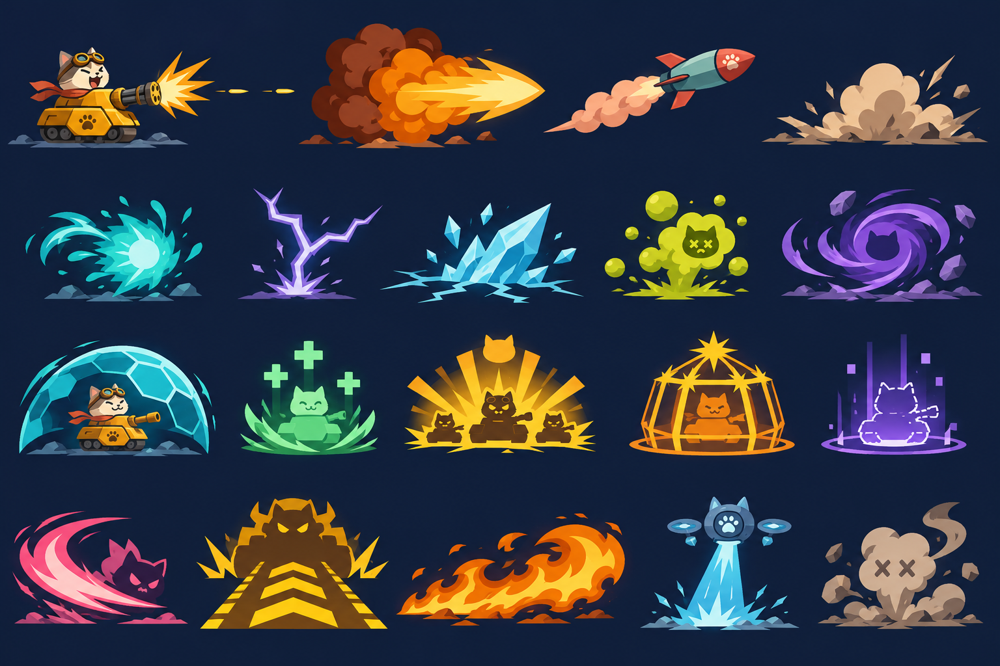

# Tham khảo hình ảnh cho VFX CatTanks

## Quyết định áp dụng

- **Tương phản theo mức nguy hiểm.** Gatling đọc bằng đường vàng ngắn. Đại bác đọc bằng lõi hổ phách, khối nổ tròn và khói thấp. Rocket dùng điểm nổ hồng cam, đuôi lửa ấm và thân xanh thép. Chớp trắng tập trung ở lõi trong thời gian ngắn. [Riot Games Visual Effects](https://www.riotgames.com/en/artedu/visual-effects) · [GDC Artistic Principles of VFX](https://media.gdcvault.com/gdc2017/Presentations/Chamberlin_Keyser_ArtisticPrinciplesVFX.pdf)
- **Vuốt, băng, độc và buff có hình riêng.** Vệt cào cong hồng, băng xanh vỡ theo mặt phẳng, độc xanh vàng bằng bọt, buff chữa dùng dấu cộng bạc hà, gravity xoắn tím. Dùng tam giác, đường cong và ký hiệu khác nhau để phân biệt kể cả khi màu khó đọc. [League of Legends Clarity](https://www.leagueoflegends.com/en-us/news/dev/clarity-in-league/) · [Riot Games VFX guide slides](https://www.deck.gallery/league-of-legends-2017/slide/13-how-to-determine-value-range/)
- **Nổ có nhịp rõ.** Xem cách thư viện mẫu dựng hình bùng rồi để hình khối tan đi. Atlas CatTanks dùng từng frame cho hình chính, một đợt hạt nhỏ tách khỏi lõi và khói xám tím làm hậu cảnh. [CraftPix Cartoon Explosion FX](https://craftpix.net/product/cartoon-explosion-fx/) · [CraftPix Animated Explosion Sprite Pack](https://craftpix.net/freebies/free-animated-explosion-sprite-pack/)
- **Hạt rời có thể dùng chung.** Dùng một nhóm hình khói, tia, bọt, tàn lửa, mảnh băng, mảnh tím và dấu cộng. Vị trí, hướng, opacity và nhịp sống giúp tạo phối cảnh cho từng lớp. [Kenney Particle Pack](https://kenney.nl/assets/particle-pack) · [Jean Moreno Cartoon FX Remaster](https://assetstore.unity.com/packages/vfx/particles/cartoon-fx-remaster-4010) · [Archanor Epic Toon FX](https://assetstore.unity.com/packages/vfx/particles/epic-toon-fx-57772)
- **Dấu báo hiệu bám vào game.** Chỗ đạn rơi, hướng húc, khóa mục tiêu và đầu cuối của beam phải khớp đối tượng/origin thật. Dấu quan trọng dùng silhouette rộng, ổn định giữa nhiều vụ nổ. [GDC Artistic Principles of VFX](https://media.gdcvault.com/gdc2017/Presentations/Chamberlin_Keyser_ArtisticPrinciplesVFX.pdf) · [Riot Games Game VFX video](https://www.youtube.com/watch?v=3QKK2o5rWSQ)
- **Kiểm chứng texture chung bằng công cụ Unity.** Kit dùng atlas RGBA chia ô và một mesh. Kiểm tra chi phí thật bằng Frame Debugger và Profiler. Nếu đội dùng Shuriken riêng cho một effect bổ sung, Texture Sheet Animation có thể đọc sprite từ atlas và vẫn cần cap theo thiết bị. [Unity 2022.3 Sprite Atlas](https://docs.unity3d.com/2022.3/Documentation/Manual/class-SpriteAtlas.html) · [Texture Sheet Animation](https://docs.unity3d.com/2022.3/Documentation/Manual/PartSysTexSheetAnimModule.html) · [Frame Debugger](https://docs.unity3d.com/2022.3/Documentation/Manual/FrameDebugger.html) · [Profiler](https://docs.unity3d.com/2022.3/Documentation/Manual/Profiler.html)

Ảnh tham khảo trên web dùng để phân tích nhịp, phân lớp và hình. Atlas đi kèm được dựng từ các hình gốc trong [build_atlas.py](Source/build_atlas.py). Bảng mỹ thuật được tạo riêng bằng công cụ ImageGen tích hợp và dùng lúc duyệt hướng.

## Prompt bảng mỹ thuật

> Create an original VFX art-direction reference board for CatTanks, a playful 2D side-view game about cats in colorful mustard-armored tanks on a navy lunar landscape. Landscape 3:2 image. Use a clean dark blue background, no labels, no lettering, no logos. Four tidy horizontal bands with separate small groups, all with plenty of empty space between samples. Band 1: angular Gatling flash and tiny gold tracer, heavy amber cannon blast with saffron core and stepped rusty smoke, red-nosed cartoon rocket with teal gray body and peach exhaust, a low dusty boom. Band 2: turquoise plasma burst, forked lavender spark, jagged blue-cyan ice fracture, sour chartreuse poison pop and violet gravity collapse. Band 3: frosted cyan shield arc, mint healing bloom, gold rally flare, amber cage-star capture, lilac decoy teleport. Band 4: pink enemy swipe with dark pink silhouette, yellow boss charge warning, orange flame attack, an icy-blue drone beam and a warm stone-gray death puff. Flat-shaded hand-painted 2D game VFX with controlled 3-tone shapes and graphic impact silhouettes, each effect designed to be readable at thumbnail size, avoid bloom, photorealism, excessive noise, or UI chrome. Distinct palettes across samples. This is a production art direction reference for original VFX, make it exciting and cohesive.
